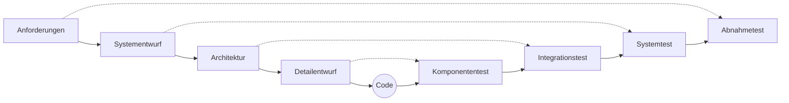

import Quiz from '@site/src/components/Quiz';
import fragen from './02-teststufen-und-testarten.fragen.yaml';

# Teststufen und Testarten

:::info[Lernziele]
Nach dieser Lektion kannst du …
- die vier **Teststufen** mit Ziel, Testbasis und Testobjekt beschreiben,
- **Testarten** unterscheiden: funktional, nicht-funktional, Black-Box, White-Box,
- **Fehlernachtest**, **Regressionstest** und **Smoke-Test** auseinanderhalten,
- Teststufen im **V-Modell** und in **agilen** Projekten einordnen,
- die Tests des Mini-Shops den Stufen zuordnen.
:::

## Teststufe oder Testart? \{#stufe-oder-art}

- Eine **Teststufe** beschreibt, **was** in welchem Umfang getestet wird – von der einzelnen Komponente bis zum ganzen System beim Kunden.
- Eine **Testart** beschreibt, **welche Eigenschaft** geprüft wird – z. B. Funktion, Performanz oder Sicherheit.

Jede Testart kann auf jeder Teststufe vorkommen: Performanz lässt sich für eine einzelne Methode messen und für das ganze System.

## Die vier Teststufen \{#teststufen}

| Teststufe | Testobjekt | Testbasis (Beispiele) | Typisch durchgeführt von |
|---|---|---|---|
| **Komponententest** (Unit-Test, Modultest) | einzelne Klassen, Methoden, Module – isoliert | Detailentwurf, Code | Entwicklung |
| **Integrationstest** | Zusammenspiel von Komponenten bzw. Systemen über Schnittstellen | Architektur, Schnittstellen-Spezifikation | Entwicklung, Testteam |
| **Systemtest** | das **ganze System** in einer möglichst produktionsnahen Umgebung | Anforderungen, Use Cases, User Stories | unabhängiges Testteam |
| **Abnahmetest** | das System aus Sicht von **Kunden, Nutzern, Betrieb** | Geschäftsprozesse, Verträge, Benutzeranforderungen | Fachbereich, Kunde, Betrieb |

### Komponententest \{#komponententest}

Prüft eine Komponente **isoliert** von ihren Abhängigkeiten – diese werden durch [Testdoubles](../02-testautomation/02-csharp/02-testdoubles-nsubstitute.mdx) ersetzt. Schnell, automatisiert, oft testgetrieben (TDD).

Im Mini-Shop: `RabattrechnerTests`, `WarenkorbTests`, `BestellServiceTests` (mit NSubstitute für Zahlungsdienst und Repository).

### Integrationstest \{#integrationstest}

Prüft die **Schnittstellen** und das **Zusammenspiel**. Zwei Ausprägungen:

- **Komponentenintegrationstest**: Zusammenspiel von Komponenten innerhalb eines Systems (z. B. Service + echte Datenbank).
- **Systemintegrationstest**: Zusammenspiel mit **anderen Systemen** (z. B. Shop + externer Zahlungsanbieter + Versanddienstleister).

Typische Fehler: falsche Datenformate, falsche Reihenfolge von Aufrufen, unterschiedliche Annahmen über Einheiten (Euro vs. Cent), Timeouts.

Integrationsstrategien: **Top-down**, **Bottom-up** oder schrittweise nach Funktionen – auf jeden Fall **inkrementell**, nicht alles auf einmal („Big Bang“), sonst findet man die Ursache eines Fehlers kaum.

Im Mini-Shop: die **API-Tests** – sie prüfen Controller, Fachlogik und Speicher im Zusammenspiel.

### Systemtest \{#systemtest}

Prüft das **gesamte System** gegen die Anforderungen – funktional **und** nicht-funktional, in einer Umgebung, die der Produktion möglichst ähnlich ist.

Im Mini-Shop: die **UI-Tests**, die den ganzen Ablauf vom Browser bis zur Bestellung prüfen.

### Abnahmetest \{#abnahmetest}

Beantwortet die Frage: **Kann das System in Betrieb gehen?** Hier steht die **Validierung** im Vordergrund. Formen:

| Form | Wer / was |
|---|---|
| **Benutzerakzeptanztest** (UAT) | echte Nutzer prüfen, ob sie ihre Aufgaben erledigen können |
| **Betrieblicher Abnahmetest** | Betrieb prüft Backup, Wiederherstellung, Überwachung, Installation |
| **Vertraglicher / regulatorischer Abnahmetest** | Erfüllung von Verträgen und gesetzlichen Vorgaben |
| **Alpha- und Beta-Test** | Test durch Kunden – Alpha beim Hersteller, Beta beim Kunden selbst |

## Das V-Modell \{#v-modell}

Das V-Modell ordnet jeder Entwicklungsstufe eine Teststufe zu:

Die wichtigste Botschaft: Tests werden **auf jeder Stufe parallel zur Entwicklung vorbereitet** – der Abnahmetest entsteht schon zusammen mit den Anforderungen. Das deckt Unklarheiten früh auf (Grundsatz „frühes Testen“).

## Teststufen in agilen Projekten \{#agil}

In Scrum & Co. gibt es keine getrennten Phasen, aber die Teststufen bleiben: In **jedem Sprint** werden Komponenten-, Integrations- und Systemtests für die neuen Funktionen durchgeführt – möglichst **automatisiert** und in der **CI-Pipeline**. Der Abnahmetest findet oft im **Sprint-Review** und anhand der **Akzeptanzkriterien** der User Stories statt. Mehr dazu in [Fehlermanagement und agiles Testen](./07-fehlermanagement-agil.mdx#agil).

## Testarten \{#testarten}

### Funktionale Tests \{#funktional}

Prüfen, **was** das System tut: Liefert es die richtigen Ergebnisse? Grundlage sind die funktionalen Anforderungen.

> Ab 100 € Zwischensumme wird 10 % Rabatt abgezogen.

### Nicht-funktionale Tests \{#nicht-funktional}

Prüfen, **wie gut** das System etwas tut. Die Norm **ISO/IEC 25010** beschreibt dazu Qualitätsmerkmale:

| Qualitätsmerkmal | Beispiel für einen Test |
|---|---|
| **Performanz / Effizienz** | Antwortet `/api/produkte` bei 200 gleichzeitigen Nutzern in unter 500 ms? (Last-, Stresstest) |
| **Sicherheit** | Kann ich den Warenkorb eines anderen Kunden sehen? Ist die Eingabe gegen SQL-Injection geschützt? |
| **Gebrauchstauglichkeit** (Usability) | Finden neue Nutzer den Bestellen-Button ohne Hilfe? |
| **Zuverlässigkeit** | Läuft der Shop eine Woche ohne Neustart? Erholt er sich nach einem Datenbankausfall? |
| **Kompatibilität** | Funktioniert er in Chrome, Firefox und Safari? |
| **Wartbarkeit** | Wie aufwendig ist eine Änderung der Rabattregel? (oft per Review/statischer Analyse) |
| **Übertragbarkeit** | Lässt er sich auf einem anderen Server/Container installieren? |
| **Barrierefreiheit** (Teil der Gebrauchstauglichkeit) | Ist der Shop per Tastatur und Screenreader bedienbar? |

:::warning[Nicht-funktional heißt nicht „unwichtig“]
Ein Shop, der richtig rechnet, aber 20 Sekunden pro Seite braucht oder Kundendaten preisgibt, ist unbrauchbar. Nicht-funktionale Anforderungen brauchen **messbare** Kriterien: nicht „schnell“, sondern „95 % der Anfragen unter 500 ms“.
:::

### Black-Box und White-Box \{#black-white-box}

| | Black-Box | White-Box |
|---|---|---|
| Grundlage | Spezifikation, Verhalten von außen | **interne Struktur**: Code, Architektur |
| Frage | Tut das System, was es soll? | Wurde der Code ausreichend durchlaufen? |
| Verfahren | Äquivalenzklassen, Grenzwerte, Entscheidungstabellen, Zustände | Anweisungs-, Zweigüberdeckung |
| Lektion | [Black-Box-Testverfahren](./04-black-box-testverfahren.mdx) | [White-Box und erfahrungsbasiert](./05-white-box-erfahrungsbasiert.mdx) |

## Tests nach Änderungen \{#nach-aenderungen}

| Test | Frage | Beispiel |
|---|---|---|
| **Fehlernachtest** (Bestätigungstest) | Ist **der gemeldete Fehler** wirklich behoben? | Der Fehler „kein Rabatt bei genau 100 €“ wurde korrigiert → genau diesen Fall erneut testen |
| **Regressionstest** | Hat die Änderung **anderswo** etwas kaputtgemacht? | Nach der Korrektur alle Rabatt-, Warenkorb- und Bestelltests erneut ausführen |
| **Smoke-Test** | Ist das System **überhaupt** lauffähig und testbar? | Startet der Shop, lädt die Produktliste, lässt sich ein Warenkorb anlegen? |

Regressionstests wachsen mit jedem Release und werden ständig wiederholt – sie sind die **Hauptkandidaten für Automatisierung** (siehe [Grundlagen der Testautomation](../02-testautomation/01-grundlagen/01-grundlagen-testautomation.mdx#was-automatisieren)).

**Wartungstests** betreffen ein System, das schon in Betrieb ist: nach Fehlerkorrekturen, Erweiterungen, Migrationen oder der Abschaltung von Funktionen. Eine **Auswirkungsanalyse** zeigt, welche Teile betroffen sind und wie viel Regressionstest nötig ist.

## Typische Fehler \{#typische-fehler}

- **Teststufe und Testart verwechseln** – „Performanztest“ ist keine Stufe, sondern eine Art.
- **Nur Systemtests** – Fehler werden spät und teuer gefunden, die Ursache ist schwer zu lokalisieren.
- **Big-Bang-Integration** – alles auf einmal zusammenstecken; bei Fehlern weiß niemand, welche Schnittstelle schuld ist.
- **Nicht-funktionale Anforderungen ohne Zahlen** – „schnell“ und „sicher“ sind nicht testbar.
- **Nach einer Korrektur nur den Fehlernachtest** – Regressionen bleiben unentdeckt.
- **Abnahmetest nur durch Entwickler** – die Sicht der echten Nutzer fehlt.

## Zusammenfassung \{#zusammenfassung}

- **Teststufen**: Komponenten-, Integrations-, System-, Abnahmetest – jeweils mit eigener Testbasis und eigenem Ziel.
- Im **V-Modell** gehört zu jeder Entwicklungsstufe eine Teststufe, die früh vorbereitet wird.
- **Testarten**: funktional (was?) und nicht-funktional (wie gut? – ISO 25010), Black-Box und White-Box.
- **Fehlernachtest** prüft die Korrektur, **Regressionstest** die Umgebung der Änderung, **Smoke-Test** die grundsätzliche Lauffähigkeit.
- Im Mini-Shop: Unit-Tests = Komponententest, API-Tests = Integrationstest, UI-Tests = Systemtest.

<Quiz fragen={fragen} titel="Quiz: Teststufen und Testarten" />
