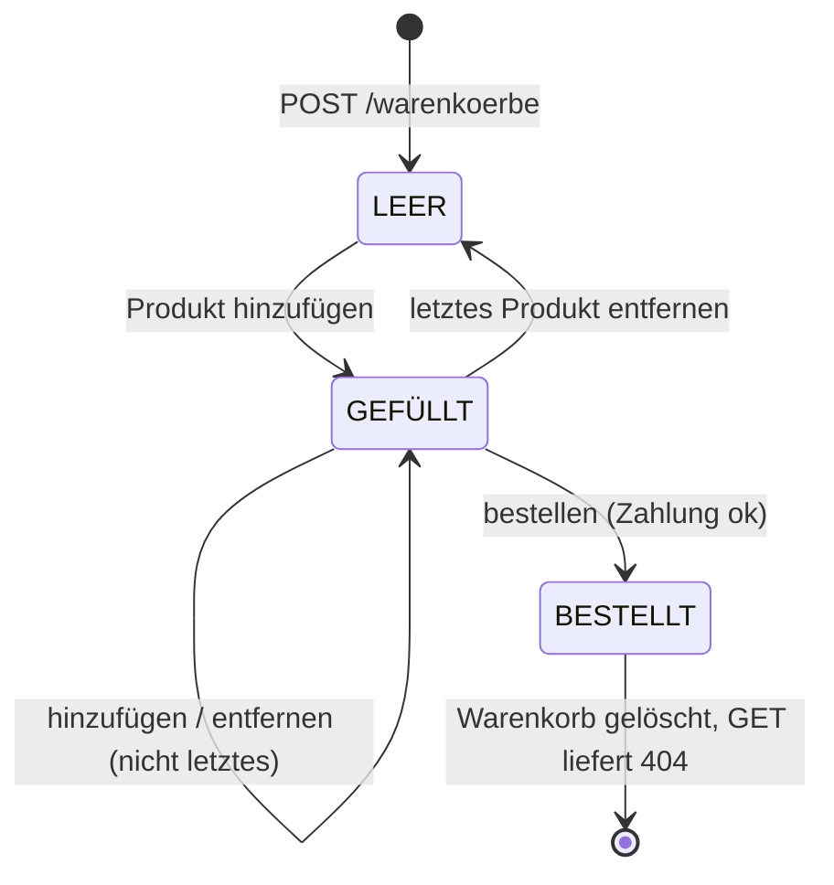

import Quiz from '@site/src/components/Quiz';
import fragen from './04-black-box-testverfahren.fragen.yaml';

# Black-Box-Testverfahren

:::info[Lernziele]
Nach dieser Lektion kannst du …
- mit der **Äquivalenzklassenbildung** gültige und ungültige Eingaben in Klassen einteilen,
- mit der **Grenzwertanalyse** die fehleranfälligsten Werte bestimmen (2-Wert und 3-Wert),
- Regeln mit **Entscheidungstabellen** vollständig erfassen,
- Abläufe mit dem **Zustandsübergangstest** prüfen,
- aus diesen Verfahren konkrete, **automatisierbare Testfälle** ableiten.
:::

## Warum Testentwurfsverfahren? \{#warum}

Vollständiges Testen ist unmöglich (Grundsatz 2). Testentwurfsverfahren helfen, mit **wenigen Testfällen** möglichst **viele Fehler** zu finden – **systematisch** statt nach Bauchgefühl. Sie machen außerdem nachvollziehbar, **warum** gerade diese Testfälle existieren.

Alle Beispiele beziehen sich auf die Regeln des [Mini-Shops](../02-testautomation/01-grundlagen/03-tests-strukturieren.mdx#testanwendung):
- Pro Produkt sind **1 bis 99** Stück erlaubt.
- Ab **100,00 €** Zwischensumme gibt es **10 %** Rabatt, **Stammkunden** zusätzlich **5 %**.
- Der Zahlungsdienst lehnt Beträge **über 500 €** ab.

## Äquivalenzklassenbildung \{#aequivalenzklassen}

**Idee:** Werte, die das System **gleich behandeln** sollte, bilden eine **Äquivalenzklasse**. Es genügt, **einen Vertreter** pro Klasse zu testen – findet er keinen Fehler, finden die anderen Werte der Klasse vermutlich auch keinen.

Beispiel: das Feld **Menge** beim Hinzufügen zum Warenkorb.

| Klasse | Werte | gültig? | Vertreter |
|---|---|---|---|
| ÄK1 | kleiner als 1 | ❌ ungültig | `-5` |
| ÄK2 | 1 bis 99 | ✅ gültig | `10` |
| ÄK3 | größer als 99 | ❌ ungültig | `150` |
| ÄK4 | keine ganze Zahl (`"zwei"`, `2.5`, leer) | ❌ ungültig | `"zwei"` |

Regeln für gute Testfälle:
- **Gültige** Klassen dürfen in **einem** Testfall **kombiniert** werden (gültige Menge + gültiges Produkt).
- **Ungültige** Klassen werden **einzeln** getestet – jeweils **eine** ungültige Klasse pro Testfall, alle anderen Werte gültig. Sonst weiß man nicht, welcher Fehler die Ablehnung ausgelöst hat (**Fehlermaskierung**).

| Testfall | Produkt | Menge | erwartet |
|---|---|---|---|
| T1 | `buch` (gültig) | `10` (ÄK2) | 200 OK, Menge 10 |
| T2 | `buch` | `-5` (ÄK1) | 400 Bad Request |
| T3 | `buch` | `150` (ÄK3) | 400 Bad Request |
| T4 | `gibt-es-nicht` (ungültig) | `1` | 400, Meldung nennt das Produkt |

:::note[Ausgaben haben auch Klassen]
Äquivalenzklassen bildet man nicht nur für Eingaben. Beim Rabatt gibt es vier **Ausgabeklassen**: 0 %, 5 %, 10 %, 15 %. Für jede sollte es mindestens einen Testfall geben – das führt direkt zur [Entscheidungstabelle](#entscheidungstabellen).
:::

**Überdeckung:** Anteil der Klassen, die durch mindestens einen Testfall abgedeckt sind. Die vier Testfälle oben erreichen 100 % Äquivalenzklassenüberdeckung für Menge und Produkt.

## Grenzwertanalyse \{#grenzwerte}

**Idee:** Fehler passieren besonders oft **an den Rändern** der Klassen – `<` statt `<=`, `>` statt `>=`, um eins daneben. Die Grenzwertanalyse testet deshalb gezielt die **Grenzwerte** geordneter Klassen.

Für die Menge mit den Grenzen 1 und 99:

```text
       ungültig     │        gültig         │     ungültig
  ... -1    0       │  1    2  ...  98   99 │  100   101 ...
            ▲       │  ▲                ▲   │   ▲
          Grenze    │ Grenze         Grenze │ Grenze
```

| Variante | Getestete Werte | Prinzip |
|---|---|---|
| **2-Wert-Grenzwertanalyse** | `0, 1, 99, 100` | der Grenzwert und sein **nächster Nachbar** in der anderen Klasse |
| **3-Wert-Grenzwertanalyse** | `0, 1, 2, 98, 99, 100` | der Grenzwert **und beide Nachbarn** – findet noch mehr Fehler |

Für die **Rabattschwelle** (Geldbeträge mit Cent-Genauigkeit) sind die 2-Wert-Grenzwerte **99,99 €** und **100,00 €**.

### Was davon steht schon in den Tests? \{#grenzwerte-im-code}

Der Abgleich mit dem echten Mini-Shop:

| Grenzwert | Test in `Shop.Core.Tests` | ✔ |
|---|---|---|
| Menge `0` | `Ungueltige_Menge_wird_abgelehnt(0)` | ✔ |
| Menge `1` | `Hinzufuegen_berechnet_Zwischensumme` (u. a. 1 × Tasse) | ✔ |
| Menge `99` | `Menge_darf_auch_in_Summe_das_Maximum_nicht_ueberschreiten` (füllt bis 99) | ✔ |
| Menge `100` | `Ungueltige_Menge_wird_abgelehnt(100)` | ✔ |
| Zwischensumme `99,99 €` | `Endpreis_wendet_Rabattregeln_an(99.99, false, 99.99)` | ✔ |
| Zwischensumme `100,00 €` | `Endpreis_wendet_Rabattregeln_an(100, false, 90)` | ✔ |
| Zahlungslimit `500,00 €` / `500,01 €` | – | ❌ **fehlt** |

Die letzte Zeile ist ein echter Befund: Für das Zahlungslimit gibt es keinen Grenzwerttest. Getestet ist nur ein Betrag **weit** darüber (628,20 € in den API-Tests). Ein Fehler wie `betrag < Limit` statt `betrag <= Limit` würde **nicht** auffallen. Genau dafür ist die Grenzwertanalyse da.

```csharp
// Ergänzung für einen Test des DemoZahlungsdienst (Übung):
[TestCase(500.00, true)]    // genau auf dem Limit: genehmigt
[TestCase(500.01, false)]   // ein Cent darüber: abgelehnt
public void Abbuchen_beachtet_das_Limit(decimal betrag, bool erwartet)
{
    Assert.That(new DemoZahlungsdienst().Abbuchen("Max", betrag), Is.EqualTo(erwartet));
}
```

:::tip[Grenzwerte gehören in Unit-Tests]
Grenzwerte sind schnell und billig auf **Komponentenebene** zu testen. Die [Gegenprobe](../02-testautomation/01-grundlagen/03-tests-strukturieren.mdx#gegenprobe) hat gezeigt: Nur die Unit-Tests mit dem Wert 100,00 € haben den Fehler `>` statt `>=` gefunden.
:::

## Entscheidungstabellen \{#entscheidungstabellen}

**Idee:** Wenn das Ergebnis von einer **Kombination von Bedingungen** abhängt, listet eine Entscheidungstabelle **alle Kombinationen** und die jeweilige **Aktion** auf. So fallen fehlende oder widersprüchliche Regeln sofort auf.

Beispiel Rabatt – zwei Bedingungen, also 2² = **4 Regeln**:

| | R1 | R2 | R3 | R4 |
|---|---|---|---|---|
| **Bedingung:** Zwischensumme ≥ 100 € | J | J | N | N |
| **Bedingung:** Stammkunde | J | N | J | N |
| **Aktion:** Rabatt | **15 %** | **10 %** | **5 %** | **0 %** |
| Testfall (Zwischensumme → Endpreis) | 100 → 85 | 100 → 90 | 50 → 47,50 | 99,99 → 99,99 |

Jede Spalte wird ein Testfall – genau diese vier Fälle stehen als `[TestCase]` in den [RabattrechnerTests](https://github.com/Smie89/lernplattform/blob/main/beispiele/shop/tests/Shop.Core.Tests/Preise/RabattrechnerTests.cs). Die Testwerte sind dabei geschickt als **Grenzwerte** gewählt – die Verfahren lassen sich kombinieren.

### Zusammenfassen mit „–“ \{#entscheidungstabellen-reduziert}

Beim Bestellen hängt das Ergebnis von drei Bedingungen ab – 2³ = 8 Kombinationen. Viele davon führen zum selben Ergebnis, weil eine Bedingung **die anderen bedeutungslos macht**. Das Zeichen **„–“** steht für „egal“:

| | R1 | R2 | R3 | R4 |
|---|---|---|---|---|
| Warenkorb leer? | J | N | N | N |
| Name fehlt? | – | J | N | N |
| Zahlung abgelehnt? | – | – | J | N |
| **Ergebnis** | 400 „Warenkorb leer“ | 400 „Namen angeben“ | 422 abgelehnt | **201 Bestellung angelegt** |
| Test in `BestellungApiTests` | `Leerer_Warenkorb_kann_nicht_bestellt_werden` | `Bestellung_ohne_Namen_wird_abgelehnt` | `Zahlung_ueber_dem_Limit_wird_mit_422_abgelehnt` | `Bestellung_wird_angelegt_und_ist_abrufbar` |

Vier Regeln decken alle acht Kombinationen ab – und jede hat bereits einen Test.

## Zustandsübergangstest \{#zustaende}

**Idee:** Manche Systeme verhalten sich je nach **Zustand** unterschiedlich auf dasselbe Ereignis. Ein **Zustandsdiagramm** beschreibt Zustände, Ereignisse und Übergänge; Tests prüfen die Übergänge – und dass **ungültige** Übergänge abgewiesen werden.

Der Warenkorb des Mini-Shops:



Übergangstabelle – mit gültigen **und ungültigen** Ereignissen:

| Zustand | Ereignis | Folgezustand / Reaktion |
|---|---|---|
| LEER | Produkt hinzufügen | GEFÜLLT |
| LEER | bestellen | bleibt LEER, **400** (ungültiger Übergang) |
| GEFÜLLT | Produkt hinzufügen | GEFÜLLT, Menge/Summe steigt |
| GEFÜLLT | letztes Produkt entfernen | LEER |
| GEFÜLLT | bestellen, Zahlung ok | BESTELLT |
| GEFÜLLT | bestellen, Zahlung abgelehnt | bleibt GEFÜLLT, **422** |
| BESTELLT | abrufen / hinzufügen | **404** – Warenkorb existiert nicht mehr |

**Überdeckungsstufen:**
- **Alle Zustände** erreicht – die schwächste Stufe.
- **Alle gültigen Übergänge** durchlaufen (0-Switch-Überdeckung) – der übliche Standard.
- **Alle Übergänge inkl. ungültiger** – findet zusätzlich Fehler, bei denen das System etwas Unerlaubtes zulässt.

Ein Testfall kann mehrere Übergänge hintereinander prüfen. Der API-Test `Nach_der_Bestellung_ist_der_Warenkorb_weg` prüft z. B. LEER → GEFÜLLT → BESTELLT → (abrufen) 404.

:::tip[Übung]
Welche Zeilen der Übergangstabelle haben noch **keinen** Test? (Tipp: Was passiert, wenn man nach einer **abgelehnten** Zahlung ein günstigeres Produkt entfernt und erneut bestellt? Und was beim Hinzufügen zu einem bereits bestellten Warenkorb?)
:::

## Welches Verfahren wann? \{#auswahl}

| Situation | Verfahren |
|---|---|
| Eingabefelder mit Wertebereichen | **Äquivalenzklassen** + **Grenzwerte** |
| geordnete Werte (Zahlen, Datum, Länge) | **Grenzwertanalyse** |
| Geschäftsregeln mit mehreren Bedingungen | **Entscheidungstabelle** |
| Abläufe, Status, Workflows (Bestellung, Login-Sperre nach 3 Versuchen) | **Zustandsübergangstest** |

Die Verfahren werden in der Praxis **kombiniert**: Die Entscheidungstabelle liefert die Regeln, die Grenzwertanalyse die konkreten Werte.

## Typische Fehler \{#typische-fehler}

- **Mehrere ungültige Werte in einem Testfall** – Fehlermaskierung: Man weiß nicht, welcher die Ablehnung ausgelöst hat.
- **Nur „schöne“ Werte testen** (10 Stück, 50 €) – die Fehler sitzen an den Grenzen.
- **Grenzen bei Geldbeträgen in ganzen Euro** denken – 99 € statt 99,99 €.
- **Nur gültige Zustandsübergänge** testen – das System lässt vielleicht Unerlaubtes zu.
- **Entscheidungstabelle nicht vollständig** – eine Kombination fehlt, und genau die passiert in Produktion.
- **Verfahren ohne erwartetes Ergebnis** – auch die beste Testfallableitung braucht ein Orakel.

## Zusammenfassung \{#zusammenfassung}

- **Äquivalenzklassen**: Werte mit gleichem Verhalten zusammenfassen; gültige kombinieren, **ungültige einzeln** testen.
- **Grenzwertanalyse**: Werte an den Rändern testen – 2-Wert (Grenze + Nachbar) oder 3-Wert (Grenze + beide Nachbarn).
- **Entscheidungstabellen**: alle Bedingungskombinationen → Aktionen; mit „–“ zusammenfassen.
- **Zustandsübergangstest**: Zustände, Ereignisse, Übergänge – gültige und ungültige.
- Angewendet auf den Mini-Shop zeigt die Grenzwertanalyse eine echte **Lücke**: Das Zahlungslimit von 500 € ist nicht an der Grenze getestet.

<Quiz fragen={fragen} titel="Quiz: Black-Box-Testverfahren" />
