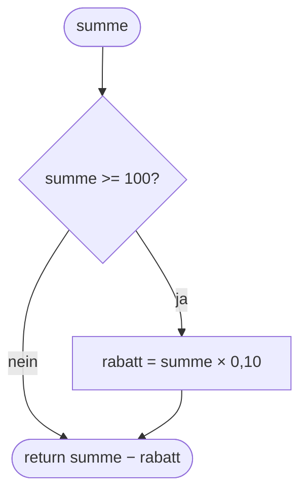

import Quiz from '@site/src/components/Quiz';
import fragen from './05-white-box-erfahrungsbasiert.fragen.yaml';

# White-Box-Test und erfahrungsbasiertes Testen

:::info[Lernziele]
Nach dieser Lektion kannst du …
- **Anweisungsüberdeckung** und **Zweigüberdeckung** erklären und berechnen,
- Codeabdeckung in .NET **messen** und die Ergebnisse **richtig deuten**,
- erklären, warum **100 % Abdeckung kein Qualitätsbeweis** ist,
- mit **intuitiver Testfallermittlung**, **exploratives Testen** und **Checklisten** Fehler finden, die systematische Verfahren übersehen.
:::

## White-Box-Test \{#white-box}

Beim White-Box-Test leitet man Tests aus der **internen Struktur** ab und **misst**, welcher Code durch die Tests ausgeführt wurde. Die Frage lautet nicht „Stimmt das Ergebnis?“, sondern „**Welcher Code wurde überhaupt getestet?**“

### Anweisungsüberdeckung \{#anweisungsueberdeckung}

Anteil der ausführbaren **Anweisungen**, die mindestens einmal durchlaufen wurden.

### Zweigüberdeckung \{#zweigueberdeckung}

Anteil der **Zweige** (Entscheidungsausgänge), die durchlaufen wurden. Jedes `if` hat zwei Zweige – „wahr“ und „falsch“ –, auch wenn es keinen `else`-Block gibt.

Beispiel aus dem `Rabattrechner`:

```csharp
var satz = zwischensumme >= Rabattschwelle ? MengenRabatt : 0m;
if (stammkunde) satz += StammkundenRabatt;
return satz;
```

| Tests | Anweisungsüberdeckung | Zweigüberdeckung |
|---|---|---|
| nur `(200 €, Stammkunde)` | **100 %** – alle Anweisungen laufen | **50 %** – „< 100“ und „kein Stammkunde“ nie durchlaufen |
| `(200 €, Stammkunde)` + `(50 €, kein Stammkunde)` | 100 % | **100 %** |

:::note[Zweig schlägt Anweisung]
**100 % Zweigüberdeckung schließt 100 % Anweisungsüberdeckung ein** – umgekehrt nicht. Ein `if` ohne `else` kann bei 100 % Anweisungsüberdeckung den Fall „Bedingung falsch“ völlig ungetestet lassen.
:::



Ein Test mit 150 € durchläuft jede Anweisung, aber nur den **Ja**-Zweig. Für 100 % Zweigüberdeckung braucht es zusätzlich einen Test, der den **Nein**-Zweig nimmt.

## Abdeckung messen: der Mini-Shop \{#messen}

In .NET misst **coverlet** die Abdeckung. Das Paket `coverlet.collector` ist in der NUnit-Projektvorlage bereits enthalten:

```bash
cd beispiele/shop
dotnet test tests/Shop.Core.Tests --collect:"XPlat Code Coverage"
# -> TestResults/<guid>/coverage.cobertura.xml
```

Mit dem Werkzeug **ReportGenerator** wird daraus ein lesbarer HTML-Bericht (`dotnet tool install -g dotnet-reportgenerator-globaltool`, dann `reportgenerator -reports:**/coverage.cobertura.xml -targetdir:coverage-bericht`). In Java übernimmt das das Maven-Plugin **JaCoCo**.

Die **echte Messung** der Unit-Tests des Mini-Shops (Shop.Core):

| Klasse | Zeilen | Zweige |
|---|---|---|
| `Warenkorb` | 100 % | 100 % |
| `BestellService` | 96 % | **83 %** |
| `Rabattrechner` | 73 % | 100 % |
| `Bestellung` | 43 % | – |
| `InMemoryWarenkorbSpeicher`, `InMemoryBestellRepository`, `InMemoryProduktKatalog`, `DemoZahlungsdienst` | **0 %** | – |
| **Gesamt** | **65 %** | **95 %** |

So liest man das:

- **`BestellService`, 83 % Zweige** – ein **echter Befund**. Der Bericht zeigt Zeile 17 mit „1/2 Zweigen“: Der Fall „Kundenname fehlt“ wurde nie getestet. Daraufhin wurde der Test `Bestellen_ohne_Kundennamen_wirft_Exception` ergänzt – danach: **100 % Zweige**, Gesamtzweigabdeckung **100 %**.
- **In-Memory-Klassen, 0 %** – kein Problem: Die Unit-Tests ersetzen sie bewusst durch [Testdoubles](../02-testautomation/02-csharp/02-testdoubles-nsubstitute.mdx). Sie werden von den **API-Tests** ausgeführt. Abdeckung immer **pro Teststufe** betrachten.
- **`Rabattrechner`, 73 % Zeilen trotz 100 % Zweigen** – ein **Messartefakt**: Das Werkzeug zählt die drei `const`-Deklarationen als nicht ausgeführte Zeilen. Werkzeuge zählen unterschiedlich – Zahlen nie blind vergleichen.
- **`Bestellung`, 43 %** – Eigenschaften eines `record`, die kein Test liest. Fachlich unkritisch.

:::tip[Abdeckung als Suchwerkzeug]
Der größte Nutzen der Abdeckung ist nicht die Prozentzahl, sondern der Bericht: Er zeigt **konkrete ungetestete Stellen**. Hier hat er in wenigen Minuten einen fehlenden Fehlerfall-Test aufgedeckt.
:::

## 100 % Abdeckung ist kein Qualitätsbeweis \{#grenzen}

Die Grenzen der Codeabdeckung:

1. **Sie prüft nicht, ob die Asserts etwas taugen.** Ein Test ohne Assert erzeugt Abdeckung, aber keine Prüfung.
2. **Sie findet keine fehlenden Funktionen.** Code, den es nicht gibt, kann nicht als ungetestet auffallen – fehlende Anforderungen findet nur der Black-Box-Test oder ein Review.
3. **Sie findet keine Grenzwertfehler.** Mit den Tests `(250 €)` und `(50 €)` hat `zwischensumme >= Rabattschwelle` **100 % Zweigüberdeckung** – und der Fehler `>` statt `>=` bleibt trotzdem unentdeckt. Nur der Test mit **genau 100,00 €** findet ihn (siehe [Grenzwertanalyse](./04-black-box-testverfahren.mdx#grenzwerte)).
4. **Sie findet keine Fehler durch Gleichzeitigkeit, Timing oder Umgebung** – wie der Fehler im nächsten Abschnitt.

:::note[Mutationstest]
Ob Tests Fehler wirklich **finden**, prüft der **Mutationstest**: Ein Werkzeug baut automatisch kleine Fehler ein (`>=` → `>`, `+` → `-`) und schaut, ob die Tests rot werden. Überlebt eine Mutation, fehlt ein Test. Werkzeuge: **Stryker.NET**, **PIT** (Java). Die [Gegenprobe](../02-testautomation/01-grundlagen/03-tests-strukturieren.mdx#gegenprobe) war ein Mutationstest von Hand.
:::

## Erfahrungsbasiertes Testen \{#erfahrungsbasiert}

Systematische Verfahren leiten Tests aus **Spezifikation** oder **Code** ab. Erfahrungsbasierte Verfahren nutzen das **Wissen und die Intuition** der Tester: Wo sind solche Systeme typischerweise kaputt? Sie ergänzen die systematischen Verfahren – besonders, wenn die Spezifikation lückenhaft ist oder wenig Zeit bleibt.

### Intuitive Testfallermittlung \{#error-guessing}

(Engl. *error guessing*.) Man überlegt, **welche Fehler** wahrscheinlich sind, und testet gezielt darauf. Eine **Fehlerliste** für einen Webshop:

| Fehlerhypothese | Test |
|---|---|
| Leere und unsinnige Eingaben | Name leer, nur Leerzeichen, 10.000 Zeichen |
| Sonderzeichen, Umlaute, Skript-Code | `Müller`, `O'Brien`, `<script>alert(1)</script>` |
| Zahlen am Rand | Menge 0, -1, 2147483648, `2.5`, `1e3` |
| **Doppelte Aktionen** | **Doppelklick auf „Bestellen“**, Formular zweimal absenden |
| Navigation | Zurück-Button nach der Bestellung, Seite neu laden |
| Gleichzeitigkeit | zwei Browser-Tabs mit demselben Warenkorb |
| Netzwerk | langsame Verbindung, Abbruch während der Bestellung |

### Ein echter Fund: der Doppelklick \{#doppelklick}

Die Hypothese „Doppelklick auf Bestellen“ wurde am Mini-Shop ausprobiert – zuerst mit `curl`, dann im Browser.

**Mit `curl`** (5 Läufe mit je 4 gleichzeitigen Requests): immer genau **eine** Bestellung, die übrigen Requests bekamen 404. Kein Fehler sichtbar.

**Im Browser** (Doppelklick per Skript, 10 Versuche):

```text
201+201   201+201   201+201   201+404   404+201
201+404   201+201   201+404   201+404   201+201
```

In **5 von 10** Fällen antworteten **beide** Requests mit `201 Created` – mit **zwei verschiedenen Bestellnummern** (z. B. `B-20261126-3D2818` und `B-20261126-39E04A`). Der Kunde hätte zweimal bezahlt, sah aber nur **eine** Bestätigung.

**Ursache** im Code: Die Prüfung „Gibt es den Warenkorb noch?“ und das Entfernen nach der Bestellung waren **nicht atomar** (*Check-then-Act*). Gleichzeitige Requests kamen alle durch die Prüfung. Ein automatisierter Test mit 10 parallelen Requests erzeugte sogar **10 Bestellungen**.

Warum hat keine der bisherigen 43 Tests das gefunden? Kein Testentwurfsverfahren aus der Spezifikation fragt nach **Gleichzeitigkeit** – und auch 100 % Zweigabdeckung ändert daran nichts. Wie der Fehler gemeldet und behoben wurde, zeigt die Lektion [Fehlermanagement](./07-fehlermanagement-agil.mdx#fehlerbericht).

:::tip[Warum curl nichts fand]
Die `curl`-Prozesse starten nacheinander und kommen leicht zeitversetzt an. Der Browser schickt beide Requests praktisch gleichzeitig. Ein „nicht reproduziert“ heißt nicht „nicht vorhanden“ – die **Testbedingungen** müssen der echten Nutzung entsprechen.
:::

### Exploratives Testen \{#explorativ}

Beim explorativen Testen werden Testentwurf, Durchführung und Lernen **gleichzeitig** gemacht: Man untersucht das System, lernt dabei, und das Gelernte bestimmt den nächsten Test. Exploratives Testen ist **nicht** planlos – es wird meist in **Sessions** organisiert (*session-based testing*):

- **Charta**: Ziel der Session, z. B.
  > Untersuche den **Bestellvorgang** mit **ungewöhnlichem Nutzerverhalten** (Doppelklick, Zurück, mehrere Tabs), um **doppelte oder verlorene Bestellungen** zu finden.
- **Zeitrahmen**: 60–90 Minuten, ohne Unterbrechung
- **Notizen**: Was wurde getestet, was beobachtet, welche Fragen sind offen, welche Fehler gefunden?
- **Nachbesprechung** (Debriefing): Ergebnisse, neue Chartas, Fehlerberichte

Exploratives Testen eignet sich besonders, wenn
- die Spezifikation **lückenhaft** ist,
- **wenig Zeit** bleibt,
- man ein **neues System kennenlernen** will,
- als **Ergänzung** zu automatisierten Regressionstests – es findet, woran niemand gedacht hat (Grundsatz „Tests nutzen sich ab“).

### Checklistenbasiertes Testen \{#checklisten}

Eine **Checkliste** enthält Prüfpunkte aus Erfahrung, Standards oder früheren Fehlern, z. B.:

- [ ] Sind alle Pflichtfelder als solche erkennbar?
- [ ] Ist das Formular per Tastatur bedienbar (Tab-Reihenfolge, Enter)?
- [ ] Werden Fehlermeldungen neben dem betroffenen Feld angezeigt?
- [ ] Kann ein Formular nicht doppelt abgeschickt werden?
- [ ] Funktioniert die Seite auf dem Smartphone?

Checklisten geben Struktur, ohne jeden Schritt vorzuschreiben. Der Doppelklick-Fehler gehört ab sofort auf die Checkliste des Teams.

## Typische Fehler \{#typische-fehler}

- **Abdeckung als Ziel** („80 % sind Pflicht“) statt als Werkzeug – es entstehen Tests ohne sinnvolle Asserts.
- **100 % Abdeckung = fertig** – Grenzwerte, fehlende Funktionen und Gleichzeitigkeit bleiben unentdeckt.
- **Abdeckung über alle Teststufen vermischen** – 0 % in Unit-Tests kann völlig in Ordnung sein.
- **Zahlen verschiedener Werkzeuge vergleichen** – sie zählen unterschiedlich.
- **Exploratives Testen ohne Charta und Notizen** – Ergebnisse sind nicht nachvollziehbar.
- **„Nicht reproduziert“ = „kein Fehler“** – vielleicht waren die Bedingungen nur anders.

## Zusammenfassung \{#zusammenfassung}

- **Anweisungsüberdeckung** zählt ausgeführte Anweisungen, **Zweigüberdeckung** ausgeführte Entscheidungsausgänge; 100 % Zweige ⇒ 100 % Anweisungen.
- Abdeckung messen mit **coverlet** (.NET) bzw. **JaCoCo** (Java); der **Bericht** zeigt ungetestete Stellen – im Mini-Shop einen fehlenden Fehlerfall-Test.
- **Abdeckung beweist keine Qualität**: keine Aussage über Asserts, fehlende Funktionen, Grenzwerte, Gleichzeitigkeit. Der **Mutationstest** prüft die Tests selbst.
- **Erfahrungsbasiert**: intuitive Testfallermittlung, **exploratives Testen** mit Charta, Checklisten.
- Die Fehlerhypothese „Doppelklick“ hat im Mini-Shop einen **echten Fehler** gefunden, den 43 Tests und 100 % Zweigabdeckung übersehen hatten.

<Quiz fragen={fragen} titel="Quiz: White-Box-Test und erfahrungsbasiertes Testen" />
