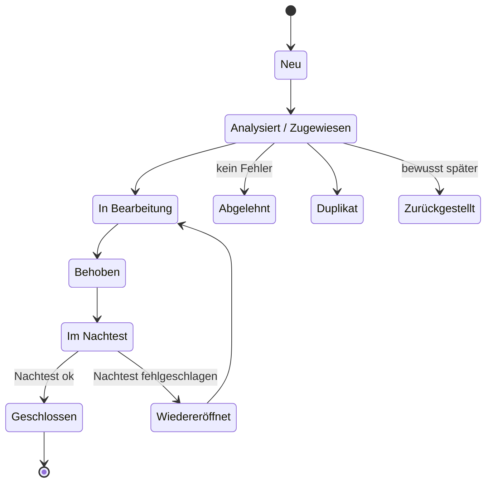
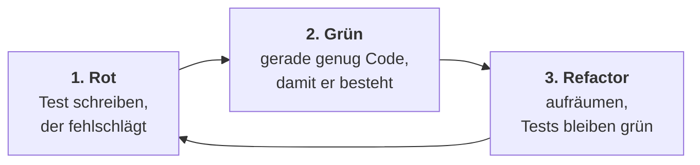

import Quiz from '@site/src/components/Quiz';
import fragen from './07-fehlermanagement-agil.fragen.yaml';

# Fehlermanagement und agiles Testen

:::info[Lernziele]
Nach dieser Lektion kannst du …
- einen **guten Fehlerbericht** schreiben,
- **Schweregrad** und **Priorität** unterscheiden,
- den **Lebenszyklus** eines Fehlers beschreiben,
- erklären, wie Testen in **agilen Teams** funktioniert: Akzeptanzkriterien, **TDD**, **BDD**, **Testquadranten**, **Shift-Left**,
- den Weg eines echten Fehlers **von der Entdeckung bis zum Regressionstest** nachvollziehen.
:::

## Ein guter Fehlerbericht \{#fehlerbericht}

Ein Fehlerbericht soll der Entwicklung ermöglichen, den Fehler **schnell zu verstehen, nachzustellen und zu beheben**. Hier der echte Bericht zum Fehler, den die Fehlerhypothese „Doppelklick“ im Mini-Shop gefunden hat (siehe [erfahrungsbasiertes Testen](./05-white-box-erfahrungsbasiert.mdx#doppelklick)):

```text
ID:            SHOP-1
Titel:         Doppelklick auf "Bestellen" erzeugt zwei Bestellungen und bucht doppelt ab
Gemeldet von:  Test, 26.11.2026
Version:       Mini-Shop, Commit 8033789 (C#), Shop-Java gleicher Stand
Umgebung:      Windows 11, Chrome (eingebetteter Browser), Shop.Web lokal auf Port 5000
Schweregrad:   kritisch     Priorität: hoch

Schritte zum Nachstellen
  1. Shop öffnen (http://localhost:5000)
  2. "Fachbuch Testautomation" in den Warenkorb legen
  3. Name "Max Muster" eingeben
  4. Schnell doppelt auf "Bestellen" klicken

Erwartetes Ergebnis
  Genau eine Bestellung wird angelegt und genau einmal abgebucht.

Tatsächliches Ergebnis
  In 5 von 10 Versuchen antworten beide Requests mit 201 Created und zwei
  verschiedenen Bestellnummern (z. B. B-20261126-3D2818 und B-20261126-39E04A).
  Die Oberfläche zeigt nur eine Bestätigung.
  Über die API mit 10 gleichzeitigen Requests: 10 Bestellungen (10 von 10 Läufen).

Häufigkeit:    reproduzierbar (Browser 5/10, API-Test 10/10)
Anhänge:       Netzwerkprotokoll beider Requests, API-Test als Reproduktion
Vermutung:     Prüfung "Warenkorb vorhanden" und Entfernen nach der Bestellung sind
               nicht atomar (Check-then-Act).
```

Was diesen Bericht gut macht:

| Merkmal | Warum |
|---|---|
| **Aussagekräftiger Titel** | Man versteht das Problem schon in der Fehlerliste. Nicht: „Bestellung kaputt“. |
| **Version und Umgebung** | Der Fehler gehört zu einem genauen Stand. |
| **Nummerierte Schritte** | Jeder kann den Fehler nachstellen. |
| **Erwartet vs. tatsächlich** | Ohne Erwartung kein Fehler – das [Testorakel](./01-grundlagen-softwaretest.mdx#begriffe). |
| **Häufigkeit** | „5 von 10“ ist viel hilfreicher als „manchmal“. |
| **Belege** | Bestellnummern, Netzwerkprotokoll, ein Test, der den Fehler zeigt. |
| **Sachlich** | beschreibt das Verhalten, nicht die Person. Die Ursache ist als **Vermutung** gekennzeichnet. |

:::tip[Ein Test als Reproduktion]
Der beste Anhang ist ein **automatisierter Test, der den Fehler zeigt**. Für SHOP-1 war das der API-Test mit 10 gleichzeitigen Bestellungen – rot vor der Korrektur, grün danach. Er bleibt als **Regressionstest** in der Suite.
:::

## Schweregrad und Priorität \{#schweregrad-prioritaet}

| | Schweregrad (Severity) | Priorität |
|---|---|---|
| Frage | Wie **schlimm** ist die Auswirkung? | Wie **dringend** muss es behoben werden? |
| Wer bewertet | meist Test | meist Produktverantwortliche |
| Stufen (Beispiel) | kritisch – hoch – mittel – gering | sofort – hoch – normal – niedrig |

Beide hängen oft zusammen, aber nicht immer:

| Beispiel | Schweregrad | Priorität |
|---|---|---|
| SHOP-1: doppelte Abbuchung | **kritisch** | **hoch** |
| Firmenname auf der Startseite falsch geschrieben | gering | **hoch** (peinlich, sofort sichtbar) |
| Absturz in einer Exportfunktion, die nur ein Admin einmal im Jahr nutzt | **hoch** | niedrig |

## Lebenszyklus eines Fehlers \{#lebenszyklus}



SHOP-1 hat diesen Weg durchlaufen:

1. **Neu** – gefunden in der explorativen Session, Bericht angelegt.
2. **Analysiert** – Ursache bestätigt: Check-then-Act ohne Sperre; betroffen sind die **C#- und die Java-Version**.
3. **In Bearbeitung** – zuerst ein **Test, der den Fehler zeigt** (rot: 10 statt 1 Bestellung, in beiden Versionen).
4. **Behoben** – zwei Korrekturen:
   - **Server**: Prüfen, Bestellen und Entfernen laufen pro Warenkorb in einer Sperre (`lock` in C#, `synchronized` in Java),
   - **Oberfläche**: Der Button wird während der Bestellung deaktiviert.
5. **Im Nachtest** – **Fehlernachtest**: API-Test grün (dreimal hintereinander), Doppelklick im Browser 10 von 10 Mal genau eine Bestellung. **Regressionstest**: alle 44 Tests je Version grün.
6. **Geschlossen**.

```csharp
lock (warenkorb)
{
    if (speicher.Finde(id) is null) return NichtGefunden("Warenkorb");   // schon bestellt
    // ... prüfen und bestellen ...
    if (ergebnis.Erfolgreich) speicher.Entfernen(id);
}
```

:::note[Warum zwei Korrekturen?]
Die Sperre im Button allein reicht nicht: Ein Nutzer mit zwei Tabs, ein Netzwerk-Retry oder ein Skript erreichen die API trotzdem doppelt. **Die Regel muss der Server durchsetzen** – die Oberfläche verbessert zusätzlich die Bedienung (keine irritierende Fehlermeldung nach dem zweiten Klick).
:::

Aus der Nachbesprechung des Fehlers (**Grundursachenanalyse**) entstanden zwei Verbesserungen: „Doppelte Aktionen“ steht jetzt auf der [Checkliste](./05-white-box-erfahrungsbasiert.mdx#checklisten), und „doppelte Bestellung“ wurde in die [Risikomatrix](./06-testmanagement.mdx#risikomatrix) aufgenommen.

## Agiles Testen \{#agil}

In agilen Teams (Scrum, Kanban) gibt es keine getrennte „Testphase“ am Ende. Testen ist eine **Tätigkeit des ganzen Teams** in jedem Sprint.

### Der ganze Teamansatz und Shift-Left \{#shift-left}

- **Whole Team**: Entwicklung, Test und Fachbereich sind gemeinsam für Qualität verantwortlich. Tester bringen ihre Sicht schon in die **Planung** und das **Refinement** ein.
- **Shift-Left**: Testaktivitäten so **früh** wie möglich – Anforderungen reviewen, Akzeptanzkriterien mit Beispielen schreiben, Tests vor oder mit dem Code entwickeln, statische Analyse in der Pipeline.
- **Shift-Right**: auch **nach** dem Release lernen – Monitoring, Logs, Fehlerraten in Produktion, A/B-Tests.

### Akzeptanzkriterien \{#akzeptanzkriterien}

Jede User Story bekommt **Akzeptanzkriterien** – prüfbare Bedingungen, die erfüllt sein müssen. Gut bewährt ist das Format **Given – When – Then**:

```gherkin
Funktionalität: Bestellung abschicken

  Szenario: Doppelklick erzeugt nur eine Bestellung
    Angenommen ein Warenkorb mit einem Fachbuch
    Und der Name "Max Muster" ist eingegeben
    Wenn ich zweimal schnell auf "Bestellen" klicke
    Dann wird genau eine Bestellung angelegt
    Und es wird genau einmal abgebucht
```

Hätte die ursprüngliche User Story dieses Kriterium enthalten, wäre SHOP-1 nie entstanden – ein Beispiel für **Shift-Left**.

### TDD, ATDD und BDD \{#tdd-bdd}

| Ansatz | Idee | Ebene |
|---|---|---|
| **TDD** (Test-Driven Development) | **Rot – Grün – Refactor**: erst einen fehlschlagenden Test schreiben, dann genau so viel Code, dass er grün wird, dann aufräumen | Komponente |
| **ATDD** (Acceptance Test-Driven Development) | Akzeptanztests werden **vor** der Umsetzung gemeinsam mit dem Fachbereich festgelegt | Story / System |
| **BDD** (Behavior-Driven Development) | Verhalten in **Given-When-Then** in Fachsprache beschreiben; Werkzeuge wie **Reqnroll** (.NET) oder **Cucumber** (Java) führen die Szenarien als Tests aus | Story / System |

Die Behebung von SHOP-1 folgte dem TDD-Muster: **erst der rote Test**, dann die Korrektur, dann grün.



### Die Testquadranten \{#testquadranten}

Die agilen Testquadranten (nach Brian Marick, bekannt durch Lisa Crispin und Janet Gregory) ordnen Tests nach zwei Achsen: **technisch oder fachlich** und **das Team unterstützend oder das Produkt kritisierend**.

```text
                      fachlich (geschäftsorientiert)
                                  │
     Q2  Funktionale Tests,       │   Q3  Exploratives Testen,
         Story-Tests, Beispiele,  │       Usability, Abnahme
         BDD-Szenarien            │       (meist manuell)
                                  │
 unterstützen ────────────────────┼──────────────────── Produkt
 das Team                         │                     kritisieren
     Q1  Unit-Tests,              │   Q4  Performanz-, Last-,
         Komponententests         │       Sicherheitstests
         (automatisiert)          │       (werkzeuggestützt)
                                  │
                      technisch (technologieorientiert)
```

Alle vier Quadranten sind wichtig. Der Mini-Shop hat Q1 und Q2 gut abgedeckt (Unit-, API-, UI-Tests). SHOP-1 wurde in **Q3** gefunden – durch exploratives Testen. **Q4** (Last, Sicherheit) fehlt noch – das steht als Restrisiko im [Testbericht](./06-testmanagement.mdx#testbericht).

### Definition of Done \{#dod}

Die **Definition of Done** legt fest, wann eine Story fertig ist, z. B.:

- [ ] Akzeptanzkriterien erfüllt und als Tests automatisiert
- [ ] Unit-Tests für neue Logik, Fachlogik mit Zweigabdeckung ≥ 90 %
- [ ] Code-Review durchgeführt, keine neuen Analyzer-Warnungen
- [ ] Alle Tests in der CI grün, keine neuen Flaky Tests
- [ ] Keine offenen Fehler der Schwere „kritisch“ oder „hoch“

## Typische Fehler \{#typische-fehler}

- **Fehlerberichte wie „geht nicht“** – ohne Schritte, Erwartung, Version.
- **Schweregrad und Priorität verwechseln** oder alles „kritisch“ melden.
- **Mehrere Fehler in einem Bericht** – sie werden unterschiedlich schnell behoben, der Bericht kann nie geschlossen werden.
- **Fehler schließen ohne Nachtest** – oder ohne Regressionstest.
- **Nur die Oberfläche korrigieren**, wenn die Regel auf dem Server durchgesetzt werden muss.
- **„Testen machen die Tester“** in agilen Teams – Qualität ist Teamaufgabe.
- **User Stories ohne Akzeptanzkriterien** – niemand weiß, wann sie fertig sind.

## Zusammenfassung \{#zusammenfassung}

- Ein guter **Fehlerbericht**: klarer Titel, Version/Umgebung, Schritte, **erwartet vs. tatsächlich**, Häufigkeit, Belege – sachlich.
- **Schweregrad** = Auswirkung, **Priorität** = Dringlichkeit – sie können auseinanderfallen.
- **Lebenszyklus**: Neu → Analysiert → In Bearbeitung → Behoben → Nachtest → Geschlossen (oder Wiedereröffnet).
- SHOP-1: gefunden durch exploratives Testen, reproduziert durch einen roten Test, auf Server **und** Oberfläche behoben, abgesichert durch einen dauerhaften Regressionstest.
- **Agil**: ganzes Team, **Shift-Left**, Akzeptanzkriterien in **Given-When-Then**, **TDD/ATDD/BDD**, alle vier **Testquadranten**, klare **Definition of Done**.

<Quiz fragen={fragen} titel="Quiz: Fehlermanagement und agiles Testen" />
