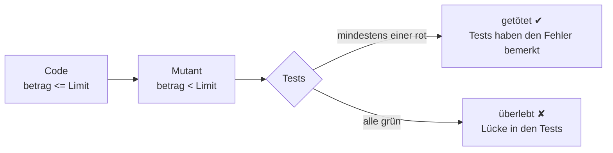

import Quiz from '@site/src/components/Quiz';
import fragen from './04-mutationstests.fragen.yaml';

# Mutationstests

:::info[Lernziele]
Nach dieser Lektion kannst du …
- erklären, was ein **Mutationstest** misst und warum Codeabdeckung dafür nicht reicht,
- **Stryker.NET** und **mutmut** einrichten und ausführen,
- **überlebende Mutanten** bewerten: fehlender Test, äquivalenter Mutant oder bewusste Ausnahme,
- Mutationstests sinnvoll in die **CI** einbauen.
:::

## Wer testet die Tests? \{#idee}

Grüne Tests und 90 % Codeabdeckung sagen nur, dass der Code **ausgeführt** wurde – nicht, dass ein Fehler **aufgefallen**
wäre. Ein Test ohne passende Assertion deckt Code ab und prüft nichts.

Ein **Mutationstest** stellt die Frage direkt: Das Werkzeug baut absichtlich kleine Fehler in den Code ein und führt die
Tests aus.



| Begriff | Bedeutung |
|---|---|
| **Mutant** | eine Kopie des Codes mit genau einer kleinen Änderung |
| **Mutationsoperator** | die Art der Änderung, z. B. `<=` → `<`, `&&` → `||`, `true` → `false`, Zeichenkette → `""` |
| **getötet** (killed) | mindestens ein Test schlägt fehl – gut |
| **überlebt** (survived) | alle Tests bleiben grün – die Tests haben die Änderung nicht bemerkt |
| **nicht abgedeckt** (no coverage) | kein Test führt die Stelle überhaupt aus |
| **äquivalenter Mutant** | die Änderung verändert das Verhalten nicht – kein Test kann ihn töten |
| **Mutation Score** | getötete ÷ bewertete Mutanten |

Die Idee entspricht der **Fehlereinpflanzung** (*fault seeding*) aus der Testtheorie: Wie viele absichtlich eingebaute
Fehler finden die Tests?

### Typische Mutationsoperatoren \{#operatoren}

| Operator | Original | Mutant | Findet Tests, die … |
|---|---|---|---|
| Vergleich | `betrag <= Limit` | `betrag < Limit` | … Grenzwerte nicht prüfen |
| Arithmetik | `preis * menge` | `preis / menge` | … Rechenergebnisse nicht prüfen |
| Logik | `a && b` | `a \|\| b` | … Kombinationen von Bedingungen nicht prüfen |
| Negation | `if (!ok)` | `if (ok)` | … nur den Gutfall prüfen |
| Rückgabe / Block | `return false;` | `return true;` / Block entfernt | … Seiteneffekte nicht prüfen |
| Zeichenkette | `"zwischen 1 und 99"` | `""` | … Meldungen nicht prüfen |
| LINQ | `FirstOrDefault()` | `First()` | … den Fall „nicht gefunden“ nicht prüfen |

## Praxis: Stryker.NET am Mini-Shop \{#stryker}

**Stryker** gibt es für .NET, JavaScript/TypeScript und Scala; Java nutzt meist **PIT**, Python **mutmut**.

```bash
cd beispiele/shop
dotnet new tool-manifest                       # dotnet-tools.json – Werkzeug ist Teil des Repositorys
dotnet tool install dotnet-stryker --version 5.1.0

cd tests/Shop.Core.Tests
dotnet stryker                                 # mutiert Shop.Core, führt die Tests aus
```

Am Ende liegt ein **HTML-Bericht** unter `StrykerOutput/…/reports/` – jede Zeile mit ihren Mutanten, farbig nach Status.

### Erster Lauf: 61,6 % \{#erster-lauf}

Nur die 23 Unit-Tests, alle grün:

```text
83 mutants created
13 mutants got status NoCoverage.   Reason: Not covered by any test.
Killed:   45
Survived: 15
The final mutation score is 61.64 %
```

Ein Teil davon ist ehrlich: Die Unit-Tests decken den HTTP-Zahlungsdienst gar nicht ab – den prüfen die API-Tests mit
WireMock. Also beide Testprojekte einbeziehen:

```json title="beispiele/shop/tests/Shop.Core.Tests/stryker-config.json"
{
  "stryker-config": {
    "project": "Shop.Core.csproj",
    "test-projects": [
      "./Shop.Core.Tests.csproj",
      "../Shop.Api.Tests/Shop.Api.Tests.csproj"
    ],
    "reporters": ["progress", "html", "json"],
    "thresholds": { "high": 95, "low": 90, "break": 90 }
  }
}
```

:::note[Stryker und Solutions]
Im Ordner mit der `.slnx` arbeitet Stryker im **Solution-Modus** und nimmt alle Testprojekte – auch die UI-Tests, die
eine laufende Anwendung brauchen. Deshalb liegt die Konfiguration im Testordner und nennt die Testprojekte ausdrücklich.
:::

### Zweiter Lauf: 90,4 % – und 7 Überlebende \{#zweiter-lauf}

```text
Killed:   66
Survived:  7
The final mutation score is 90.41 %
```

Jetzt wird es interessant. Jeder Überlebende verlangt eine **Entscheidung**:

| Mutant | Bewertung | Maßnahme |
|---|---|---|
| `betrag <= Limit` → `betrag < Limit` im Demo-Zahlungsdienst | **Lücke**: Genau 500 € prüfte kein Test – ein fehlender Grenzwert | Grenzwerttest ergänzt |
| Meldung „Die Menge pro Produkt muss zwischen 1 und 99 liegen“ → `""` | **Lücke**: Die API gibt die Meldung an den Nutzer weiter, kein Test prüfte sie | Inhalt der Meldung prüfen |
| `Guid.NewGuid().ToString("N")` → `ToString("")` in der Bestellnummer | **äquivalent**: Auch ohne `"N"` beginnt die GUID mit Hex-Ziffern; die ersten 6 Zeichen sind gleich | bewusst ausnehmen |
| Meldungen der Schutzprüfungen in `BestellService` und `Rabattrechner` | **unwichtig**: Die API prüft vorher selbst, kein Nutzer sieht diese Meldungen | bewusst ausnehmen |
| Produktname „Rucksack“ → `""` im Demo-Katalog | **Testdaten**, keine Logik | bewusst ausnehmen |

Die beiden echten Lücken schließen neue bzw. schärfere Tests:

```csharp title="tests/Shop.Core.Tests/Zahlung/DemoZahlungsdienstTests.cs"
[TestCase(499.99, true)]
[TestCase(500.00, true)]    // genau auf der Grenze: wird noch genehmigt
[TestCase(500.01, false)]
public void Genehmigt_Betraege_bis_einschliesslich_Limit(decimal betrag, bool genehmigt)
{
    Assert.That(new DemoZahlungsdienst().Abbuchen("Anna", betrag), Is.EqualTo(genehmigt));
}
```

```csharp title="tests/Shop.Core.Tests/Warenkoerbe/WarenkorbTests.cs (Auszug)"
var fehler = Assert.Throws<ArgumentOutOfRangeException>(() => warenkorb.Hinzufuegen(TestProdukte.Buch, menge));

// Die Meldung gibt die API als "detail" an den Nutzer weiter – also prüfen.
Assert.That(fehler.Message, Does.Contain("zwischen 1 und 99"));
```

Der Grenzwerttest ist genau das, was die [Grenzwertanalyse](../../01-softwaretest/04-black-box-testverfahren.mdx)
verlangt – der Mutationstest hat gezeigt, dass er gefehlt hat.

### Ausnahmen begründen \{#ausnahmen}

Stryker.NET versteht Kommentare im Code – mit Pflichtbegründung, die im Bericht erscheint:

```csharp
// Stryker disable once String : äquivalenter Mutant – ToString("") liefert ebenfalls Hex-Ziffern am Anfang
Bestellnummer: $"B-{jetzt:yyyyMMdd}-{Guid.NewGuid().ToString("N")[..6].ToUpperInvariant()}",
```

```csharp
// Stryker disable String : Demo-Daten, keine Logik
private static readonly Produkt[] Produkte = [ … ];
// Stryker restore String
```

:::warning[Ausnahmen so eng wie möglich]
`disable once` gilt für die **ganze Anweisung**. Im Beispiel nahm es deshalb zwei Mutanten aus – auch die Formatierung
der Bestellnummer, die der Test `Bestellnummer_enthaelt_das_Bestelldatum` sonst getötet hätte. Ausnahmen deshalb nur für
einen Operator (`String`) und möglichst kleine Bereiche setzen – und im Review prüfen wie Code.
:::

### Dritter Lauf: 100 % \{#dritter-lauf}

```text
2  mutants got status Ignored. Reason: äquivalenter Mutant – ToString("") liefert ebenfalls Hex-Ziffern am Anfang
10 mutants got status Ignored. Reason: Demo-Daten, keine Logik
1  mutants got status Ignored. Reason: interne Schutzprüfung – Zwischensummen sind nie negativ, kein Nutzer sieht die Meldung
5  mutants got status Ignored. Reason: Schutzprüfungen – die API prüft vorher selbst, diese Meldungen erreichen keinen Nutzer
Killed:   55
Survived:  0
The final mutation score is 100.00 %
```

Ehrlich gelesen: 100 % der **bewerteten** Mutanten – 18 sind mit Begründung ausgenommen. Gewonnen sind zwei echte
Tests, die vorher fehlten.

Später bekam `Shop.Core` eigene Telemetrie (siehe [Observability](../../13-observability/02-opentelemetry.mdx)). Mit den
passenden Tests liegt der Score bei **97,3 %**: Zwei Mutanten in Beschreibungstexten der Metriken überleben – bewusst
stehen gelassen, der Score liegt über der Schwelle.

## mutmut für Python \{#mutmut}

```toml title="beispiele/python/pyproject.toml (Auszug)"
[tool.mutmut]
source_paths = ["shop/"]
# Der API-Client wird nur von den Tests gegen den laufenden Shop geprüft.
do_not_mutate = ["shop/api_client.py"]
pytest_add_cli_args_test_selection = ["tests/unit"]
```

```bash
pip install mutmut==3.8.1
mutmut run          # mutiert, führt die Tests aus
mutmut results      # Liste der Überlebenden
mutmut show <name>  # Änderung eines Mutanten als Diff
mutmut browse       # Oberfläche im Terminal
```

mutmut 3 nutzt `fork` und läuft deshalb nur unter **Linux und macOS** – unter Windows über WSL oder, wie im Beispiel, in
der CI.

### Ergebnis: 83 % – trotz Parametrisierung und Hypothesis \{#mutmut-ergebnis}

```text
84/84  🎉 70 🫥 0  ⏰ 0  🤔 0  🙁 14  🔇 0
```

70 getötet, **14 überlebt** – bei Tests, die Grenzwerte parametrisieren und mit Hypothesis Hunderte Beträge prüfen.
mutmut zeigt jeden Überlebenden als Diff (`mutmut show`). Drei davon sind echte Lücken:

```diff
 def endpreis(zwischensumme: Decimal, stammkunde: bool = False) -> Decimal:
     preis = zwischensumme * (1 - rabatt_satz(zwischensumme, stammkunde))
-    return preis.quantize(Decimal("0.01"), rounding=ROUND_HALF_UP)
+    return preis.quantize(Decimal("0.01"), rounding=None)
```

| Mutant | Bewertung |
|---|---|
| `rounding=ROUND_HALF_UP` entfernt (2×) | **Lücke**: Ohne Angabe rundet Python „kaufmännisch gerade“ (*Banker's Rounding*). Kein Testfall traf einen halben Cent, bei dem das einen Unterschied macht. |
| `stammkunde: bool = False` → `True` (2×) | **Lücke**: Kein Test rief `endpreis(…)` **ohne** Angabe auf – ein Neukunde hätte still 5 % Rabatt bekommen. |
| `kunde=kunde.strip()` → `kunde=None` | **Lücke**: Kein Test prüfte, dass die Bestellung den Namen speichert. |
| 9 Meldungstexte (`"XX…XX"`, Groß- und Kleinschreibung) | **akzeptiert**: interne Meldungen; `pytest.raises(…, match="leer")` prüft bewusst nur ein Stichwort. |

Die Lücken schließen drei kleine Tests:

```python
# 10,30 € − 5 % = 9,785 €: kaufmännisch 9,79 €, Banker's Rounding (Pythons Standard) ergäbe 9,78 €
(D("10.30"), True, D("9.79")),

def test_ohne_angabe_gibt_es_keinen_stammkundenrabatt():
    assert rabatt_satz(D("50")) == D("0")
    assert endpreis(D("100")) == D("90.00")

assert ergebnis.kunde == "Anna"
```

Die Meldungen bekommen eine Ausnahme direkt in der Zeile:

```python
raise ValueError("Der Name des Kunden fehlt.")  # pragma: no mutate – interne Meldung
```

:::info[Warum Hypothesis den Rundungsfehler nicht fand]
Die Eigenschaften „Endpreis liegt zwischen 0 und Zwischensumme“ und „Stammkunde zahlt nie mehr“ gelten auch mit
falscher Rundung. Eigenschaftsbasierte Tests finden nur, was die Eigenschaft ausschließt. Für die Rundungsregel braucht
es ein Beispiel genau auf dem halben Cent – oder eine Eigenschaft wie „Rundung nach oben bei genau 0,5 Cent“.
Übrigens: .NETs `Math.Round` rundet ohne Angabe ebenfalls „gerade“ – deshalb steht im C#-Shop
`MidpointRounding.AwayFromZero`.
:::

In der CI bricht der Job ab, sobald **irgendein** Mutant überlebt – jeder neue Überlebende muss bewertet werden:

```bash
ueberlebende=$(mutmut results | awk -F: '/survived/ {print $1}')
for m in $ueberlebende; do mutmut show "$m"; done
test -z "$ueberlebende"
```

## In der CI \{#ci}

```yaml title=".github/workflows/beispiele.yml (Auszug)"
mutationstests:
  runs-on: ubuntu-latest
  steps:
    - uses: actions/checkout@v7
    - uses: actions/setup-dotnet@v6
      with:
        dotnet-version: 10.0.x
    - name: "Stryker.NET: Shop.Core gegen Unit- und API-Tests (bricht unter 90 % ab)"
      working-directory: beispiele/shop
      run: |
        dotnet tool restore
        cd tests/Shop.Core.Tests
        dotnet stryker
```

- **`break`-Schwelle**: Sinkt der Score unter 90 %, schlägt der Job fehl – neue Logik ohne aussagekräftige Tests fällt auf.
  `high` und `low` steuern nur die Farben im Bericht; `break` darf nicht über `low` liegen, sonst bricht Stryker mit
  einer Konfigurationsmeldung ab.
- **Laufzeit**: Jeder Mutant bedeutet einen Testlauf. Bei großen Projekten deshalb nachts oder nur für **geänderte
  Dateien** (Stryker: `--since main`; PIT: inkrementelle Analyse).
- **Eigener Job**: Mutationstests gehören nicht in die schnelle Rückmeldung bei jedem Commit.

## Grenzen \{#grenzen}

- **Laufzeit**: Viele Mutanten × alle Tests – für große Codebasen nur gezielt.
- **Äquivalente Mutanten** muss ein Mensch erkennen; das kostet Zeit.
- **100 % sind kein Ziel an sich.** Wer jeden Überlebenden mit einem Test „tötet“, schreibt schnell Tests, die Details
  festnageln statt Verhalten zu prüfen.
- Mutationstests sagen nichts über **fehlende Anforderungen**: Was nie programmiert wurde, kann auch nicht mutiert werden.

Am meisten bringen sie bei **Kernlogik** – Preise, Rabatte, Berechtigungen, Grenzwerte –, wo ein unbemerkter Fehler teuer
ist.

## Typische Fehler \{#typische-fehler}

- Codeabdeckung mit Testqualität gleichsetzen.
- Nur Unit-Tests einbeziehen und Stellen, die andere Tests prüfen, als „Lücke“ melden.
- Überlebende pauschal ausnehmen statt einzeln zu bewerten.
- Ausnahmen ohne Begründung oder zu breit gesetzt.
- Jeden äquivalenten Mutanten mit einem künstlichen Test „töten“ wollen.
- Mutationstests bei jedem Commit über das ganze Projekt laufen lassen.

## Zusammenfassung \{#zusammenfassung}

- Mutationstests bauen absichtlich Fehler ein und prüfen, ob die Tests sie bemerken; der **Mutation Score** misst das.
- Abdeckung zeigt, was ausgeführt wird; Mutationstests zeigen, was **geprüft** wird.
- Überlebende einzeln bewerten: **fehlender Test**, **äquivalent** oder **bewusste Ausnahme** mit Begründung.
- Im Beispiel: Stryker 61,6 % → 90,4 % (alle Testprojekte) → 100 % mit zwei neuen Tests und dokumentierten Ausnahmen;
  mutmut 83 % mit drei echten Lücken trotz Hypothesis – darunter die Rundungsregel.
- **Stryker.NET** (.NET), **PIT** (Java), **mutmut** (Python); in der CI als eigener Job mit Schwelle.

<Quiz fragen={fragen} titel="Quiz: Mutationstests" />
