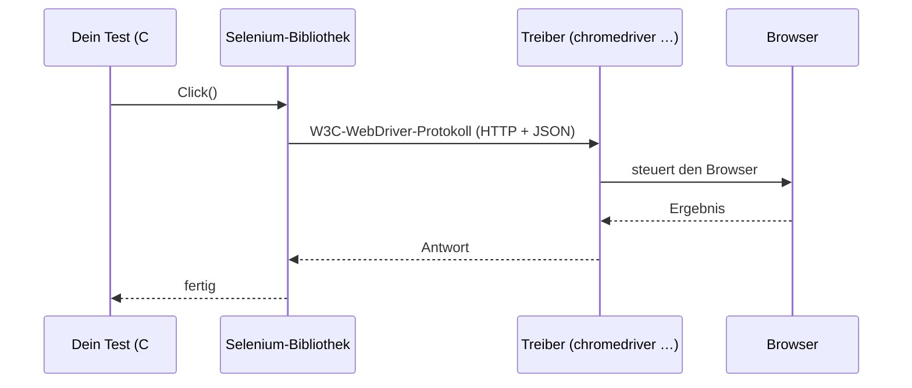

import Quiz from '@site/src/components/Quiz';
import Tabs from '@theme/Tabs';
import TabItem from '@theme/TabItem';
import fragen from './02-selenium-webdriver.fragen.yaml';

# Selenium WebDriver

:::info[Lernziele]
Nach dieser Lektion kannst du …
- erklären, wie **Selenium WebDriver** einen Browser steuert,
- ein Testprojekt in **C# (NUnit)** und **Java (JUnit 5)** aufsetzen,
- robuste **Locators** wählen und Elemente bedienen,
- mit **explizitem Warten** (`WebDriverWait`) stabile Tests schreiben,
- die häufigsten **Selenium-Exceptions** verstehen und beheben.
:::

:::tip[Sprache wählen]
Die Codebeispiele gibt es in C# und Java. Wählst du einmal einen Reiter, schalten alle Beispiele auf dieser Seite mit um.
:::

## Wie Selenium funktioniert \{#architektur}



- Selenium spricht über das standardisierte **W3C-WebDriver-Protokoll** mit einem **Treiber**, der den Browser fernsteuert.
- Seit Selenium 4.6 lädt der **Selenium Manager** den passenden Treiber automatisch herunter. Früher musste man `chromedriver.exe` selbst besorgen und aktuell halten.
- Statt lokal kann der Test auch ein **Selenium Grid** ansprechen – siehe [Docker in der Testautomation](../../05-docker/05-docker-testautomation.mdx).

## Projekt aufsetzen \{#einrichtung}

<Tabs groupId="sprache">
<TabItem value="csharp" label="C#">

```bash
dotnet new nunit -n Shop.WebTests
cd Shop.WebTests
dotnet add package Selenium.WebDriver
dotnet add package Selenium.Support   # z. B. für SelectElement (Dropdowns)
```

</TabItem>
<TabItem value="java" label="Java">

```xml
<dependency>
  <groupId>org.seleniumhq.selenium</groupId>
  <artifactId>selenium-java</artifactId>
  <version>4.27.0</version> <!-- aktuelle Version prüfen -->
  <scope>test</scope>
</dependency>
```

Dazu JUnit 5 wie in [JUnit 5 – Grundlagen](../03-java/01-junit5-grundlagen.mdx#maven).

</TabItem>
</Tabs>

## Der erste Test \{#erster-test}

<Tabs groupId="sprache">
<TabItem value="csharp" label="C#">

```csharp
using OpenQA.Selenium;
using OpenQA.Selenium.Chrome;
using OpenQA.Selenium.Support.UI;   // WebDriverWait

namespace Shop.WebTests;

public class LoginTests
{
    private IWebDriver _driver = null!;

    [SetUp]
    public void BrowserStarten()
    {
        var options = new ChromeOptions();
        options.AddArgument("--headless=new");      // ohne sichtbares Fenster (CI)
        options.AddArgument("--window-size=1280,800");
        _driver = new ChromeDriver(options);
    }

    [TearDown]
    public void BrowserBeenden()
    {
        _driver.Quit();
        _driver.Dispose();   // NUnit-Analyzer verlangt Dispose für IDisposable-Felder
    }

    [Test]
    public void Login_mit_gueltigen_Daten_zeigt_Willkommen()
    {
        _driver.Navigate().GoToUrl("http://localhost:5000/login");

        _driver.FindElement(By.Id("benutzer")).SendKeys("tester");
        _driver.FindElement(By.Id("passwort")).SendKeys("geheim");
        _driver.FindElement(By.CssSelector("button[type='submit']")).Click();

        var wait = new WebDriverWait(_driver, TimeSpan.FromSeconds(10));
        var begruessung = wait.Until(d => d.FindElement(By.CssSelector("[data-testid='willkommen']")));
        Assert.That(begruessung.Text, Does.Contain("Willkommen, tester"));
    }
}
```

</TabItem>
<TabItem value="java" label="Java">

```java
import org.junit.jupiter.api.*;
import org.openqa.selenium.*;
import org.openqa.selenium.chrome.*;
import org.openqa.selenium.support.ui.*;

import java.time.Duration;

import static org.junit.jupiter.api.Assertions.assertTrue;

class LoginTest {

    private WebDriver driver;

    @BeforeEach
    void browserStarten() {
        var options = new ChromeOptions();
        options.addArguments("--headless=new", "--window-size=1280,800");
        driver = new ChromeDriver(options);
    }

    @AfterEach
    void browserBeenden() {
        driver.quit();
    }

    @Test
    void loginMitGueltigenDatenZeigtWillkommen() {
        driver.get("http://localhost:5000/login");

        driver.findElement(By.id("benutzer")).sendKeys("tester");
        driver.findElement(By.id("passwort")).sendKeys("geheim");
        driver.findElement(By.cssSelector("button[type='submit']")).click();

        var wait = new WebDriverWait(driver, Duration.ofSeconds(10));
        var begruessung = wait.until(ExpectedConditions.visibilityOfElementLocated(
            By.cssSelector("[data-testid='willkommen']")));
        assertTrue(begruessung.getText().contains("Willkommen, tester"));
    }
}
```

</TabItem>
</Tabs>

:::warning[Quit statt Close]
`Close()` schließt nur das **aktuelle Fenster**, `Quit()` beendet den **ganzen Browser und den Treiber**. Wer im Teardown nur `Close()` aufruft, hat nach einer langen Testsuite Dutzende verwaiste `chromedriver`-Prozesse.
:::

## Locator-Strategien \{#locators}

Ein **Locator** beschreibt, wie Selenium ein Element findet. Von robust nach fragil:

| Priorität | Locator | Beispiel | Bewertung |
|---|---|---|---|
| 1 | **Test-ID** | `By.CssSelector("[data-testid='speichern']")` | ✅ extra für Tests, ändert sich nicht bei Design-Umbauten |
| 2 | **ID** | `By.Id("benutzer")` | ✅ eindeutig, wenn die IDs stabil sind |
| 3 | **Name** | `By.Name("email")` | 👍 gut für Formularfelder |
| 4 | **CSS-Selektor** | `By.CssSelector("form.login input[type='email']")` | 👍 flexibel, aber an die Struktur gebunden |
| 5 | **Linktext** | `By.LinkText("Abmelden")` | ⚠️ bricht bei Textänderung und Übersetzung |
| 6 | **XPath** | `By.XPath("//table/tbody/tr[3]/td[2]")` | ❌ absolute Pfade brechen bei jeder Layout-Änderung |

:::tip[Test-IDs mit dem Team vereinbaren]
Das zuverlässigste Mittel gegen fragile Locators ist ein Attribut wie `data-testid`, das die Entwicklung **gezielt für Tests** setzt. Das ist auch in Playwright die empfohlene Vorgehensweise (`GetByTestId`).
:::

XPath ist nicht grundsätzlich schlecht – **relative** Ausdrücke sind manchmal die einzige Möglichkeit, etwa um ein Element über seinen Text zu finden:

```text
//button[normalize-space()='Speichern']
//tr[td[text()='Max Mustermann']]//button[@aria-label='Löschen']
```

## Elemente bedienen \{#interaktionen}

<Tabs groupId="sprache">
<TabItem value="csharp" label="C#">

```csharp
var feld = _driver.FindElement(By.Id("email"));
feld.Clear();
feld.SendKeys("max@test.de");
feld.SendKeys(Keys.Enter);

var text = _driver.FindElement(By.Id("meldung")).Text;
var wert = feld.GetDomProperty("value");     // aktueller Inhalt eines Eingabefelds
var sichtbar = feld.Displayed;
var aktiv = feld.Enabled;

// Dropdown (Paket Selenium.Support, using OpenQA.Selenium.Support.UI)
var land = new SelectElement(_driver.FindElement(By.Id("land")));
land.SelectByText("Deutschland");

// Mehrere Elemente
var zeilen = _driver.FindElements(By.CssSelector("table#bestellungen tbody tr"));
Assert.That(zeilen, Has.Count.EqualTo(3));
```

</TabItem>
<TabItem value="java" label="Java">

```java
var feld = driver.findElement(By.id("email"));
feld.clear();
feld.sendKeys("max@test.de");
feld.sendKeys(Keys.ENTER);

var text = driver.findElement(By.id("meldung")).getText();
var wert = feld.getDomProperty("value");     // aktueller Inhalt eines Eingabefelds
var sichtbar = feld.isDisplayed();
var aktiv = feld.isEnabled();

// Dropdown
var land = new Select(driver.findElement(By.id("land")));
land.selectByVisibleText("Deutschland");

// Mehrere Elemente
var zeilen = driver.findElements(By.cssSelector("table#bestellungen tbody tr"));
assertEquals(3, zeilen.size());
```

</TabItem>
</Tabs>

`FindElement` wirft eine Exception, wenn nichts gefunden wird. `FindElements` liefert dagegen eine **leere Liste** – praktisch, um zu prüfen, dass etwas **nicht** da ist.

## Warten \{#warten}

Moderne Web-Anwendungen laden Inhalte **nachträglich** (AJAX, React, Angular). Klickt der Test zu früh, ist das Element noch nicht da. Selenium wartet – anders als Playwright – **nicht automatisch** darauf, dass ein Element sichtbar oder klickbar ist.

| Art | Wie | Bewertung |
|---|---|---|
| **Feste Pause** | `Thread.Sleep(3000)` | ❌ langsam und trotzdem unzuverlässig |
| **Implizites Warten** | `driver.Manage().Timeouts().ImplicitWait = TimeSpan.FromSeconds(5)` | ⚠️ wartet nur aufs **Vorhandensein** im DOM, gilt global |
| **Explizites Warten** | `WebDriverWait` + Bedingung | ✅ wartet gezielt auf **genau den Zustand**, den du brauchst |

<Tabs groupId="sprache">
<TabItem value="csharp" label="C#">

```csharp
var wait = new WebDriverWait(_driver, TimeSpan.FromSeconds(10));

// Warten, bis das Element sichtbar ist
var meldung = wait.Until(d =>
{
    var e = d.FindElement(By.Id("erfolg"));
    return e.Displayed ? e : null;
});

// Warten, bis ein Ladeindikator verschwunden ist
wait.Until(d => d.FindElements(By.CssSelector(".spinner")).Count == 0);

// Warten, bis die URL wechselt
wait.Until(d => d.Url.Contains("/dashboard"));
```

Die Methode `Until` ruft die Bedingung wiederholt auf, bis sie einen Wert ungleich `null`/`false` liefert oder die Zeit abläuft. `NoSuchElementException` wird dabei standardmäßig ignoriert. Die aus Selenium 3 bekannte Klasse `ExpectedConditions` gibt es für .NET nur noch im Community-Paket `DotNetSeleniumExtras.WaitHelpers`.

</TabItem>
<TabItem value="java" label="Java">

```java
var wait = new WebDriverWait(driver, Duration.ofSeconds(10));

// Warten, bis das Element sichtbar ist
var meldung = wait.until(ExpectedConditions.visibilityOfElementLocated(By.id("erfolg")));

// Warten, bis ein Element klickbar ist, dann klicken
wait.until(ExpectedConditions.elementToBeClickable(By.id("weiter"))).click();

// Warten, bis ein Ladeindikator verschwunden ist
wait.until(ExpectedConditions.invisibilityOfElementLocated(By.cssSelector(".spinner")));

// Eigene Bedingung als Lambda
wait.until(d -> d.getCurrentUrl().contains("/dashboard"));
```

</TabItem>
</Tabs>

:::danger[Implizites und explizites Warten nicht mischen]
Sind beide aktiv, können sich die Zeiten **unvorhersehbar addieren** – ein Test, der nach 10 Sekunden scheitern sollte, hängt plötzlich 20 Sekunden oder länger. Die Selenium-Dokumentation rät ausdrücklich davon ab. Empfehlung: **nur explizit** warten.
:::

## Screenshot bei Fehlschlag \{#screenshot}

Ein Screenshot vom Moment des Fehlers spart in der CI viel Rätselraten.

<Tabs groupId="sprache">
<TabItem value="csharp" label="C#">

```csharp
using NUnit.Framework.Interfaces;

[TearDown]
public void BrowserBeenden()
{
    if (TestContext.CurrentContext.Result.Outcome.Status == TestStatus.Failed)
    {
        var datei = Path.Combine(TestContext.CurrentContext.WorkDirectory,
                                 $"{TestContext.CurrentContext.Test.Name}.png");
        ((ITakesScreenshot)_driver).GetScreenshot().SaveAsFile(datei);
        TestContext.AddTestAttachment(datei);   // erscheint im Testreport
    }
    _driver.Quit();
    _driver.Dispose();
}
```

</TabItem>
<TabItem value="java" label="Java">

In JUnit 5 kennt `@AfterEach` das Testergebnis nicht. Dafür gibt es eine **Extension**. `AfterTestExecutionCallback` läuft direkt nach der Testmethode und **vor** `@AfterEach` – der Browser ist also noch offen:

```java
import org.junit.jupiter.api.extension.*;
import java.nio.file.*;

class ScreenshotBeiFehler implements AfterTestExecutionCallback {
    @Override
    public void afterTestExecution(ExtensionContext ctx) throws Exception {
        if (ctx.getExecutionException().isEmpty()) return;   // Test war grün

        var test = (LoginTest) ctx.getRequiredTestInstance();
        var bild = ((TakesScreenshot) test.driver()).getScreenshotAs(OutputType.FILE);
        Files.createDirectories(Path.of("target/screenshots"));
        Files.copy(bild.toPath(), Path.of("target/screenshots", ctx.getDisplayName() + ".png"),
                   StandardCopyOption.REPLACE_EXISTING);
    }
}
```

Die Testklasse bekommt `@ExtendWith(ScreenshotBeiFehler.class)` und eine Methode `WebDriver driver() { return driver; }`.

</TabItem>
</Tabs>

## Selenium oder Playwright? \{#vergleich}

| | Selenium | Playwright |
|---|---|---|
| Sprachen | Java, C#, Python, JS, Ruby | TS/JS, Python, Java, .NET |
| Warten | **explizit** mit `WebDriverWait` | **automatisch** (Auto-Waiting) |
| Browser | alle mit W3C-Treiber, auch echte Safari | Chromium, Firefox, WebKit |
| Standard | **W3C-Standard**, sehr weit verbreitet | eigenes Protokoll, jünger |
| Extras | Grid, riesiges Ökosystem | Trace Viewer, Codegen, Netzwerk-Mocking, API-Client |

Neue Projekte starten heute oft mit **Playwright**. Selenium begegnet dir aber in sehr vielen bestehenden Testsuiten – und in Stellenausschreibungen. Beides zu können, ist ein klarer Vorteil.

## Typische Fehler \{#typische-fehler}

| Exception | Bedeutung | Lösung |
|---|---|---|
| `NoSuchElementException` | Element nicht gefunden | Locator prüfen; mit `WebDriverWait` warten; liegt es in einem **iframe**? Dann erst `SwitchTo().Frame(...)` |
| `StaleElementReferenceException` | Element wurde gefunden, aber die Seite hat es inzwischen **neu gerendert** | Element **erneut suchen**, statt die alte Referenz weiterzuverwenden |
| `ElementClickInterceptedException` | ein anderes Element (Cookie-Banner, Overlay, Spinner) liegt darüber | auf das Verschwinden des Overlays warten bzw. Banner schließen |
| `ElementNotInteractableException` | Element ist da, aber unsichtbar oder deaktiviert | auf Sichtbarkeit/Klickbarkeit warten |
| `WebDriverTimeoutException` (C#) / `TimeoutException` (Java) | Wartebedingung nicht rechtzeitig erfüllt | Bedingung prüfen – war es der richtige Zustand? |

Weitere klassische Fehler:
- `Thread.Sleep` statt explizitem Warten (siehe [Flaky Tests](../01-grundlagen/02-flaky-tests.mdx#timing)).
- Implizites und explizites Warten **gemischt**.
- Absolute XPath-Ausdrücke, die bei jeder Layout-Änderung brechen.
- `Close()` statt `Quit()` im Teardown.

## Zusammenfassung \{#zusammenfassung}

- Selenium steuert den Browser über das **W3C-WebDriver-Protokoll** und einen Treiber; der **Selenium Manager** lädt Treiber automatisch.
- Locators: **Test-ID > ID > Name > CSS > Text > XPath**.
- Selenium wartet **nicht automatisch** – nutze **`WebDriverWait`** mit klaren Bedingungen und mische es nicht mit implizitem Warten.
- Im Teardown immer `Quit()`, bei Fehlschlag einen **Screenshot** sichern.
- `StaleElementReferenceException` heißt: Element neu suchen.

<Quiz fragen={fragen} titel="Quiz: Selenium WebDriver" />
