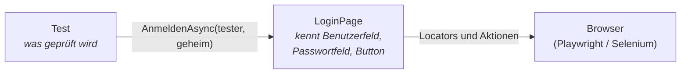

import Quiz from '@site/src/components/Quiz';
import Tabs from '@theme/Tabs';
import TabItem from '@theme/TabItem';
import fragen from './03-page-object-model.fragen.yaml';

# Page Object Model

:::info[Lernziele]
Nach dieser Lektion kannst du …
- erklären, **welches Problem** das Page Object Model löst,
- **Page Objects** in Playwright (C#) und Selenium (Java) schreiben,
- wiederkehrende Bereiche als **Komponenten** auslagern,
- Seitenwechsel mit **Fluent-Navigation** abbilden,
- die **Regeln** guter Page Objects anwenden – vor allem: keine Asserts im Page Object.
:::

## Das Problem \{#problem}

Ohne Struktur sehen Browser-Tests oft so aus:

```csharp
[Test]
public async Task Login_ok()
{
    await Page.GotoAsync("/login");
    await Page.Locator("#user").FillAsync("tester");
    await Page.Locator("#pw").FillAsync("geheim");
    await Page.Locator("form > button.btn-primary").ClickAsync();
    await Expect(Page.Locator(".welcome")).ToBeVisibleAsync();
}

[Test]
public async Task Login_falsches_Passwort()
{
    await Page.GotoAsync("/login");
    await Page.Locator("#user").FillAsync("tester");
    await Page.Locator("#pw").FillAsync("falsch");
    await Page.Locator("form > button.btn-primary").ClickAsync();
    await Expect(Page.Locator(".alert-danger")).ToBeVisibleAsync();
}
// ... und 40 weitere Tests, die sich einloggen
```

Benennt die Entwicklung `#pw` in `#password` um, musst du **jeden einzelnen Test** anpassen. Außerdem liest sich der Test wie eine Klickanleitung – **was** eigentlich geprüft wird, geht unter.

## Die Idee \{#idee}

Ein **Page Object** ist eine Klasse, die **eine Seite** (oder einen Bereich) der Anwendung repräsentiert:

- Es kennt die **Locators** der Seite – an genau **einer** Stelle.
- Es bietet **fachliche Methoden** an: `AnmeldenAsync(benutzer, passwort)` statt „fülle `#user`, fülle `#pw`, klicke …“.
- Der Test spricht nur noch mit dem Page Object, nie direkt mit Locators.



Ändert sich die Oberfläche, passt du **nur das Page Object** an. Die Tests bleiben unverändert.

## Ein erstes Page Object \{#erstes-page-object}

<Tabs groupId="sprache">
<TabItem value="csharp" label="C# (Playwright)">

```csharp title="Pages/LoginPage.cs"
using Microsoft.Playwright;

namespace Shop.WebTests.Pages;

public class LoginPage(IPage page)
{
    // Locators: an genau einer Stelle
    private ILocator Benutzer => page.GetByLabel("Benutzername");
    private ILocator Passwort => page.GetByLabel("Passwort");
    private ILocator Anmelden => page.GetByRole(AriaRole.Button, new() { Name = "Anmelden" });

    // Für Prüfungen im Test nach außen gegeben
    public ILocator Fehlermeldung => page.GetByRole(AriaRole.Alert);

    public async Task OeffnenAsync() => await page.GotoAsync("/login");

    public async Task AnmeldenAsync(string benutzer, string passwort)
    {
        await Benutzer.FillAsync(benutzer);
        await Passwort.FillAsync(passwort);
        await Anmelden.ClickAsync();
    }
}
```

```csharp title="LoginTests.cs"
using Microsoft.Playwright.NUnit;
using Shop.WebTests.Pages;
using static Microsoft.Playwright.Assertions;

public class LoginTests : PageTest
{
    private LoginPage _login = null!;

    [SetUp]
    public async Task Vorbereiten()
    {
        _login = new LoginPage(Page);
        await _login.OeffnenAsync();
    }

    [Test]
    public async Task Login_mit_falschem_Passwort_zeigt_Fehlermeldung()
    {
        await _login.AnmeldenAsync("tester", "falsch");

        await Expect(_login.Fehlermeldung).ToHaveTextAsync("Benutzername oder Passwort falsch");
    }
}
```

Die relative URL `/login` funktioniert, wenn die `BaseURL` konfiguriert ist – z. B. per Überschreiben von `ContextOptions()` in der Testklasse oder über eine `.runsettings`-Datei.

</TabItem>
<TabItem value="java" label="Java (Selenium)">

```java title="pages/LoginPage.java"
package de.shop.pages;

import org.openqa.selenium.*;
import org.openqa.selenium.support.ui.*;
import java.time.Duration;

public class LoginPage {

    // Locators: an genau einer Stelle
    private static final By BENUTZER = By.id("benutzer");
    private static final By PASSWORT = By.id("passwort");
    private static final By ANMELDEN = By.cssSelector("[data-testid='anmelden']");
    private static final By FEHLER   = By.cssSelector("[role='alert']");

    private final WebDriver driver;
    private final WebDriverWait wait;

    public LoginPage(WebDriver driver) {
        this.driver = driver;
        this.wait = new WebDriverWait(driver, Duration.ofSeconds(10));
    }

    public LoginPage oeffnen(String baseUrl) {
        driver.get(baseUrl + "/login");
        return this;
    }

    public void anmelden(String benutzer, String passwort) {
        driver.findElement(BENUTZER).sendKeys(benutzer);
        driver.findElement(PASSWORT).sendKeys(passwort);
        driver.findElement(ANMELDEN).click();
    }

    // Liefert Daten – die Prüfung macht der Test
    public String fehlermeldung() {
        return wait.until(ExpectedConditions.visibilityOfElementLocated(FEHLER)).getText();
    }
}
```

```java title="LoginTest.java"
class LoginTest {

    private WebDriver driver;
    private LoginPage login;

    @BeforeEach
    void vorbereiten() {
        driver = new ChromeDriver();
        login = new LoginPage(driver).oeffnen("http://localhost:5000");
    }

    @AfterEach
    void aufraeumen() {
        driver.quit();
    }

    @Test
    void loginMitFalschemPasswortZeigtFehlermeldung() {
        login.anmelden("tester", "falsch");

        assertEquals("Benutzername oder Passwort falsch", login.fehlermeldung());
    }
}
```

</TabItem>
</Tabs>

Der Test liest sich jetzt **fachlich**: Seite öffnen, anmelden, Fehlermeldung prüfen. Wie das technisch passiert, steht im Page Object.

## Keine Asserts im Page Object \{#keine-asserts}

Die wichtigste Regel: Das Page Object **beschreibt die Seite**, der Test **prüft**.

```csharp
// ❌ Page Object entscheidet, was „richtig“ ist
public async Task PruefeFehlermeldungAsync()
{
    await Expect(Fehlermeldung).ToHaveTextAsync("Benutzername oder Passwort falsch");
}

// ✅ Page Object gibt Zugriff, der Test prüft
public ILocator Fehlermeldung => page.GetByRole(AriaRole.Alert);
```

Warum?
- Ein Page Object wird von **vielen Tests** mit **unterschiedlichen Erwartungen** genutzt.
- Im Test soll man **auf einen Blick** sehen, was geprüft wird.
- Page Objects bleiben dadurch klein und wiederverwendbar.

:::note[Ausnahme]
Eine Prüfung, ob die **richtige Seite geladen** ist (z. B. „Überschrift Warenkorb ist sichtbar“), darf im Page Object stehen – etwa im Konstruktor oder in einer `WarteBisGeladenAsync()`-Methode. Sie sichert das Page Object selbst ab, nicht das Testergebnis.
:::

## Fluent-Navigation \{#fluent}

Führt eine Aktion auf eine **andere Seite**, gibt die Methode das **Page Object der neuen Seite** zurück. So bildet der Code den Weg durch die Anwendung ab:

<Tabs groupId="sprache">
<TabItem value="csharp" label="C# (Playwright)">

```csharp
public class LoginPage(IPage page)
{
    // ...
    public async Task<DashboardPage> AnmeldenAlsAsync(string benutzer, string passwort)
    {
        await AnmeldenAsync(benutzer, passwort);
        return new DashboardPage(page);
    }
}

public class DashboardPage(IPage page)
{
    public ILocator Begruessung => page.GetByTestId("willkommen");

    public async Task<WarenkorbPage> ZumWarenkorbAsync()
    {
        await page.GetByRole(AriaRole.Link, new() { Name = "Warenkorb" }).ClickAsync();
        return new WarenkorbPage(page);
    }
}
```

```csharp
[Test]
public async Task Nach_Login_ist_Warenkorb_leer()
{
    var dashboard = await _login.AnmeldenAlsAsync("tester", "geheim");
    var warenkorb = await dashboard.ZumWarenkorbAsync();

    await Expect(warenkorb.Positionen).ToHaveCountAsync(0);
}
```

</TabItem>
<TabItem value="java" label="Java (Selenium)">

```java
public DashboardPage anmeldenAls(String benutzer, String passwort) {
    anmelden(benutzer, passwort);
    return new DashboardPage(driver);
}
```

```java
@Test
void nachLoginIstWarenkorbLeer() {
    var warenkorb = login
        .anmeldenAls("tester", "geheim")
        .zumWarenkorb();

    assertEquals(0, warenkorb.anzahlPositionen());
}
```

</TabItem>
</Tabs>

## Komponenten \{#komponenten}

Manche Bereiche tauchen auf **vielen Seiten** auf: Navigationsleiste, Kopfzeile mit Warenkorb-Symbol, Cookie-Banner, Dialoge, Tabellen. Statt sie in jedes Page Object zu kopieren, schreibt man eine **Komponente** und baut sie ein:

```csharp
public class Kopfzeile(IPage page)
{
    private ILocator Bereich => page.GetByRole(AriaRole.Banner);
    public ILocator WarenkorbAnzahl => Bereich.GetByTestId("warenkorb-anzahl");

    public async Task AbmeldenAsync() =>
        await Bereich.GetByRole(AriaRole.Button, new() { Name = "Abmelden" }).ClickAsync();
}

public class DashboardPage(IPage page)
{
    public Kopfzeile Kopf { get; } = new(page);
    // ...
}

public class ProduktPage(IPage page)
{
    public Kopfzeile Kopf { get; } = new(page);

    public async Task InDenWarenkorbAsync() =>
        await page.GetByRole(AriaRole.Button, new() { Name = "In den Warenkorb" }).ClickAsync();
}
```

```csharp
await produkt.InDenWarenkorbAsync();
await Expect(produkt.Kopf.WarenkorbAnzahl).ToHaveTextAsync("1");
```

Tipp: Komponenten-Locators werden **relativ zum Bereich** gesucht (`Bereich.GetBy...`). So findet `Abmelden` nur den Button in der Kopfzeile, nicht einen gleichnamigen woanders auf der Seite.

## Regeln für gute Page Objects \{#regeln}

1. **Keine Asserts** im Page Object (außer „Seite ist geladen“).
2. **Fachliche Methoden** statt technischer: `AnmeldenAsync` statt `KlickeButton3Async`.
3. **Locators privat** halten – nach außen nur, was der Test prüfen muss.
4. **Eine Seite oder ein Bereich pro Klasse** – keine „God Page“ mit 80 Methoden.
5. **Seitenwechsel** gibt das nächste Page Object zurück.
6. **Kein Warten mit `Sleep`** – bei Selenium `WebDriverWait` im Page Object kapseln, bei Playwright übernimmt das Auto-Waiting.
7. **Testdaten gehören in den Test**, nicht ins Page Object.

Eine typische Ordnerstruktur:

```text
Shop.WebTests/
├── Pages/
│   ├── LoginPage.cs
│   ├── DashboardPage.cs
│   └── WarenkorbPage.cs
├── Components/
│   └── Kopfzeile.cs
└── Tests/
    ├── LoginTests.cs
    └── WarenkorbTests.cs
```

## Typische Fehler \{#typische-fehler}

- **Asserts im Page Object** – Tests werden unlesbar, das Page Object passt nur noch zu einem Testfall.
- **Locators trotzdem im Test** – „nur dieses eine Mal“. Damit ist der Vorteil dahin.
- **Riesige Page Objects**, die die ganze Anwendung abbilden – besser in Seiten und Komponenten aufteilen.
- **Zu technische Methoden** wie `FuelleFeld1Async` – sie verschieben nur Code, ohne ihn verständlicher zu machen.
- **Zustand im Page Object**, z. B. ein gespeichertes Element (`IWebElement`) in Selenium, das nach dem Neuladen der Seite zur `StaleElementReferenceException` führt. Besser den **Locator** (`By`) speichern und das Element bei Bedarf neu suchen.

## Zusammenfassung \{#zusammenfassung}

- Ein **Page Object** kapselt Locators und Aktionen einer Seite an **einer Stelle**.
- Tests sprechen nur noch mit Page Objects und lesen sich **fachlich**.
- **Keine Asserts** im Page Object: Es liefert Locators oder Werte, der Test prüft.
- **Fluent-Navigation:** Seitenwechsel geben das nächste Page Object zurück.
- Wiederkehrende Bereiche werden **Komponenten**, die mehrere Page Objects einbinden.

<Quiz fragen={fragen} titel="Quiz: Page Object Model" />
