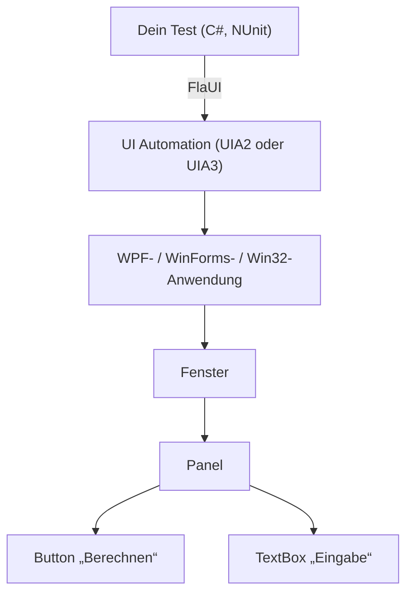

import Quiz from '@site/src/components/Quiz';
import fragen from './01-flaui-grundlagen.fragen.yaml';

# FlaUI – Grundlagen

:::info[Lernziele]
Nach dieser Lektion kannst du …
- erklären, wie Desktop-Testautomation unter Windows über **UI Automation (UIA)** funktioniert,
- mit **FlaUInspect** oder Accessibility Insights den **Elementbaum** einer WPF-Anwendung untersuchen,
- eine Anwendung aus einem **NUnit-Test** starten, Elemente finden und bedienen,
- mit **`Retry`** stabil auf Elemente und Dialoge warten,
- Screenshots erstellen und typische Fehler vermeiden.
:::

## Wie Desktop-Automatisierung funktioniert \{#ui-automation}

Browser-Tests sprechen über WebDriver oder Playwright mit dem Browser. Für Windows-Desktop-Anwendungen gibt es eine eigene Schnittstelle: **Microsoft UI Automation (UIA)**. Sie wurde ursprünglich für **Barrierefreiheit** gebaut – Screenreader lesen darüber Fenster, Buttons und Texte aus. Testwerkzeuge nutzen denselben Weg.



Jede Anwendung stellt einen **Baum aus Automation-Elementen** bereit. Jedes Element hat Eigenschaften:

| Eigenschaft | Beispiel | Bedeutung |
|---|---|---|
| **AutomationId** | `btnBerechnen` | technische, stabile ID – **erste Wahl** für Tests |
| **Name** | `Berechnen` | sichtbarer Text bzw. Beschriftung (ändert sich bei Übersetzung!) |
| **ControlType** | `Button`, `Edit`, `ComboBox` | Art des Elements |
| **ClassName** | `Button`, `TextBox` | technischer Klassenname |

Dazu kommen **Patterns** – Fähigkeiten eines Elements: `Invoke` (klickbar), `Value` (Text setzen), `Toggle` (Checkbox), `SelectionItem` (Auswahl), `ExpandCollapse` (aufklappen).

## Was ist FlaUI? \{#was-ist-flaui}

**FlaUI** ist eine Open-Source-Bibliothek für .NET, die UI Automation komfortabel nutzbar macht. Sie ist der Nachfolger des älteren Frameworks *TestStack.White*.

- **FlaUI.UIA3** – nutzt die neuere native UIA-Schnittstelle; **empfohlen für WPF** und moderne Anwendungen.
- **FlaUI.UIA2** – nutzt die ältere verwaltete UIA-Schnittstelle; manchmal besser für **WinForms**.

:::note[Und WinAppDriver?]
Microsofts **WinAppDriver** bietet eine WebDriver-ähnliche API für Desktop-Anwendungen, wird aber seit Jahren kaum noch weiterentwickelt. In .NET-Projekten ist FlaUI heute die gängigere Wahl, weil es direkt im Testprozess läuft und keinen separaten Server braucht.
:::

## Elemente untersuchen \{#inspect}

Bevor du Tests schreibst, musst du wissen, **wie die Elemente heißen**. Dafür gibt es Inspect-Werkzeuge:

| Werkzeug | Herkunft |
|---|---|
| **FlaUInspect** | vom FlaUI-Projekt, zeigt den Baum mit UIA2 oder UIA3 – passend zu FlaUI |
| **Accessibility Insights for Windows** | von Microsoft, sehr komfortabel, zeigt auch Barrierefreiheits-Probleme |
| **Inspect.exe** | Teil des Windows SDK, der Klassiker |

So gehst du vor:
1. Anwendung starten, Inspect-Werkzeug öffnen.
2. Mit der Maus über das Element fahren (bzw. „Hover-Modus“ aktivieren).
3. **AutomationId**, Name und ControlType notieren.
4. Fehlt eine AutomationId, mit der Entwicklung sprechen – siehe [WPF testbar machen](./02-wpf-testbar-machen.mdx).

## Projekt einrichten \{#einrichtung}

```bash
dotnet new nunit -n Rechner.UiTests
cd Rechner.UiTests
dotnet add package FlaUI.UIA3
```

`FlaUI.UIA3` bringt `FlaUI.Core` als Abhängigkeit mit. Das Testprojekt muss für Windows gebaut werden – in der `.csproj` z. B. `<TargetFramework>net8.0-windows</TargetFramework>`.

## Der erste Test \{#erster-test}

Beispiel: ein kleiner WPF-Rechner mit Eingabefeld, Button und Ergebnisanzeige.

```csharp
using FlaUI.Core;
using FlaUI.Core.AutomationElements;
using FlaUI.UIA3;

namespace Rechner.UiTests;

[NonParallelizable]   // Desktop-Tests teilen sich Maus, Tastatur und Fokus
public class RechnerTests
{
    private const string Exe = @"..\..\..\..\Rechner\bin\Debug\net8.0-windows\Rechner.exe";

    private Application _app = null!;
    private UIA3Automation _automation = null!;
    private Window _fenster = null!;

    [SetUp]
    public void Starten()
    {
        _app = Application.Launch(Path.GetFullPath(Exe));
        _automation = new UIA3Automation();
        _fenster = _app.GetMainWindow(_automation, TimeSpan.FromSeconds(10));
    }

    [TearDown]
    public void Beenden()
    {
        _app.Close();          // Fenster schließen
        _app.Dispose();
        _automation.Dispose();
    }

    [Test]
    public void Quadrat_von_7_ist_49()
    {
        var eingabe = _fenster.FindFirstDescendant(cf => cf.ByAutomationId("txtEingabe")).AsTextBox();
        var knopf = _fenster.FindFirstDescendant(cf => cf.ByAutomationId("btnQuadrat")).AsButton();
        var ergebnis = _fenster.FindFirstDescendant(cf => cf.ByAutomationId("lblErgebnis")).AsLabel();

        eingabe.Text = "7";
        knopf.Invoke();

        Assert.That(ergebnis.Text, Is.EqualTo("49"));
    }
}
```

Was passiert hier?
- `Application.Launch(...)` startet die Anwendung als eigenen Prozess. Mit `Application.Attach(...)` kann man sich alternativ an eine bereits laufende Anwendung hängen.
- `GetMainWindow(...)` wartet bis zu 10 Sekunden auf das Hauptfenster.
- `FindFirstDescendant` sucht im **ganzen Unterbaum** nach dem ersten passenden Element.
- `AsTextBox()`, `AsButton()`, `AsLabel()` wandeln das allgemeine `AutomationElement` in einen **typisierten Wrapper** mit passenden Methoden um.

:::warning[Exe-Pfad]
Relative Pfade beziehen sich auf das Ausgabeverzeichnis des **Testprojekts** (`bin/Debug/net8.0-windows`). Robuster ist es, den Pfad aus einer Umgebungsvariable oder `.runsettings` zu lesen, damit er lokal und in der CI passt.
:::

## Elemente finden \{#elemente-finden}

Die Suchbedingungen baut man mit der **ConditionFactory** (`cf`):

```csharp
// Nach AutomationId – erste Wahl
_fenster.FindFirstDescendant(cf => cf.ByAutomationId("btnSpeichern"));

// Nach Name (sichtbarer Text) – bricht bei Übersetzungen
_fenster.FindFirstDescendant(cf => cf.ByName("Speichern"));

// Nach Typ
_fenster.FindAllDescendants(cf => cf.ByControlType(ControlType.CheckBox));

// Kombiniert
_fenster.FindFirstDescendant(cf => cf.ByControlType(ControlType.Button).And(cf.ByName("OK")));
```

`ControlType` liegt im Namespace `FlaUI.Core.Definitions`.

| Methode | Sucht … |
|---|---|
| `FindFirstChild` | nur in den **direkten Kindern** |
| `FindFirstDescendant` | im **ganzen Unterbaum** (langsamer bei großen Fenstern) |
| `FindAllDescendants` / `FindAllChildren` | alle Treffer als Array |
| `FindFirstByXPath("/Pane/Button[2]")` | per XPath auf dem UIA-Baum – fragil, nur als Notlösung |

Wird nichts gefunden, liefert `FindFirst…` **`null`** – es gibt keine Exception wie bei Selenium. Ein anschließendes `.AsButton().Invoke()` führt dann zur `NullReferenceException`.

## Elemente bedienen \{#bedienen}

```csharp
// Textfeld
var name = _fenster.FindFirstDescendant(cf => cf.ByAutomationId("txtName")).AsTextBox();
name.Text = "Max";            // setzt den Wert direkt über das Value-Pattern
name.Enter("Max");            // tippt Zeichen für Zeichen über die Tastatur (löst Tastatur-Events aus)

// Button
var ok = _fenster.FindFirstDescendant(cf => cf.ByAutomationId("btnOk")).AsButton();
ok.Invoke();                  // über das Invoke-Pattern, ohne Mausbewegung
ok.Click();                   // echte Mausbewegung und Klick

// Checkbox
var agb = _fenster.FindFirstDescendant(cf => cf.ByAutomationId("chkAgb")).AsCheckBox();
agb.IsChecked = true;

// ComboBox
var land = _fenster.FindFirstDescendant(cf => cf.ByAutomationId("cmbLand")).AsComboBox();
land.Select("Deutschland");

// Tastatur (Namespace FlaUI.Core.Input und FlaUI.Core.WindowsAPI)
Keyboard.TypeSimultaneously(VirtualKeyShort.CONTROL, VirtualKeyShort.KEY_S);
```

:::tip[Invoke oder Click?]
`Invoke()` ist **stabiler**: kein Mauszeiger, keine Abhängigkeit von Fensterposition oder überlagernden Fenstern. `Click()` ist **realistischer** und manchmal nötig, wenn die Anwendung auf Maus-Events reagiert. Faustregel: zuerst `Invoke()`, `Click()` nur, wenn es nötig ist. Dasselbe gilt für `Text = …` gegenüber `Enter(…)`: Reagiert die Anwendung auf Tastatureingaben (z. B. Validierung beim Tippen), nimm `Enter`.
:::

## Warten \{#warten}

Auch Desktop-Anwendungen arbeiten **asynchron**: Daten werden im Hintergrund geladen, Dialoge erscheinen verzögert. FlaUI hat kein Auto-Waiting wie Playwright. Stattdessen gibt es die Klasse **`Retry`** (Namespace `FlaUI.Core.Tools`):

```csharp
using FlaUI.Core.Tools;

// Warten, bis das Element auftaucht (max. 5 Sekunden)
var ergebnis = Retry.WhileNull(
        () => _fenster.FindFirstDescendant(cf => cf.ByAutomationId("lblErgebnis")),
        timeout: TimeSpan.FromSeconds(5),
        throwOnTimeout: true,
        timeoutMessage: "Ergebnis-Label nicht gefunden")
    .Result.AsLabel();

// Warten, bis eine Bedingung erfüllt ist
Retry.WhileFalse(() => ergebnis.Text == "49", TimeSpan.FromSeconds(5), throwOnTimeout: true);
```

Nach Tastatureingaben hilft außerdem `Wait.UntilInputIsProcessed()` (Namespace `FlaUI.Core.Input`): Es wartet, bis Windows die Eingaben an die Anwendung zugestellt hat.

:::danger[Kein Thread.Sleep]
Auch hier gilt: Warte auf einen **Zustand**, nicht auf eine **Zeit**. `Thread.Sleep` macht Desktop-Tests langsam und trotzdem [flaky](../01-grundlagen/02-flaky-tests.mdx#timing).
:::

## Dialoge \{#dialoge}

Modale Dialoge (z. B. eine `MessageBox` „Wirklich löschen?“) sind eigene Fenster. Man findet sie über das Hauptfenster:

```csharp
_fenster.FindFirstDescendant(cf => cf.ByAutomationId("btnLoeschen")).AsButton().Invoke();

var dialog = Retry.WhileEmpty(() => _fenster.ModalWindows, TimeSpan.FromSeconds(5), throwOnTimeout: true)
                  .Result[0];

Assert.That(dialog.Title, Is.EqualTo("Löschen bestätigen"));
dialog.FindFirstDescendant(cf => cf.ByName("Ja")).AsButton().Invoke();
```

Bei der Standard-`MessageBox` haben die Buttons keine sprechende AutomationId – hier ist die Suche über den **Namen** („Ja“, „OK“) üblich. Achtung: Auf einem englischen Windows heißen sie „Yes“ und „OK“.

## Screenshots \{#screenshots}

```csharp
using FlaUI.Core.Capturing;
using NUnit.Framework.Interfaces;

[TearDown]
public void Beenden()
{
    if (TestContext.CurrentContext.Result.Outcome.Status == TestStatus.Failed)
    {
        var datei = Path.Combine(TestContext.CurrentContext.WorkDirectory,
                                 $"{TestContext.CurrentContext.Test.Name}.png");
        Capture.Screen().ToFile(datei);      // oder Capture.Element(_fenster)
        TestContext.AddTestAttachment(datei);
    }
    _app.Close();
    _app.Dispose();
    _automation.Dispose();
}
```

Ein Screenshot des **ganzen Bildschirms** zeigt auch Dialoge oder Fehlermeldungen, die außerhalb des Hauptfensters liegen.

## Typische Fehler \{#typische-fehler}

- **`NullReferenceException`** nach `FindFirstDescendant` – das Element wurde (noch) nicht gefunden. Mit `Retry.WhileNull` warten bzw. AutomationId im Inspect-Werkzeug prüfen.
- **Suche über Name** statt AutomationId – bricht bei Textänderungen und auf anderssprachigen Systemen.
- **Tests parallel ausführen** – Desktop-Tests konkurrieren um Maus, Tastatur und Fokus. `[NonParallelizable]` setzen.
- **Anwendung nicht beendet** – nach einem Fehlschlag laufen Prozesse weiter und stören den nächsten Test. Im Teardown immer schließen; notfalls `_app.Kill()`.
- **UIA2 und UIA3 gemischt** – Elemente aus der einen Automation funktionieren nicht mit der anderen. Pro Testlauf eine Variante wählen.
- **Bildschirm gesperrt oder Remote-Sitzung minimiert** – dann scheitern Mausklicks und Tastatureingaben. Mehr dazu in [WPF testbar machen](./02-wpf-testbar-machen.mdx#ci).

## Zusammenfassung \{#zusammenfassung}

- Desktop-Tests unter Windows nutzen **UI Automation**; FlaUI macht sie in .NET komfortabel nutzbar (**UIA3 für WPF**).
- Elemente mit **FlaUInspect** oder Accessibility Insights untersuchen, bevorzugt über die **AutomationId** finden.
- Starten mit `Application.Launch`, Hauptfenster mit `GetMainWindow`, suchen mit `FindFirstDescendant(cf => …)`, typisieren mit `AsButton()` usw.
- `Invoke()` und `Text = …` sind stabiler als `Click()` und `Enter(…)`.
- Warten mit **`Retry.WhileNull`/`WhileFalse`**, Dialoge über `ModalWindows`, Tests **nicht parallel**.

<Quiz fragen={fragen} titel="Quiz: FlaUI – Grundlagen" />
