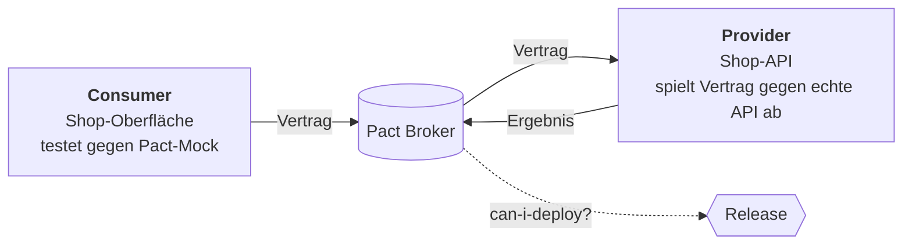
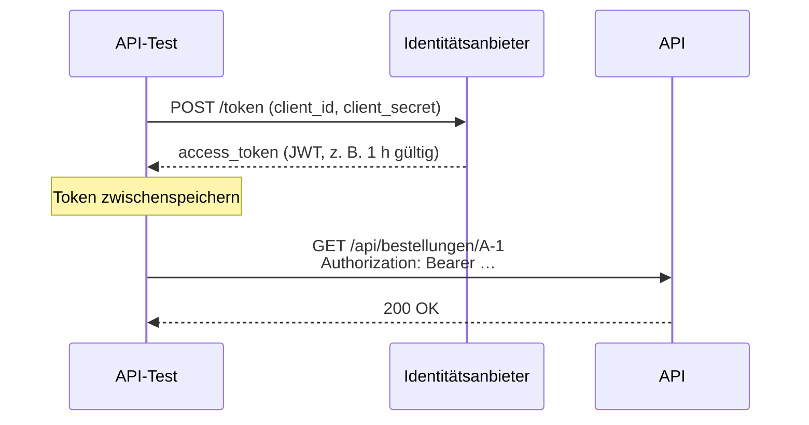

import Quiz from '@site/src/components/Quiz';
import Tabs from '@theme/Tabs';
import TabItem from '@theme/TabItem';
import fragen from './03-contract-auth-graphql.fragen.yaml';

# Contract-Tests, Authentifizierung und GraphQL

:::info[Lernziele]
Nach dieser Lektion kannst du …
- **Consumer-Driven Contract Tests** erklären und den Ablauf mit **Pact** beschreiben,
- in API-Tests **Tokens nach OAuth 2.0** holen und **Rechte** systematisch testen,
- **Idempotenz** und **Wiederholungen** in API-Tests berücksichtigen,
- die Besonderheiten beim Testen von **GraphQL** benennen.
:::

## Consumer-Driven Contract Tests \{#contract}

Bei vielen kleinen Diensten (Microservices) stellt sich die Frage: Wie testet man, dass Dienst A (der **Consumer**) und Dienst
B (der **Provider**) zusammenpassen – ohne jedes Mal alle Dienste gemeinsam zu starten? End-to-End-Tests über alle Dienste
sind langsam und brüchig. [Simulationen](./02-externe-dienste-wiremock.mdx#grenzen) allein laufen Gefahr, von der Wirklichkeit
abzuweichen.

**Consumer-Driven Contract Testing** verbindet beides:

1. Der **Consumer** schreibt Tests gegen eine Simulation des Providers und hält dabei fest, **welche Anfragen er stellt und
   welche Antworten er erwartet** – das ist der **Vertrag** (Pact-Datei).
2. Der Vertrag wird in einem **Broker** abgelegt.
3. Der **Provider** spielt die Anfragen aus allen Verträgen gegen seine echte Implementierung ab und prüft, ob die Antworten passen.
4. Vor einem Release fragt die Pipeline: „Ist diese Version mit allen Consumern verträglich?“ (`can-i-deploy`).



Der Vorteil gegenüber einem reinen [OpenAPI-Vertrag](./01-openapi-vertragstests.mdx#vertragstests): Der Provider erfährt,
welche Felder **wirklich genutzt** werden. Ein Feld, das kein Consumer verwendet, kann gefahrlos entfallen; ein genutztes
Feld umzubenennen macht den Provider-Test sofort rot.

| | OpenAPI-Vertragstest | Consumer-Driven Contract (Pact) |
|---|---|---|
| Wer legt den Vertrag fest? | der Provider (Beschreibung) | die Consumer (tatsächliche Nutzung) |
| geeignet für | öffentliche APIs mit unbekannten Nutzern | interne Dienste mit bekannten Consumern |
| Werkzeuge | Vertragstests, Schemathesis, oasdiff | Pact (für .NET, Java, JavaScript und mehr) |

<Tabs groupId="sprache">
<TabItem value="csharp" label="C# (PactNet)">

```csharp
// Consumer-Test: hält fest, was die Oberfläche von der API erwartet
pact.UponReceiving("eine Anfrage nach allen Produkten")
    .WithRequest(HttpMethod.Get, "/api/produkte")
    .WillRespond()
    .WithStatus(HttpStatusCode.OK)
    .WithJsonBody(Match.MinType(new { id = "buch", name = "Fachbuch", preis = 24.90m }, 1));

await pact.VerifyAsync(async ctx =>
{
    var produkte = await new ShopClient(ctx.MockServerUri).ProdukteAsync();
    Assert.That(produkte, Is.Not.Empty);
});
```

</TabItem>
<TabItem value="java" label="Java (Pact JVM)">

```java
@Pact(consumer = "shop-oberflaeche", provider = "shop-api")
V4Pact produkte(PactDslWithProvider builder) {
    return builder
        .uponReceiving("eine Anfrage nach allen Produkten")
        .path("/api/produkte").method("GET")
        .willRespondWith().status(200)
        .body(PactDslJsonArray.arrayMinLike(1)
            .stringType("id", "buch").stringType("name", "Fachbuch").decimalType("preis", 24.90))
        .toPact(V4Pact.class);
}
```

</TabItem>
</Tabs>

Die Skizzen zeigen das Prinzip; im Mini-Shop gibt es nur einen Consumer (die eigene Oberfläche), deshalb ist dort der
OpenAPI-Vertragstest die passendere Wahl.

## Authentifizierung in API-Tests \{#auth}

Die meisten echten APIs verlangen eine Anmeldung, heute meist mit **OAuth 2.0** und **JWT** als Zugriffstoken
(Grundlagen in [Authentifizierung](../../07-cybersecurity/03-authentifizierung-kryptografie.mdx#sessions)).

| OAuth-Ablauf | Einsatz | im Test |
|---|---|---|
| **Client Credentials** | Dienst zu Dienst, ohne Benutzer | Test holt sich mit Client-ID und Secret ein Token |
| **Authorization Code + PKCE** | Anmeldung eines Menschen im Browser oder in der App | in UI-Tests einmal anmelden und den Zustand speichern; für API-Tests Testbenutzer mit eigenem Token |
| ~~Password Grant~~ | veraltet, nicht mehr verwenden | – |

Bewährte Muster:

```csharp
// Token einmal pro Testlauf holen und wiederverwenden – nicht vor jedem Test
public static class TestTokens
{
    private static readonly ConcurrentDictionary<string, Task<string>> Cache = new();

    public static Task<string> FuerRolle(string rolle) => Cache.GetOrAdd(rolle, HoleTokenAsync);
}

http.DefaultRequestHeaders.Authorization = new AuthenticationHeaderValue("Bearer", await TestTokens.FuerRolle("kunde"));
```

- **Zugangsdaten** der Testclients aus Umgebungsvariablen bzw. CI-Secrets lesen, nie im Code.
- **Tokens zwischenspeichern** – das Holen kostet Zeit und kann vom Identitätsanbieter begrenzt werden.
- In Integrationstests lässt sich die Anmeldung oft durch ein **Test-Authentifizierungsschema** ersetzen (ASP.NET Core:
  eigener `AuthenticationHandler` in der `WebApplicationFactory`) – schnell und unabhängig vom Identitätsanbieter.



### Rechte systematisch testen \{#rechte}

Der wichtigste Sicherheitstest einer API ist die **Zugriffskontrolle** – datengetrieben über alle Rollen:

```csharp
[TestCase("kunde-a",  "/api/bestellungen/A-1", HttpStatusCode.OK)]
[TestCase("kunde-b",  "/api/bestellungen/A-1", HttpStatusCode.NotFound)]       // fremde Bestellung
[TestCase(null,       "/api/bestellungen/A-1", HttpStatusCode.Unauthorized)]   // ohne Anmeldung
[TestCase("kunde-a",  "/api/admin/preise",     HttpStatusCode.Forbidden)]      // falsche Rolle
public async Task Zugriff_nach_Rolle(string? rolle, string pfad, HttpStatusCode erwartet) { ... }
```

Dazu gehören Tests mit **manipulierten Tokens**: abgelaufen, falsche Signatur, veränderte Rolle – alle müssen `401` liefern
(siehe [IDOR](../../07-cybersecurity/02-web-schwachstellen.mdx#idor) und
[Testfälle für die Anmeldung](../../07-cybersecurity/03-authentifizierung-kryptografie.mdx#sessions)).

## Idempotenz und Wiederholungen \{#idempotenz}

Netzwerke sind unzuverlässig; Clients wiederholen Anfragen. Für [nicht idempotente](../../09-netzwerke/04-http-tls.mdx#methoden)
Anfragen wie „Bestellung anlegen“ setzen viele APIs deshalb einen **Idempotenzschlüssel** ein: Der Client schickt
`Idempotency-Key: 6f1c…` mit; kommt dieselbe Anfrage mit demselben Schlüssel erneut, liefert der Server das Ergebnis der ersten
Ausführung, statt eine zweite Bestellung anzulegen. Testfälle dazu:

- Dieselbe Anfrage zweimal mit **gleichem** Schlüssel → eine Bestellung, gleiche Antwort.
- **Parallel** zweimal → eine Bestellung (das Muster aus dem Test für [SHOP-1](../../01-softwaretest/07-fehlermanagement-agil.mdx#lebenszyklus)).
- Gleicher Schlüssel, **anderer** Inhalt → Fehler, kein stilles Überschreiben.

## GraphQL testen \{#graphql}

Bei **GraphQL** gibt es nur **einen** Endpunkt (meist `POST /graphql`); der Client beschreibt in der Abfrage, welche Felder er
haben möchte:

```graphql
query {
  warenkorb(id: "6f1c…") {
    positionen { produkt { name } menge }
    endpreis
  }
}
```

| Besonderheit | Folge für Tests |
|---|---|
| **Fast immer HTTP 200**, Fehler stehen im Feld `errors` der Antwort | nicht nur den Statuscode prüfen, sondern `errors` |
| **Schema** ist eingebaut (Introspektion) | Schema-Änderungen automatisch vergleichen; Introspektion in Produktion oft abschalten |
| Clients wählen Felder frei | Rechte **pro Feld** prüfen, nicht nur pro Endpunkt |
| **Verschachtelte Abfragen** | Abfragetiefe und -kosten begrenzen und testen – sonst Denial of Service mit einer einzigen Anfrage |
| N+1 auf dem Server | Abfragen mit vielen verschachtelten Objekten auf Anzahl der Datenbankzugriffe prüfen ([N+1](../../08-datenbanken/04-datenbanken-im-test.mdx#n-plus-1)) |

Getestet wird mit denselben Werkzeugen wie REST – REST Assured, HttpClient, Postman –, die Abfrage ist einfach ein
JSON-Body `{"query": "…", "variables": {…}}`.

## Typische Fehler \{#typische-fehler}

- Zusammenspiel von Diensten **nur end-to-end** testen – langsam, brüchig, spät.
- Für jeden Test ein **neues Token** holen.
- Client-Secrets **im Code**.
- Zugriffskontrolle nur mit **einer** Rolle testen.
- Bei GraphQL nur auf **Status 200** prüfen.
- Wiederholte POST-Anfragen ohne **Idempotenzschlüssel** – doppelte Bestellungen.

## Zusammenfassung \{#zusammenfassung}

- **Consumer-Driven Contracts** (Pact): Consumer halten ihre Erwartungen fest, der Provider prüft sie gegen die echte Implementierung.
- **OAuth 2.0**: Client Credentials für Dienst-zu-Dienst, Authorization Code + PKCE für Menschen; Tokens zwischenspeichern, Secrets aus der CI.
- **Rechte datengetrieben** über alle Rollen testen, dazu manipulierte Tokens.
- **Idempotenzschlüssel** verhindern doppelte Ausführung bei Wiederholungen.
- **GraphQL**: ein Endpunkt, Fehler im Feld `errors`, Rechte pro Feld, Abfragetiefe begrenzen.

<Quiz fragen={fragen} titel="Quiz: Contract-Tests, Authentifizierung und GraphQL" />
