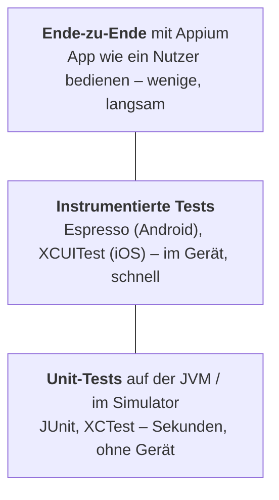

import Quiz from '@site/src/components/Quiz';
import fragen from './01-mobile-testen-grundlagen.fragen.yaml';

# Mobile Apps testen – Grundlagen

:::info[Lernziele]
Nach dieser Lektion kannst du …
- **native, hybride und Web-Apps** unterscheiden und weißt, was das für Tests bedeutet,
- die **Besonderheiten** mobiler Apps benennen, die es im Web nicht gibt,
- **Emulator, echtes Gerät und Gerätefarm** passend einsetzen,
- die **mobile Testpyramide** mit den passenden Werkzeugen beschreiben,
- eine sinnvolle **Gerätematrix** auswählen.
:::

## Arten von Apps \{#app-arten}

| Art | Aufbau | Beispiel | Testwerkzeuge |
|---|---|---|---|
| **Native App** | in Kotlin/Java (Android) oder Swift (iOS) geschrieben, nutzt die Bedienelemente des Systems | Banking-App, Kamera | Espresso, XCUITest, **Appium** |
| **Hybride App** | Webinhalte in einer nativen Hülle (WebView), z. B. mit Capacitor | viele Shop-Apps | Appium (Wechsel zwischen nativem und Web-Kontext) |
| **Plattformübergreifend** | eine Codebasis, native Oberfläche: Flutter, React Native, .NET MAUI | | Appium, framework-eigene Werkzeuge |
| **Mobile Web / PWA** | Website im mobilen Browser, ggf. installierbar | diese Lernplattform | Playwright mit Geräteemulation, Appium mit Chrome/Safari |

Für eine **mobile Website** reicht oft Playwright mit `devices["Pixel 7"]` – Bildschirmgröße, Touch und User-Agent werden
nachgebildet. Sobald eine **App installiert** wird, braucht man Werkzeuge, die das Betriebssystem bedienen.

## Was mobile Apps besonders macht \{#besonderheiten}

| Besonderheit | Testfrage |
|---|---|
| **Fragmentierung** | Läuft die App auf alten und neuen Android-Versionen, kleinen und großen Bildschirmen, bei Herstelleranpassungen (Samsung, Xiaomi)? |
| **Lebenszyklus** | Bleibt der Zustand erhalten, wenn die App in den Hintergrund geht, ein Anruf kommt oder das System sie beendet? |
| **Drehen** | Android baut die Activity beim Drehen **neu auf** – sind Eingaben und Warenkorb danach noch da? |
| **Netzwerk** | Was passiert offline, bei langsamem Netz, beim Wechsel von WLAN zu Mobilfunk? |
| **Berechtigungen** | Kamera, Standort, Benachrichtigungen: Was tut die App, wenn der Nutzer **ablehnt**? |
| **Gesten und Tastatur** | Wischen, Langdruck, Zoomen; verdeckt die Bildschirmtastatur den Knopf? |
| **Ressourcen** | Akkuverbrauch, Speicher, App-Größe, Startzeit |
| **Installation und Update** | Funktioniert ein Update über eine ältere Version mit vorhandenen Daten? |
| **Barrierefreiheit** | Funktioniert die App mit TalkBack (Android) und VoiceOver (iOS)? Siehe [Barrierefreiheit](../07-barrierefreiheit/01-barrierefreiheit-grundlagen.mdx) |
| **Store-Vorgaben** | Erfüllt die App die Regeln von Google Play und App Store? |

:::warning[Der Klassiker: Zustand nach dem Drehen]
Dreht man ein Android-Gerät, zerstört das System die Activity und erzeugt sie neu. Was die App nicht ausdrücklich sichert
(`onSaveInstanceState` oder ein ViewModel), ist weg – der Warenkorb ist leer, das halb ausgefüllte Formular gelöscht.
Ein Test, der das Gerät einmal dreht, findet diesen Fehler sofort. Im Beispielprojekt sichert die App den Warenkorb, und
`test_warenkorb_bleibt_beim_drehen_erhalten` stellt sicher, dass das so bleibt.
:::

## Emulator, echtes Gerät oder Gerätefarm? \{#geraete}

| | Emulator (Android) / Simulator (iOS) | Echtes Gerät | Gerätefarm in der Cloud |
|---|---|---|---|
| Kosten | kostenlos | Anschaffung, Pflege | pro Minute oder Monat |
| Geschwindigkeit | schnell aufgesetzt, in der CI nutzbar | schnell, aber manuell zu verwalten | Warteschlangen möglich |
| Realität | gut für Logik und Oberfläche; Kamera, Sensoren, Leistung nur nachgebildet | echt: Leistung, Sensoren, Herstelleranpassungen | echt, viele Modelle |
| Typisch für | tägliche Tests, CI | Abnahme, Leistung, Hardwarefunktionen | Kompatibilität über viele Geräte |

Ein **Emulator** bildet ein komplettes Android-Gerät nach (inklusive CPU-Architektur). Ein iOS-**Simulator** führt die App
dagegen direkt auf dem Mac aus – er läuft **nur unter macOS**. Bekannte Gerätefarmen: Firebase Test Lab, BrowserStack,
Sauce Labs, AWS Device Farm.

## Die mobile Testpyramide \{#testpyramide}



| Stufe | Werkzeug | Läuft | Stärke |
|---|---|---|---|
| **Unit** | JUnit (Android), XCTest (iOS) | auf dem Rechner, ohne Gerät | Logik in Sekunden |
| **Instrumentiert / UI** | **Espresso** (Android), **XCUITest** (iOS) | im Gerät, im selben Prozess wie die App | schnell und stabil; synchronisiert sich mit der App; von Entwicklern in Kotlin/Swift geschrieben |
| **Ende-zu-Ende** | **Appium** | außerhalb der App, über das System | eine Sprache und ein Werkzeug für Android **und** iOS; auch Systemdialoge, andere Apps, echte Abläufe |

Im Beispielprojekt prüfen JUnit-Tests die Rabattregeln der App in Sekunden; die Appium-Tests decken nur ab, was die
Oberfläche und das System betrifft: Anzeige, Bestellung, Dialog, Drehen, Hintergrund.

```java title="beispiele/mobile/app/src/test/…/WarenkorbTest.java (Auszug)"
@Test
public void rabattAbHundertEuro() {
    Warenkorb w = new Warenkorb();
    w.hinzufuegen(RUCKSACK);
    w.hinzufuegen(RUCKSACK);                      // 99,80 €
    assertEquals(new BigDecimal("99.80"), w.endpreis(false));
    w.hinzufuegen(TASSE);                         // 112,30 €
    assertEquals(new BigDecimal("101.07"), w.endpreis(false));
}
```

## Welche Geräte testen? \{#geraetematrix}

Alle Geräte zu testen ist unmöglich. Eine **Gerätematrix** wählt gezielt aus:

- **Nutzungsdaten** der eigenen App (Analytics): Welche Geräte und Versionen haben die Nutzer wirklich?
- **Ränder** abdecken: älteste unterstützte Version (`minSdk`), neueste Version, kleinster und größter Bildschirm.
- **Hersteller** mit eigenen Anpassungen (Samsung, Xiaomi) mindestens einmal.
- **Risiko**: neue Betriebssystemversionen früh in den Beta-Phasen testen.

| Ebene | Wie oft | Geräte |
|---|---|---|
| Jeder Commit | in der CI | 1 Emulator (aktuelle Version) |
| Nächtlich | in der CI oder Gerätefarm | 3–5 Konfigurationen (älteste, neueste, kleiner Bildschirm, Tablet) |
| Vor dem Release | Gerätefarm und echte Geräte | 10–20 meistgenutzte Geräte, manuelle Erkundung |

## Typische Fehler \{#typische-fehler}

- Nur auf dem eigenen, neuen Telefon testen.
- Nur Ende-zu-Ende-Tests mit Appium – langsam und teuer; Logik gehört in Unit-Tests.
- Drehen, Hintergrund und Unterbrechungen vergessen.
- Berechtigungen immer erlauben – nie den Fall „abgelehnt“ prüfen.
- Offline-Verhalten nicht testen.
- iOS-Tests ohne Mac planen – Simulator und XCUITest laufen nur unter macOS.

## Zusammenfassung \{#zusammenfassung}

- **Native, hybride, plattformübergreifende** Apps und **mobile Web** brauchen unterschiedliche Werkzeuge.
- Mobile Besonderheiten: Fragmentierung, **Lebenszyklus und Drehen**, Netzwerk, Berechtigungen, Gesten, Ressourcen.
- **Emulator** für die tägliche CI, **echte Geräte** für Leistung und Hardware, **Gerätefarmen** für Vielfalt.
- Pyramide: **JUnit/XCTest** → **Espresso/XCUITest** → wenige **Appium**-Tests.
- Geräte nach **Nutzungsdaten und Rändern** auswählen.

<Quiz fragen={fragen} titel="Quiz: Mobile Apps testen – Grundlagen" />
