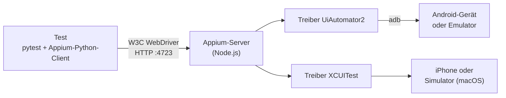

import Quiz from '@site/src/components/Quiz';
import fragen from './02-appium.fragen.yaml';

# Appium mit Python

:::info[Lernziele]
Nach dieser Lektion kannst du …
- die **Architektur** von Appium erklären und eine Sitzung mit **Capabilities** starten,
- Elemente mit der passenden **Locator-Strategie** finden,
- ein **Screen Object** mit Warten und Scrollen schreiben,
- **Systemdialoge, Tastatur, Drehen und Hintergrund** im Test steuern,
- typische Ursachen **instabiler** mobiler Tests erkennen.
:::

Getestet wird die Android-Fassung des Mini-Shops aus
[beispiele/mobile](https://github.com/Smie89/lernplattform/tree/main/beispiele/mobile): fünf Produkte, Warenkorb mit
denselben Rabattregeln wie im Web, Bestellung mit Bestätigungsdialog.

## Architektur \{#architektur}



- Der **Test** nutzt eine Client-Bibliothek (Python, Java, C#, JavaScript …) und spricht das **WebDriver-Protokoll** – dasselbe
  wie Selenium.
- Der **Appium-Server** nimmt die Befehle an und reicht sie an einen **Treiber** weiter.
- Der Treiber **UiAutomator2** installiert einen kleinen Helfer auf dem Android-Gerät und steuert darüber die Oberfläche;
  **XCUITest** macht dasselbe für iOS. Weitere Treiber gibt es z. B. für Flutter, Windows und macOS.

Wer [Selenium](../04-browser/02-selenium-webdriver.mdx) kennt, findet sich sofort zurecht: `find_element`, `click`,
`send_keys`, `WebDriverWait`.

## Einrichten \{#einrichten}

```bash
npm install -g appium@4.0.2                 # Server (Node.js 22.22+)
appium driver install uiautomator2@10.4.0   # Treiber für Android
appium                                      # startet auf Port 4723

pip install Appium-Python-Client==6.5.2 pytest
```

Für Android braucht es außerdem das **Android SDK** (`ANDROID_HOME`) und einen Emulator oder ein Gerät mit aktiviertem
**USB-Debugging**. `adb devices` zeigt, was verbunden ist. `appium driver doctor uiautomator2` prüft die Einrichtung.

## Sitzung und Capabilities \{#capabilities}

**Capabilities** beschreiben, was getestet wird – welches Gerät, welche App, welcher Treiber:

```python title="beispiele/mobile/tests/conftest.py (Auszug)"
from appium import webdriver
from appium.options.android import UiAutomator2Options

@pytest.fixture(scope="session")
def optionen() -> UiAutomator2Options:
    o = UiAutomator2Options()
    o.app = str(APP)                                   # Pfad zur APK – wird installiert
    o.app_package = "de.lernplattform.minishop"
    o.app_activity = ".MainActivity"
    o.new_command_timeout = 120
    o.set_capability("appium:disableWindowAnimation", True)
    return o

@pytest.fixture(scope="session")
def sitzung(optionen):
    driver = webdriver.Remote("http://127.0.0.1:4723", options=optionen)
    yield driver
    driver.quit()
```

| Capability | Bedeutung |
|---|---|
| `platformName` | `Android` oder `iOS` (setzen die Options-Klassen selbst) |
| `appium:automationName` | Treiber: `UiAutomator2`, `XCUITest` |
| `appium:app` | Pfad oder URL der App (APK, IPA) |
| `appium:appPackage` / `appActivity` | bereits installierte App starten |
| `appium:udid` / `deviceName` | bestimmtes Gerät wählen |
| `appium:noReset` / `fullReset` | App-Daten behalten bzw. App neu installieren |
| `appium:autoGrantPermissions` | alle Berechtigungen automatisch erteilen |

Das Installieren der App dauert – deshalb **eine Sitzung für alle Tests**. Vor jedem Test setzt eine zweite Fixture die
App zurück:

```python
@pytest.fixture
def driver(sitzung, request):
    sitzung.orientation = "PORTRAIT"
    sitzung.terminate_app("de.lernplattform.minishop")
    sitzung.execute_script("mobile: clearApp", {"appId": "de.lernplattform.minishop"})   # Daten löschen
    sitzung.activate_app("de.lernplattform.minishop")
    yield sitzung
    # bei Fehlschlag: Screenshot nach testergebnisse/<test>.png
```

## Locator-Strategien \{#locators}

| Strategie | Beispiel | Bewertung |
|---|---|---|
| **Accessibility ID** (`content-desc`) | `AppiumBy.ACCESSIBILITY_ID, "Tasse in den Warenkorb"` | **erste Wahl**: stabil, plattformübergreifend, hilft Screenreader-Nutzern |
| **ID** (`resource-id`) | `AppiumBy.ID, "de.lernplattform.minishop:id/endpreis"` | stabil, wenn Entwickler feste ids vergeben |
| **UiAutomator** (Android) | `AppiumBy.ANDROID_UIAUTOMATOR, 'new UiSelector().descriptionStartsWith("Produkt ")'` | mächtig: Suchen nach Text, Scrollen |
| **Class Chain / Predicate** (iOS) | `**/XCUIElementTypeButton[\`label == "OK"\`]` | iOS-Gegenstück, schnell |
| **XPath** | `//android.widget.TextView[@text="Tasse"]` | **vermeiden**: langsam, bricht bei jeder Layoutänderung |

In der App vergibt das Layout feste ids, und der Code setzt Beschreibungen:

```java title="MainActivity.java (Auszug)"
zeile.setContentDescription("Produkt " + produkt.name());
knopf.setContentDescription(produkt.name() + " in den Warenkorb");
```

Wie bei `data-testid` im Web gilt: **Testbarkeit ist Aufgabe der Entwicklung** – fehlen ids und Beschreibungen, bleibt nur
XPath. Hier zahlt sich Barrierefreiheit doppelt aus.

### Appium Inspector \{#inspector}

Der **Appium Inspector** (eigene Desktop-Anwendung) verbindet sich mit dem Server, zeigt den Bildschirm und den
Elementbaum mit allen Attributen und schlägt Locators vor. Alternativ zeigt `driver.page_source` den Baum als XML.

## Ein Screen Object \{#screen-object}

Das **Screen Object** ist das Page Object für Apps. Die Tests sprechen nur mit ihm:

```python title="beispiele/mobile/tests/screens.py (Auszug)"
class ShopScreen:
    def __init__(self, driver, timeout: float = 10):
        self.driver = driver
        self.warten = WebDriverWait(driver, timeout)

    def hinzufuegen(self, produktname: str, anzahl: int = 1) -> "ShopScreen":
        for _ in range(anzahl):
            self._scrollen_zu(f"{produktname} in den Warenkorb").click()
        return self

    def menge(self, produktname: str) -> int:
        zeile = self._scrollen_zu(f"Produkt {produktname}")
        return int(zeile.find_element(*rid("menge")).text)   # Suche innerhalb der Zeile

    @property
    def endpreis(self) -> str:
        return self.text("endpreis")
```

Jede Produktzeile enthält dieselben ids (`name`, `preis`, `menge`). Der Test sucht deshalb erst die **Zeile** über ihre
Beschreibung und darin die Menge – wie verschachtelte Locators in Playwright.

```python title="beispiele/mobile/tests/test_shop_app.py (Auszug)"
def test_rabatt_ab_100_euro(driver):
    shop = ShopScreen(driver).hinzufuegen("Rucksack", 2)   # 99,80 €
    assert shop.rabatt == "Rabatt: 0 %"
    shop.hinzufuegen("Tasse")                              # 112,30 €
    assert shop.rabatt == "Rabatt: 10 %"
    assert shop.endpreis == "Endpreis: 101,07 €"
```

### Warten und Scrollen \{#warten}

Appium kennt kein Auto-Waiting wie Playwright. Ohne Warten sucht ein Test, bevor die App so weit ist. Das Beispiel setzt
`implicitly_wait(0)` und wartet **ausdrücklich** mit `WebDriverWait` – implizite und explizite Wartezeiten zu mischen
führt zu schwer erklärbaren Zeiten.

Elemente außerhalb des Bildschirms existieren für UiAutomator2 nicht – man muss scrollen. Der übliche Weg ist
`UiScrollable` von Android. Das Beispiel scrollt nach zwei Befunden aber **selbst**: erst direkt suchen, sonst ein Stück
wischen – mit Abstand zu den Bildschirmrändern – und erneut suchen:

```python title="beispiele/mobile/tests/screens.py (Auszug)"
def _wischen(self, richtung: str) -> bool:
    flaeche = self.driver.find_element(AppiumBy.CLASS_NAME, "android.widget.ScrollView").rect
    rand_oben_unten = int(flaeche["height"] * 0.25)          # nie in der Nähe der Ränder wischen
    rand_seite = int(flaeche["width"] * 0.1)
    return self.driver.execute_script("mobile: scrollGesture", {
        "left": flaeche["x"] + rand_seite,
        "top": flaeche["y"] + rand_oben_unten,
        "width": flaeche["width"] - 2 * rand_seite,
        "height": flaeche["height"] - 2 * rand_oben_unten,
        "direction": richtung,
        "percent": 0.8,
    })                                                      # True = es geht noch weiter

def _finden(self, locator):
    richtung = ["down"]

    def versuch(d):
        treffer = [e for e in d.find_elements(*locator) if e.is_displayed()]
        if treffer:
            return treffer[0]                               # schon sichtbar
        if not self._wischen(richtung[0]):                  # Seitenende erreicht: Richtung wechseln
            richtung[0] = "up" if richtung[0] == "down" else "down"
        return False                                        # False = WebDriverWait versucht es erneut

    return WebDriverWait(self.driver, 20, poll_frequency=0.2).until(versuch, message=f"nicht gefunden: {locator[1]}")
```

:::info[Befund 1: UiScrollable fand sichtbare Elemente nicht]
Die erste Fassung suchte **nur** mit `UiScrollable`. In etwa jedem dritten Lauf schlug ein zufälliger Test mit „nicht
gefunden“ fehl. Der Screenshot vom Fehlschlag zeigte: Das Element war **sichtbar**. Die Seite passt fast ganz auf den
Bildschirm, und die ScrollView galt dann nicht immer als „scrollable“ – `UiScrollable` fand gar keinen Container.

Lehre: **Screenshots bei Fehlschlag** sind bei mobilen Tests unverzichtbar – ohne Bild hätte man auf „Timing“ getippt
und längere Wartezeiten eingebaut.
:::

:::info[Befund 3: Scrollen schickte die App auf den Startbildschirm]
Lokal (großer Bildschirm) lief alles stabil, in der CI (kleiner Emulator, 320 × 640) schlug der Drehtest fehl: Nach dem
Drehen ins Querformat war die App plötzlich im **Hintergrund**. Ein Absturz? Das Android-Log (`adb logcat`) zeigte etwas
anderes:

```text
D UiScrollable: Scrolling backward from (320, 96) to (320, 296) in 55 steps.
V ShellRecents: RecentsTransitionHandler.startRecentsTransition
I InputDispatcher: Channel [Gesture Monitor] swipe-up (server) is stealing touch from [… de.lernplattform.minishop …]
```

Im flachen Querformat wischte `UiScrollable` so nah am unteren Rand, dass die **Gestensteuerung** von Android die Geste
als „nach oben wischen = Startbildschirm“ deutete. Die Lösung ist nicht, die Gestensteuerung abzuschalten – echte Nutzer
haben sie –, sondern mit Abstand zu den Rändern zu wischen. Lokal ließ sich der Fehler mit
`adb shell wm size 320x640` nachstellen und die Lösung prüfen.

Lehre: Bei Fehlschlägen, die nur in der CI auftreten, **mehr Daten sammeln statt raten** – der Test legt dafür neben dem
Screenshot den App-Zustand, die aktive Activity und den Elementbaum ab, das CI-Skript das logcat.
:::

:::info[Befund 4: Element nach dem Drehen „veraltet“]
Ein späterer CI-Lauf schlug im Drehtest mit `StaleElementReferenceException` fehl – im Lauf davor war er grün. Nach dem
Drehen baut Android die Activity neu auf; ein Element, das der Test eben gefunden hatte, gab es beim Lesen seines Textes
schon nicht mehr. Das Screen Object liest Werte deshalb über eine Hilfsfunktion, die bei veralteten Elementen neu sucht:

```python
FLUECHTIG = (NoSuchElementException, StaleElementReferenceException)

def _wiederholt(self, lesen, beschreibung):
    return WebDriverWait(self.driver, 20, poll_frequency=0.2, ignored_exceptions=FLUECHTIG).until(
        lambda _: (lesen(),), message=beschreibung)[0]
```

Die Klammern `(lesen(),)` sind kein Zufall: `WebDriverWait.until` wertet `0` oder `""` als „noch nicht fertig“. Ohne
das Tupel hätte `menge("Monitor")` bei Menge 0 bis zum Timeout gewartet.
:::

## System, Tastatur, Drehen, Hintergrund \{#system}

```python
# Android-Standarddialog nach der Bestellung
meldung = driver.find_element(AppiumBy.ID, "android:id/message").text
driver.find_element(AppiumBy.ID, "android:id/button1").click()   # positiver Knopf ("OK")

# Bildschirmtastatur verdeckt Knöpfe
if driver.is_keyboard_shown():
    driver.hide_keyboard()

# Drehen
driver.orientation = "LANDSCAPE"

# App-Lebenszyklus
driver.terminate_app("de.lernplattform.minishop")
driver.activate_app("de.lernplattform.minishop")
driver.query_app_state("de.lernplattform.minishop")     # 4 = im Vordergrund

# Android-spezifische Befehle über "mobile:"-Erweiterungen
driver.execute_script("mobile: clearApp", {"appId": "de.lernplattform.minishop"})
driver.execute_script("mobile: shell", {"command": "dumpsys battery"})   # nur mit "appium --allow-insecure=*:adb_shell"
```

Gesten wie Wischen, Scrollen und Langdruck gibt es als `mobile: swipeGesture`, `mobile: scrollGesture`, `mobile: longClickGesture` oder über W3C-Actions. Gesten am Bildschirmrand können mit der Gestensteuerung des Systems kollidieren (Befund 3).

```python title="beispiele/mobile/tests/test_zustand.py (Auszug)"
def test_warenkorb_bleibt_beim_drehen_erhalten(driver):
    shop = ShopScreen(driver).hinzufuegen("Tasse", 2).als_stammkunde()
    driver.orientation = "LANDSCAPE"
    assert shop.menge("Tasse") == 2
    assert shop.endpreis == "Endpreis: 23,75 €"   # 25,00 € − 5 %: auch die Checkbox ist noch gesetzt
```

:::info[Befund 2: background_app kam nicht immer zurück]
`driver.background_app(2)` soll die App zwei Sekunden in den Hintergrund schicken und dann zurückholen. Auf dem
Emulator (Android 17, Treiber 10.4) blieb in etwa jedem zweiten Lauf der **Startbildschirm** vorn. Stabil ist der
ausdrückliche Weg – und die Prüfung, dass die App wirklich vorn ist:

```python
driver.execute_script("mobile: backgroundApp", {"seconds": -1})   # -1 = im Hintergrund bleiben
time.sleep(2)                                                      # gewollt: Zeit im Hintergrund
driver.activate_app(PAKET)
WebDriverWait(driver, 10).until(lambda d: d.query_app_state(PAKET) == ApplicationState.RUNNING_IN_FOREGROUND)
```
:::

## Was macht mobile Tests instabil? \{#instabil}

| Ursache | Gegenmittel |
|---|---|
| Animationen | in den Entwickleroptionen oder per Capability abschalten |
| Suche, bevor die App bereit ist | `WebDriverWait` auf Zustände; kein `time.sleep` als Ersatz |
| Element veraltet nach Drehen oder Neuaufbau | bei `StaleElementReferenceException` neu suchen (Befund 4) |
| Elemente außerhalb des Bildschirms | gezielt scrollen – mit Abstand zu den Rändern, sonst greift die Gestensteuerung |
| Systemdialoge (Berechtigungen, „App reagiert nicht“) | `autoGrantPermissions`; frisch gebooteten Emulator abwarten |
| Zustand aus vorherigen Tests | App vor jedem Test zurücksetzen (`clearApp`) |
| XPath-Locators | Accessibility IDs und resource-ids |
| Tastatur verdeckt Elemente | `hide_keyboard()` |

## Typische Fehler \{#typische-fehler}

- Für jeden Test eine neue Sitzung mit Neuinstallation – die Suite dauert ein Vielfaches.
- XPath überall, weil die App keine ids hat – besser die Entwicklung um Accessibility IDs bitten.
- `implicitly_wait` und `WebDriverWait` gemischt.
- Keine Screenshots bei Fehlschlag.
- Nur hochkant testen.
- Annehmen, dass ein Appium-Befehl wie `background_app` immer zuverlässig arbeitet – das Ergebnis prüfen.

## Zusammenfassung \{#zusammenfassung}

- **Client → Appium-Server → Treiber (UiAutomator2, XCUITest) → Gerät**, über das WebDriver-Protokoll.
- **Capabilities** wählen Gerät, App und Treiber; eine Sitzung für alle Tests, App vor jedem Test zurücksetzen.
- Locators: **Accessibility ID** > resource-id > UiAutomator > XPath.
- **Screen Objects** mit ausdrücklichem Warten; gescrollt wird nur bei Bedarf und mit Abstand zu den Rändern.
- System, Tastatur, Drehen und Hintergrund gehören in mobile Tests – und **Screenshots bei Fehlschlag** in jede Suite.

<Quiz fragen={fragen} titel="Quiz: Appium mit Python" />
