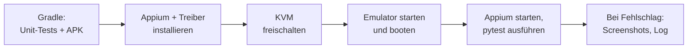

import Quiz from '@site/src/components/Quiz';
import fragen from './03-mobile-in-der-ci.fragen.yaml';

# Mobile Tests in der CI

:::info[Lernziele]
Nach dieser Lektion kannst du …
- eine Android-App in der CI **bauen** und ihre **Unit-Tests** ohne Emulator ausführen,
- einen **Android-Emulator** in GitHub Actions starten und Appium-Tests darauf ausführen,
- **Diagnosedaten** bei Fehlschlag sichern,
- abwägen, wann **macOS-Runner** und **Gerätefarmen** nötig sind.
:::

## Der Ablauf \{#ablauf}



Der Job läuft auf einem normalen Linux-Runner von GitHub. Die schnellen **Unit-Tests der App** laufen zuerst – schlagen sie
fehl, startet der teure Emulator gar nicht erst.

## App bauen und Unit-Tests \{#bauen}

```yaml title=".github/workflows/beispiele.yml (Auszug)"
- uses: actions/setup-java@v6
  with:
    distribution: temurin
    java-version: 21
- uses: gradle/actions/setup-gradle@v6
  with:
    gradle-version: "8.10.2"
- name: Unit-Tests der App (JVM, ohne Emulator) und APK bauen
  run: gradle --no-daemon testDebugUnitTest assembleDebug
```

Auf den GitHub-Runnern ist das **Android SDK vorinstalliert**. Fehlende Plattformen und Build-Tools lädt das
Android-Gradle-Plugin selbst nach. Das Ergebnis liegt unter `app/build/outputs/apk/debug/app-debug.apk`.

In echten Projekten liegt ein **Gradle-Wrapper** (`gradlew`) im Repository, der die richtige Gradle-Version mitbringt;
das Beispiel legt die Version stattdessen in der Pipeline fest.

## Appium installieren \{#appium-ci}

```yaml
- uses: actions/setup-node@v7
  with:
    node-version: 24
- name: Appium und UiAutomator2-Treiber installieren
  run: |
    npm install -g appium@4.0.2
    appium driver install uiautomator2@10.4.0
```

**Feste Versionen** für Server und Treiber sind hier besonders wichtig: Neue Treiberversionen ändern regelmäßig Verhalten –
wie `background_app` in [Befund 2](./02-appium.mdx#system) zeigt.

## Der Emulator in GitHub Actions \{#emulator}

Ein x86-Emulator braucht **Hardware-Beschleunigung (KVM)**. Auf den Linux-Runnern von GitHub ist sie vorhanden, muss aber
freigeschaltet werden. Danach übernimmt **android-emulator-runner** Download des Systemabbilds, Start, Warten auf den
fertigen Bootvorgang und Abschalten der Animationen:

```yaml
- name: Hardware-Beschleunigung (KVM) für den Emulator freischalten
  run: |
    echo 'KERNEL=="kvm", GROUP="kvm", MODE="0666", OPTIONS+="static_node=kvm"' | sudo tee /etc/udev/rules.d/99-kvm4all.rules
    sudo udevadm control --reload-rules
    sudo udevadm trigger --name-match=kvm
- name: Emulator starten und Appium-Tests ausführen
  uses: reactivecircus/android-emulator-runner@v2
  with:
    api-level: 34
    target: google_apis
    arch: x86_64
    disable-animations: true
    emulator-options: -no-window -gpu swiftshader_indirect -noaudio -no-boot-anim -no-snapshot
    working-directory: beispiele/mobile
    script: ./ci-tests.sh
```

| Option | Bedeutung |
|---|---|
| `api-level: 34` | Android-Version des Systemabbilds (34 = Android 14) |
| `target: google_apis` | Abbild mit Google-APIs; `default` ist kleiner, `playstore` enthält den Store |
| `arch: x86_64` | passend zur CPU des Runners – ARM-Abbilder wären hier viel langsamer |
| `-no-window` | ohne Bildschirm (*headless*) |
| `-no-snapshot` | jedes Mal frisch booten – reproduzierbar, aber langsamer |

Lokal lief das Beispiel auf **Android 17** (API 37), in der CI auf **Android 14** – zwei Versionen ohne Mehraufwand, ein
erster Schritt zur [Gerätematrix](./01-mobile-testen-grundlagen.mdx#geraetematrix). Mit einer `matrix` über `api-level`
lassen sich weitere Versionen ergänzen.

### Appium im Skript starten \{#skript}

Jede Zeile in `script:` läuft als **eigener Befehl** – ein dort im Hintergrund gestarteter Prozess wäre in der nächsten
Zeile schon weg. Deshalb steckt alles in einem Skript:

```bash title="beispiele/mobile/ci-tests.sh"
#!/usr/bin/env bash
set -euo pipefail

appium --port 4723 --log-level warn --log appium.log &
appium_pid=$!
trap 'kill "$appium_pid" 2>/dev/null || true' EXIT

for _ in $(seq 1 60); do
  curl -sf http://127.0.0.1:4723/status > /dev/null && break
  sleep 1
done

status=0
pytest -v --junitxml=testergebnisse/appium.xml || status=$?

# Android-Log sichern, bevor der Emulator verschwindet – zeigt Abstürze der App (FATAL EXCEPTION)
adb logcat -d > testergebnisse/logcat.txt || true
exit "$status"
```

Das Muster kennst du aus [Linux in der Testautomation](../../04-linux/07-linux-testautomation.mdx): Dienst im Hintergrund
starten, auf Bereitschaft **warten**, testen, per `trap` aufräumen.

## Diagnose bei Fehlschlag \{#diagnose}

Der Emulator ist nach dem Lauf weg. Was zur Analyse nötig ist, muss vorher gesichert werden:

- **Screenshot** jedes fehlgeschlagenen Tests und eine Textdatei mit **App-Zustand, aktiver Activity und
  Elementbaum** (die Fixture in `conftest.py` legt beides an),
- das **Appium-Log** (mit `--log-level info`, sonst steht kaum etwas darin),
- das **Android-Log**: `adb logcat -d > logcat.txt` – auch wenn die Tests fehlschlagen, deshalb `|| status=$?`.

```yaml
- name: Screenshots und Appium-Log bei Fehlschlag sichern
  if: failure()
  uses: actions/upload-artifact@v7
  with:
    name: testergebnisse-mobile
    path: |
      beispiele/mobile/testergebnisse
      beispiele/mobile/appium.log
```

Wie wertvoll das ist, zeigt [Befund 3](./02-appium.mdx#warten): Ein Test schlug **nur in der CI** fehl. Der Screenshot zeigte
den Startbildschirm, die Textdatei „App-Zustand 3 = Hintergrund“, und erst das logcat verriet die Ursache – eine
Scrollgeste, die die Gestensteuerung von Android als „zum Startbildschirm“ deutete.

## Laufzeit und Kosten \{#laufzeit}

Ein Lauf mit Emulator dauert ein Vielfaches eines Web-Tests: Systemabbild laden, booten, App installieren. Gegenmittel:

- **Unit-Tests zuerst** und den Emulator-Job nur, wenn sie grün sind.
- **Wenige Ende-zu-Ende-Tests** – die Logik prüfen Unit-Tests.
- Systemabbilder und **AVD-Snapshots cachen** (`actions/cache`), dann entfällt der Kaltstart.
- Emulator-Tests nicht bei jedem Commit, sondern z. B. bei Pull Requests und nachts.

## iOS \{#ios}

Für iOS braucht es **macOS**: Xcode, Simulator und XCUITest gibt es nur dort. GitHub bietet macOS-Runner an – deutlich
teurer pro Minute als Linux. Die Appium-Tests selbst ändern sich wenig: andere Capabilities (`XCUITestOptions`), andere
Locator-Strategien (Class Chain, Predicate String); Accessibility IDs funktionieren auf beiden Plattformen. Für echte
iPhones kommen Signierung und Provisioning-Profile hinzu – ein Grund, warum viele Teams dafür Gerätefarmen nutzen.

## Gerätefarmen \{#geraetefarmen}

| Anbieter | Eigenschaft |
|---|---|
| **Firebase Test Lab** | Google; echte und virtuelle Android-Geräte, auch iOS; Espresso, XCUITest und Robo-Tests |
| **BrowserStack App Automate** | viele echte Geräte; Appium-Tests laufen mit geänderter Server-URL und Zugangsdaten |
| **Sauce Labs** | echte Geräte und Emulatoren, Appium und Espresso/XCUITest |
| **AWS Device Farm** | echte Geräte, Abrechnung pro Minute |

Der Testcode bleibt gleich: Statt `http://127.0.0.1:4723` zeigt die Sitzung auf den Server des Anbieters, und Capabilities
wählen das Gerät. Zugangsdaten gehören in **Secrets** der Pipeline, nie in den Code.

## Typische Fehler \{#typische-fehler}

- KVM nicht freigeschaltet – der Emulator startet nicht oder ist extrem langsam.
- ARM-Systemabbild auf einem x86-Runner.
- Appium in einer `script:`-Zeile im Hintergrund starten – in der nächsten Zeile läuft es nicht mehr.
- Tests starten, bevor Appium antwortet.
- Keine Screenshots und Logs bei Fehlschlag sichern.
- Appium und Treiber ohne feste Versionen installieren.
- Alle Tests auf dem Emulator statt Logik in Unit-Tests.

## Zusammenfassung \{#zusammenfassung}

- Erst **Gradle**: Unit-Tests und APK; dann **Appium** mit festen Versionen.
- **KVM** freischalten, Emulator mit **android-emulator-runner**, Animationen aus.
- Appium in einem **Skript** starten, auf Bereitschaft warten, per `trap` beenden.
- **Screenshots, Appium-Log, logcat** bei Fehlschlag sichern.
- Laufzeit sparen: Unit-Tests zuerst, wenige E2E-Tests, Snapshots cachen.
- **iOS** braucht macOS; **Gerätefarmen** liefern viele echte Geräte mit demselben Testcode.

<Quiz fragen={fragen} titel="Quiz: Mobile Tests in der CI" />
