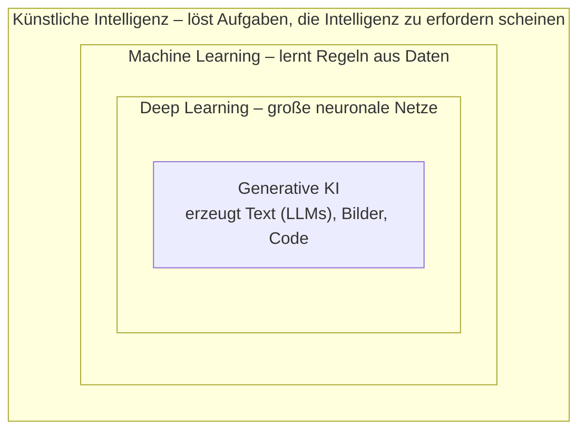

import Quiz from '@site/src/components/Quiz';
import fragen from './01-ki-grundlagen.fragen.yaml';

# Grundlagen von KI und Machine Learning

:::info[Lernziele]
Nach dieser Lektion kannst du …
- **KI**, **Machine Learning**, **Deep Learning** und **generative KI** einordnen,
- **überwachtes**, **unüberwachtes** und **bestärkendes Lernen** unterscheiden,
- erklären, warum **Trainings- und Testdaten** getrennt sein müssen und was **Overfitting** ist,
- eine **Konfusionsmatrix** lesen und **Genauigkeit**, **Präzision**, **Sensitivität** und **F1** berechnen,
- entscheiden, welche Metrik für eine Aufgabe zählt.
:::

## Begriffe \{#begriffe}



Der entscheidende Unterschied zur klassischen Programmierung:

| Klassische Software | Machine Learning |
|---|---|
| Mensch schreibt die **Regeln** (`if zwischensumme >= 100 …`) | System **lernt** die Regeln aus **Beispielen** |
| Eingabe + Regeln → Ergebnis | Eingaben + erwartete Ergebnisse → **Modell** (gelernte Regeln) |
| Verhalten ist im Code nachlesbar | Verhalten steckt in Millionen Zahlen (Gewichten) |
| Tests vergleichen mit exakten Erwartungen | Tests messen, **wie oft** das Modell richtig liegt |

Der letzte Punkt verändert das Testen grundlegend – mehr dazu in [KI-Systeme testen](./06-ki-systeme-testen.mdx).

## Lernarten \{#lernarten}

| Lernart | Daten | Beispiel |
|---|---|---|
| **Überwachtes Lernen** (supervised) | Beispiele **mit** richtiger Antwort (Label) | Bewertungen mit „positiv“/„negativ“ → Klassifikator; Hauspreise → Regression |
| **Unüberwachtes Lernen** (unsupervised) | Beispiele **ohne** Label | Kunden automatisch in Gruppen einteilen (Clustering), Auffälligkeiten in Logs finden |
| **Bestärkendes Lernen** (reinforcement) | **Belohnung** für gute Aktionen | Spiele, Robotersteuerung; auch beim Feintuning von Sprachmodellen (RLHF) |

Zwei typische Aufgaben des überwachten Lernens:
- **Klassifikation**: eine von mehreren Klassen vorhersagen (Spam/kein Spam, positiv/negativ).
- **Regression**: eine Zahl vorhersagen (Lieferzeit in Tagen, Umsatz).

## Ein echtes Beispiel \{#beispiel}

Damit die Begriffe greifbar werden, gibt es in [beispiele/ki](https://github.com/Smie89/lernplattform/tree/main/beispiele/ki) einen kleinen **Klassifikator für Kundenbewertungen** – in reinem Python, ohne Bibliotheken, rund 50 Zeilen. Er nutzt das Verfahren **Naive Bayes**: Beim Training zählt er, wie oft jedes Wort in positiven und negativen Bewertungen vorkommt, und berechnet daraus für einen neuen Text, welche Klasse wahrscheinlicher ist.

```python
modell = NaiveBayes().trainieren(TRAINING)            # 40 Bewertungen mit Label
modell.vorhersagen("Kopfhörer sind super und bequem")  # -> 'positiv'
```

```bash
cd beispiele/ki
python auswertung.py       # alle Zahlen unten stammen aus dieser Ausgabe
```

## Trainings- und Testdaten \{#daten}

Ein Modell muss auf **neuen** Daten funktionieren, nicht nur auf denen, die es schon kennt. Deshalb teilt man die Daten auf:

- **Trainingsdaten**: Daraus lernt das Modell.
- **Testdaten**: Damit wird es **danach** geprüft – sie dürfen beim Training **nie** verwendet werden.
- Oft zusätzlich **Validierungsdaten**, um Einstellungen (Hyperparameter) zu wählen, ohne die Testdaten „abzunutzen“.

Im Beispiel: 40 Trainings- und 16 Testbewertungen, jeweils zur Hälfte positiv und negativ. Ein Test stellt sicher, dass **kein** Testtext in den Trainingsdaten vorkommt.

:::danger[Datenleck]
Gelangen Testdaten ins Training (*data leakage*), sehen die Ergebnisse großartig aus – und das Modell versagt in der Praxis. Das ist eine der häufigsten Ursachen für zu optimistische KI-Bewertungen.
:::

## Overfitting \{#overfitting}

Die echten Ergebnisse des Beispiels:

| Daten | Genauigkeit |
|---|---|
| Trainingsdaten (40) | **100 %** |
| Testdaten (16, nie gesehen) | **94 %** |

Auf den Trainingsdaten ist das Modell perfekt – auf neuen Daten etwas schlechter. Eine kleine Lücke ist normal. Ist sie **groß** (z. B. 100 % gegenüber 60 %), hat das Modell die Trainingsbeispiele **auswendig gelernt**, statt allgemeine Muster zu erkennen: **Overfitting** (Überanpassung).

| | Ursache | Erkennbar an |
|---|---|---|
| **Overfitting** | Modell zu komplex, zu wenige oder zu einseitige Daten | sehr gut auf Training, deutlich schlechter auf Test |
| **Underfitting** | Modell zu einfach | schlecht auf Training **und** Test |

Darum zählt immer nur die Leistung auf **Testdaten**.

## Die Konfusionsmatrix \{#konfusionsmatrix}

Für Klassifikatoren zählt man, welche Arten von Treffern und Fehlern auftreten. Dafür legt man fest, welche Klasse man **finden** will – im Beispiel die **negativen** Bewertungen (unzufriedene Kunden sollen schnell erkannt werden).

Die echte Matrix auf den 16 Testdaten:

| | vorhergesagt: negativ | vorhergesagt: positiv |
|---|---|---|
| **tatsächlich negativ** | **TP = 8** (richtig erkannt) | **FN = 0** (übersehen) |
| **tatsächlich positiv** | **FP = 1** (Fehlalarm) | **TN = 7** (richtig als positiv) |

Der eine Fehlalarm: „Die Tasse ist hübsch, aber die Lieferung dauerte lange“ – im Datensatz als positiv markiert, vom Modell als negativ eingestuft. Ehrlich gesagt: Auch Menschen würden diese gemischte Bewertung unterschiedlich einordnen. **Die Qualität der Labels** begrenzt die Qualität des Modells.

## Metriken \{#metriken}

| Metrik | Formel | Frage | Beispiel |
|---|---|---|---|
| **Genauigkeit** (Accuracy) | (TP + TN) / alle | Wie viele Vorhersagen sind richtig? | 15 / 16 = **0,94** |
| **Präzision** (Precision) | TP / (TP + FP) | Wenn das Modell „negativ“ sagt – wie oft stimmt das? | 8 / 9 = **0,89** |
| **Sensitivität** (Recall) | TP / (TP + FN) | Wie viele der negativen Bewertungen werden gefunden? | 8 / 8 = **1,00** |
| **F1-Wert** | 2 · P · R / (P + R) | Kompromiss aus Präzision und Sensitivität | **0,94** |

:::warning[Genauigkeit kann täuschen]
Bei unausgewogenen Daten ist die Genauigkeit fast wertlos: Sind 99 % aller Transaktionen in Ordnung, erreicht ein Modell, das **immer** „kein Betrug“ sagt, 99 % Genauigkeit – und findet keinen einzigen Betrug (Sensitivität 0). Deshalb immer die Konfusionsmatrix und mehrere Metriken ansehen.
:::

**Welche Metrik zählt?** Das hängt von den **Kosten der Fehler** ab:

| Aufgabe | wichtiger | weil |
|---|---|---|
| Unzufriedene Kunden finden | **Sensitivität** | ein übersehener Kunde kostet mehr als eine unnötige Nachprüfung |
| Spamfilter | **Präzision** | eine wichtige Mail im Spam ist schlimmer als etwas Spam im Posteingang |
| Krebsfrüherkennung | **Sensitivität** | ein übersehener Befund ist fatal; Fehlalarme werden nachuntersucht |

Im Beispiel wurde deshalb als Qualitätsschwelle festgelegt: Sensitivität **≥ 0,90**, Genauigkeit **≥ 0,85** – beide als automatisierte Tests.

## Typische Fehler \{#typische-fehler}

- **Modell auf den Trainingsdaten bewerten** – die Ergebnisse sind viel zu gut.
- **Datenleck** zwischen Training und Test.
- **Nur auf Genauigkeit schauen** bei unausgewogenen Daten.
- **Labels nicht prüfen** – fehlerhafte oder mehrdeutige Labels begrenzen jedes Modell.
- **Zu wenige oder einseitige Daten** – das Modell lernt Zufälle und Vorurteile (siehe [Bias](./06-ki-systeme-testen.mdx#bias)).
- **„KI“ für alles** – eine einfache Regel (`>= 100 €`) ist oft besser, nachvollziehbarer und testbarer.

## Zusammenfassung \{#zusammenfassung}

- **KI ⊃ Machine Learning ⊃ Deep Learning ⊃ generative KI**; ML lernt Regeln aus Daten.
- **Überwacht** (mit Labels), **unüberwacht** (ohne), **bestärkend** (mit Belohnung).
- **Trainings- und Testdaten strikt trennen**; Leistung zählt nur auf unbekannten Daten.
- **Overfitting**: perfekt auf Training, schlechter auf Test – im Beispiel 100 % gegenüber 94 %.
- **Konfusionsmatrix** mit TP, FP, FN, TN; Metriken **Genauigkeit, Präzision, Sensitivität, F1** – welche zählt, hängt von den Kosten der Fehler ab.

<Quiz fragen={fragen} titel="Quiz: Grundlagen von KI und Machine Learning" />
