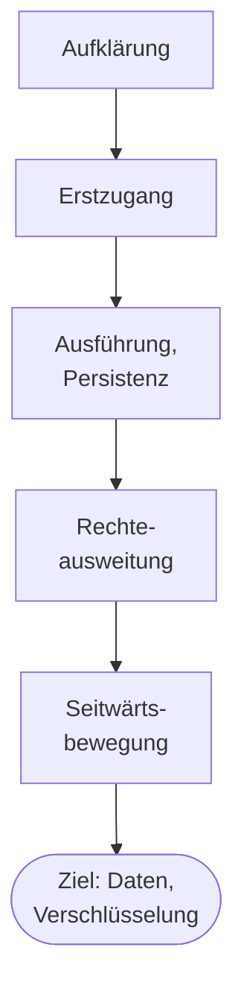

import Quiz from '@site/src/components/Quiz';
import fragen from './01-security-grundlagen.fragen.yaml';

# Grundlagen der Informationssicherheit

:::info[Lernziele]
Nach dieser Lektion kannst du …
- die **Schutzziele** Vertraulichkeit, Integrität und Verfügbarkeit erklären und Angriffen zuordnen,
- **Schwachstelle, Bedrohung, Risiko und Exploit** unterscheiden,
- einen **CVE-Eintrag** mit **CVSS**-Bewertung lesen und einordnen,
- beschreiben, wie Angreifer typischerweise **vorgehen**,
- die **Sicherheitsprinzipien** Defense in Depth, Least Privilege und Zero Trust anwenden.
:::

## Die Schutzziele (CIA) \{#schutzziele}

Informationssicherheit schützt drei Eigenschaften – im Englischen **CIA-Triade**:

| Schutzziel | Bedeutung | Angriff darauf (Beispiel) |
|---|---|---|
| **Vertraulichkeit** (Confidentiality) | Nur Berechtigte können Daten lesen | Datenleck, abgefangene Passwörter, fremde Bestellung einsehen |
| **Integrität** (Integrity) | Daten werden nicht unbemerkt verändert | Preis im Warenkorb manipulieren, Überweisung umleiten |
| **Verfügbarkeit** (Availability) | System und Daten sind nutzbar, wenn sie gebraucht werden | DDoS-Angriff, Ransomware verschlüsselt alle Server |

Oft kommen hinzu: **Authentizität** (Daten stammen wirklich vom angegebenen Absender) und **Nichtabstreitbarkeit**
(jemand kann eine Handlung später nicht leugnen – z. B. durch eine digitale Signatur).

:::tip[Denken wie beim Testen]
Für jede Funktion lohnen sich drei Fragen: *Wer darf das lesen? Wer darf das ändern? Was passiert, wenn es ausfällt?*
Daraus entstehen ganz natürlich Sicherheitstestfälle – genau wie Grenzwerte beim Black-Box-Test.
:::

## Die wichtigsten Begriffe \{#begriffe}

| Begriff | Bedeutung | Beispiel |
|---|---|---|
| **Asset** (Schutzobjekt) | Etwas mit Wert | Kundendaten, Quellcode, Verfügbarkeit des Shops |
| **Schwachstelle** (Vulnerability) | Fehler, der ausgenutzt werden kann | SQL-Abfrage aus verketteten Strings |
| **Bedrohung** (Threat) | Mögliche Ursache eines Schadens | Kriminelle, die Kundendaten verkaufen wollen |
| **Exploit** | Konkretes Vorgehen oder Code, der eine Schwachstelle ausnutzt | die Eingabe `admin' --` im Anmeldefeld |
| **Risiko** | Eintrittswahrscheinlichkeit × Schadenshöhe | hoch: öffentlich erreichbar, einfach auszunutzen, alle Kundendaten betroffen |
| **Zero-Day** | Schwachstelle, für die es noch keinen Patch gibt | wird schon ausgenutzt, bevor der Hersteller davon weiß |
| **Angriffsfläche** | Alle Stellen, an denen ein Angreifer ansetzen kann | offene Ports, Eingabefelder, APIs, Abhängigkeiten, Mitarbeitende |

Ohne Schwachstelle kein Risiko durch diese Bedrohung – aber auch eine Schwachstelle ohne realistische Bedrohung (z. B.
in einem Programm, das nie mit fremden Eingaben in Berührung kommt) hat ein geringes Risiko. Deshalb wird in der Praxis
**nach Risiko priorisiert**, wie beim [risikobasierten Testen](../01-softwaretest/06-testmanagement.mdx#risikobasiert).

## CVE, CWE und CVSS \{#cve-cvss}

Bekannte Schwachstellen werden weltweit einheitlich erfasst:

- **CVE** (Common Vulnerabilities and Exposures): eine eindeutige Nummer für **eine konkrete Schwachstelle in einem
  konkreten Produkt**, z. B. `CVE-2021-44228` („Log4Shell“ in der Java-Bibliothek Log4j 2).
- **CWE** (Common Weakness Enumeration): die **Art** des Fehlers, unabhängig vom Produkt, z. B. `CWE-89` SQL-Injection,
  `CWE-79` Cross-Site-Scripting. Werkzeuge wie Bandit geben CWE-Nummern mit aus.
- **CVSS** (Common Vulnerability Scoring System): eine Bewertung von **0,0 bis 10,0** für den Schweregrad.

| CVSS | Einstufung |
|---|---|
| 0,1 – 3,9 | niedrig |
| 4,0 – 6,9 | mittel |
| 7,0 – 8,9 | hoch |
| 9,0 – 10,0 | kritisch |

Der CVSS-Wert setzt sich aus Kriterien zusammen wie: Ist der Angriff **über das Netzwerk** möglich? Braucht der Angreifer
**Zugangsdaten** oder die **Mithilfe eines Nutzers**? Welche **Schutzziele** sind betroffen? Log4Shell hat 10,0:
über das Netz ausnutzbar, ohne Anmeldung, ohne Nutzerinteraktion, vollständige Übernahme des Servers.

:::warning[CVSS ist nicht das ganze Risiko]
CVSS bewertet die Schwachstelle **allgemein**. Ob sie bei *dir* kritisch ist, hängt vom Einsatz ab: Eine 9,8 in einer
Bibliothek, deren betroffene Funktion du nie aufrufst, ist weniger dringend als eine 7,5 im öffentlich erreichbaren Login.
Ergänzend helfen der **EPSS**-Wert (Wahrscheinlichkeit einer Ausnutzung) und der **KEV**-Katalog der US-Behörde CISA
(Schwachstellen, die nachweislich aktiv ausgenutzt werden).
:::

## Wer greift an – und wie? \{#angreifer}

| Angreifer | Motiv | typisches Vorgehen |
|---|---|---|
| **Organisierte Kriminelle** | Geld | Ransomware, Datendiebstahl mit Erpressung, Betrug |
| **Staatliche Akteure** | Spionage, Sabotage | lang andauernde, gut getarnte Angriffe (APT) |
| **Innentäter** | Rache, Geld, Fahrlässigkeit | Missbrauch vorhandener Rechte |
| **Hacktivisten** | politische Botschaft | DDoS, Veröffentlichung von Daten |
| **Gelegenheitsangreifer** | Neugier, Anerkennung | automatisierte Scans nach bekannten Lücken |

Die meisten Angriffe sind **nicht gezielt**: Bots durchsuchen das gesamte Internet nach offenen Diensten und bekannten
Schwachstellen. Ein neuer Server mit SSH-Zugang sieht oft schon nach Minuten die ersten Anmeldeversuche – das
[Beispiel-Log](https://github.com/Smie89/lernplattform/blob/main/beispiele/security/auth.log) zeigt genau das.

### Der Ablauf eines Angriffs \{#angriffsablauf}

Das Framework **MITRE ATT&CK** beschreibt reale Angriffstechniken, gegliedert nach Zielen (Taktiken). Vereinfacht:

1. **Aufklärung** – Mitarbeitende, Domains, offene Dienste, verwendete Software herausfinden
2. **Erstzugang** – Phishing-Mail, gestohlene Zugangsdaten, ungepatchte Schwachstelle in einem öffentlichen Dienst
3. **Ausführung und Persistenz** – Schadcode starten und sich dauerhaft einnisten
4. **Rechteausweitung** – vom normalen Benutzer zum Administrator
5. **Seitwärtsbewegung** (Lateral Movement) – von einem Rechner zum nächsten
6. **Ziel** – Daten abziehen (Exfiltration), verschlüsseln (Ransomware), sabotieren

Für Verteidiger heißt das: **Jede Stufe ist eine Chance**, den Angriff zu verhindern oder zu bemerken. Wer nur den
Erstzugang absichert, hat verloren, sobald eine einzige Phishing-Mail funktioniert.

## Social Engineering \{#social-engineering}

Der Mensch ist oft der einfachste Weg hinein. **Social Engineering** nutzt Hilfsbereitschaft, Respekt vor Autorität,
Neugier oder Zeitdruck aus:

- **Phishing**: gefälschte Mails mit Link auf eine nachgebaute Anmeldeseite oder mit schädlichem Anhang
- **Spear-Phishing**: gezielt auf eine Person zugeschnitten, mit echten Details aus sozialen Netzwerken
- **CEO-Betrug**: angebliche Anweisung der Geschäftsführung zu einer eiligen Überweisung
- **Vishing**: Anruf vom angeblichen IT-Support, der „kurz das Passwort braucht“

Typische Warnzeichen: **Dringlichkeit**, ungewöhnliche Absenderadresse, Link-Ziel passt nicht zum Text, Bitte um
Zugangsdaten oder Zahlung. Technische Gegenmaßnahmen sind **phishing-resistente Anmeldung** (FIDO2/Passkeys, siehe
[Authentifizierung](./03-authentifizierung-kryptografie.mdx#mfa)), Mail-Filter und ein **einfacher Meldeweg** – wer eine
verdächtige Mail ohne Angst vor Ärger melden kann, warnt alle anderen rechtzeitig.

## Sicherheitsprinzipien \{#prinzipien}

| Prinzip | Bedeutung | Beispiel |
|---|---|---|
| **Defense in Depth** | Mehrere unabhängige Schutzschichten | Eingaben validieren **und** parametrisierte Abfragen **und** Datenbankbenutzer mit minimalen Rechten |
| **Least Privilege** | Nur die Rechte, die wirklich nötig sind | Webanwendung darf Bestellungen lesen, aber keine Tabellen löschen; Container läuft nicht als root |
| **Secure by Default** | Die Standardeinstellung ist sicher | Neue Benutzer haben keine Rechte, bis sie vergeben werden; Debug-Modus ist aus |
| **Angriffsfläche minimieren** | Was nicht da ist, kann nicht angegriffen werden | ungenutzte Ports schließen, Testendpunkte nicht ausliefern |
| **Zero Trust** | Kein Vertrauen allein aufgrund der Netzwerkposition | Auch Dienste im internen Netz müssen sich authentifizieren |
| **Fail Secure** | Im Fehlerfall sicher reagieren | Kann die Rechteprüfung nicht laufen, wird der Zugriff **verweigert**, nicht erlaubt |
| **Keine Sicherheit durch Verschleierung** | Geheimhaltung des Verfahrens ist kein Schutz | Ein „versteckter“ Admin-Pfad ersetzt keine Anmeldung |

:::note[Sicherheit und Testen gehören zusammen]
Viele Prinzipien sind direkt testbar: „Ein Benutzer ohne Rolle darf nichts“ (Secure by Default), „bei einem Fehler der
Rechteprüfung kommt 403, nicht 200“ (Fail Secure). In
[Sicherheitstests und DevSecOps](./04-sicherheitstests-devsecops.mdx#regressionstests) werden genau solche Tests automatisiert.
:::

## Typische Fehler \{#typische-fehler}

- **„Uns greift doch niemand an“** – automatisierte Scans treffen jeden, der im Internet erreichbar ist.
- **Nur auf CVSS schauen** und den eigenen Einsatzkontext ignorieren.
- **Eine einzige Schutzschicht** (z. B. nur die Firewall) statt Defense in Depth.
- **Zu viele Rechte** „damit es erst mal läuft“ – und dann bleibt es so.
- **Verdächtige Mails nicht melden**, weil man sich für einen Klick schämt.

## Zusammenfassung \{#zusammenfassung}

- Schutzziele: **Vertraulichkeit, Integrität, Verfügbarkeit** (plus Authentizität).
- **Risiko** = Wahrscheinlichkeit × Schaden; Schwachstellen werden nach Risiko priorisiert.
- **CVE** benennt eine konkrete Schwachstelle, **CWE** die Fehlerart, **CVSS** bewertet den Schweregrad von 0 bis 10.
- Angriffe verlaufen in **Stufen** (MITRE ATT&CK) – jede Stufe ist eine Chance für die Verteidigung.
- **Social Engineering** greift den Menschen an; Gegenmittel sind phishing-resistente Anmeldung und eine offene Meldekultur.
- Prinzipien: **Defense in Depth, Least Privilege, Secure by Default, Zero Trust, Fail Secure**.

<Quiz fragen={fragen} titel="Quiz: Grundlagen der Informationssicherheit" />
