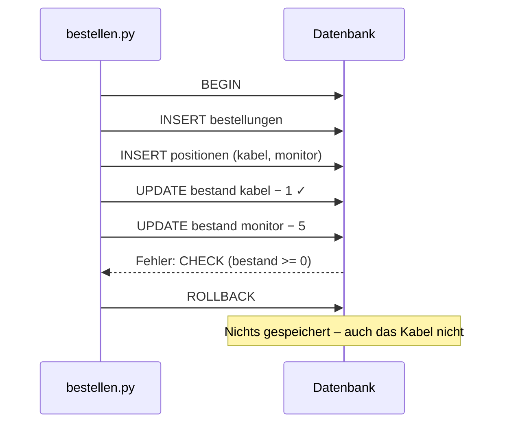

import Quiz from '@site/src/components/Quiz';
import Tabs from '@theme/Tabs';
import TabItem from '@theme/TabItem';
import fragen from './03-daten-aendern-transaktionen.fragen.yaml';

# Daten ändern, Constraints und Transaktionen

:::info[Lernziele]
Nach dieser Lektion kannst du …
- Daten mit **INSERT, UPDATE, DELETE** sicher ändern,
- erklären, wie **Constraints** die Datenqualität schützen, und sie testen,
- **Transaktionen** und die **ACID**-Eigenschaften an einem Beispiel erklären,
- typische Probleme bei **gleichzeitigen Zugriffen** benennen,
- einschätzen, wann ein **Index** hilft, und es mit einem Ausführungsplan prüfen.
:::

## INSERT, UPDATE, DELETE \{#aendern}

```sql
INSERT INTO kunden (name, email, stammkunde) VALUES ('Eva Lang', 'eva@example.org', 0);

UPDATE produkte SET preis = 44.90 WHERE id = 'buch';

DELETE FROM bestellungen WHERE status = 'storniert' AND datum < '2026-01-01';
```

:::danger[UPDATE und DELETE ohne WHERE treffen alles]
`UPDATE produkte SET preis = 1` ändert **jedes** Produkt – der Test `test_update_ohne_where_trifft_alle_zeilen` zeigt es:
fünf Zeilen geändert. Bewährte Gewohnheiten:
1. Erst die Bedingung als `SELECT` ausführen und prüfen, **welche** Zeilen betroffen sind.
2. Die Anzahl betroffener Zeilen prüfen, die jedes Datenbankwerkzeug meldet.
3. Auf wichtigen Systemen in einer Transaktion arbeiten und erst nach Kontrolle `COMMIT` ausführen.
:::

## Constraints: Regeln in der Datenbank \{#constraints}

Constraints sorgen dafür, dass ungültige Daten gar nicht erst gespeichert werden – egal, welches Programm schreibt:

```sql title="schema.sql (Auszug)"
CREATE TABLE produkte (
    id      TEXT    PRIMARY KEY,
    name    TEXT    NOT NULL,
    preis   NUMERIC NOT NULL CHECK (preis > 0),
    bestand INTEGER NOT NULL DEFAULT 0 CHECK (bestand >= 0)
);
CREATE TABLE kunden (
    id    INTEGER PRIMARY KEY,
    email TEXT NOT NULL UNIQUE
);
CREATE TABLE bestellungen (
    kunde_id INTEGER NOT NULL REFERENCES kunden (id),
    status   TEXT NOT NULL CHECK (status IN ('offen', 'bezahlt', 'versendet', 'storniert'))
);
```

| Constraint | verhindert |
|---|---|
| `PRIMARY KEY` | doppelte oder fehlende Schlüssel |
| `NOT NULL` | fehlende Pflichtwerte |
| `UNIQUE` | doppelte Werte, z. B. zwei Konten mit derselben E-Mail |
| `CHECK` | unzulässige Werte, z. B. Preis 0 oder unbekannter Status |
| `FOREIGN KEY` (`REFERENCES`) | Verweise ins Leere, z. B. Bestellung eines nicht existierenden Kunden |

Constraints sind gut testbar – jeder Test versucht, ungültige Daten zu speichern, und erwartet einen Fehler:

```python title="test_datenbank.py"
def test_email_muss_eindeutig_sein(self):
    with self.assertRaises(sqlite3.IntegrityError):
        self.db.execute("INSERT INTO kunden (name, email) VALUES ('Anna Zwei', 'anna@example.org')")
```

:::note[SQLite und Fremdschlüssel]
SQLite prüft Fremdschlüssel nur mit `PRAGMA foreign_keys = ON` – deshalb setzt
[datenbank.py](https://github.com/Smie89/lernplattform/blob/main/beispiele/datenbank/datenbank.py) das bei jeder Verbindung.
Andere Datenbanken prüfen sie immer.
:::

## Transaktionen \{#transaktionen}

Eine Bestellung besteht aus mehreren Schritten: Bestellung anlegen, Positionen speichern, Bestand reduzieren. Scheitert der
dritte Schritt, darf keine halbe Bestellung übrig bleiben. Eine **Transaktion** fasst Schritte zusammen: **alles oder nichts**.

```python title="bestellen.py"
with db:  # Transaktion: COMMIT bei Erfolg, ROLLBACK bei jeder Exception
    cursor = db.execute("INSERT INTO bestellungen (kunde_id, datum, status) VALUES (?, ?, 'offen')", (kunde_id, datum))
    bestellung_id = cursor.lastrowid
    for produkt_id, menge in positionen:
        ...
        db.execute("INSERT INTO positionen (...) VALUES (?, ?, ?, ?)", (...))
        # CHECK (bestand >= 0) schlägt fehl, wenn nicht genug da ist
        db.execute("UPDATE produkte SET bestand = bestand - ? WHERE id = ?", (menge, produkt_id))
```

Der Test bestellt ein Kabel und fünf Monitore – es sind aber nur vier da. Der CHECK-Constraint schlägt fehl, und **alles**
wird zurückgerollt, auch das Kabel:

```python title="test_datenbank.py"
def test_zu_wenig_bestand_rollt_alles_zurueck(self):
    with self.assertRaises(BestellFehler):
        bestellung_anlegen(self.db, 2, [("kabel", 1), ("monitor", 5)])  # nur 4 Monitore da
    self.assertEqual(self.wert("SELECT bestand FROM produkte WHERE id = 'kabel'"), 100)
    self.assertEqual(self.wert("SELECT bestand FROM produkte WHERE id = 'monitor'"), 4)
```

<Tabs groupId="sprache">
<TabItem value="csharp" label="C#">

```csharp
await using var transaktion = await verbindung.BeginTransactionAsync();
try
{
    // ... mehrere Befehle mit command.Transaction = transaktion ...
    await transaktion.CommitAsync();
}
catch
{
    await transaktion.RollbackAsync();
    throw;
}
```

</TabItem>
<TabItem value="java" label="Java">

```java
verbindung.setAutoCommit(false);
try {
    // ... mehrere PreparedStatements ...
    verbindung.commit();
} catch (SQLException e) {
    verbindung.rollback();
    throw e;
}
```

</TabItem>
</Tabs>



### ACID \{#acid}

| Eigenschaft | Bedeutung | im Beispiel |
|---|---|---|
| **A**tomicity (Atomarität) | alles oder nichts | keine Bestellung ohne Positionen |
| **C**onsistency (Konsistenz) | danach gelten wieder alle Regeln | kein negativer Bestand |
| **I**solation | parallele Transaktionen stören sich nicht | zwei Kunden kaufen gleichzeitig den letzten Monitor |
| **D**urability (Dauerhaftigkeit) | nach dem COMMIT bleiben die Daten erhalten | auch nach einem Stromausfall |

### Gleichzeitige Zugriffe \{#isolation}

Laufen Transaktionen parallel, können ohne ausreichende Isolation typische Probleme auftreten:

| Problem | Beispiel |
|---|---|
| **Lost Update** | zwei Käufe lesen Bestand 4, beide schreiben 3 – ein Verkauf geht verloren |
| **Dirty Read** | eine Transaktion liest Daten, die später zurückgerollt werden |
| **Non-repeatable Read** | dieselbe Abfrage liefert innerhalb einer Transaktion zweimal verschiedene Werte |

Datenbanken bieten dafür **Isolationsstufen** (z. B. Read Committed, Repeatable Read, Serializable) und Sperren. Das
Beispiel nutzt einen eleganten Trick gegen Lost Updates: `SET bestand = bestand - ?` rechnet **in der Datenbank** statt
„lesen, im Programm rechnen, zurückschreiben“. Dieselbe Fehlerklasse – Prüfen und Handeln nicht atomar – steckte übrigens
hinter dem [Fehler SHOP-1](../01-softwaretest/07-fehlermanagement-agil.mdx#lebenszyklus) im Mini-Shop.

## Indizes \{#index}

Ohne Index muss die Datenbank für `WHERE kunde_id = 1` **jede Zeile** ansehen. Ein Index funktioniert wie das Register eines
Buchs. Ob er genutzt wird, zeigt der **Ausführungsplan**:

```sql
EXPLAIN QUERY PLAN SELECT * FROM bestellungen WHERE kunde_id = 1;
-- SEARCH bestellungen USING INDEX idx_bestellungen_kunde (kunde_id=?)

EXPLAIN QUERY PLAN SELECT * FROM bestellungen WHERE datum = '2026-11-02';
-- SCAN bestellungen          ← kompletter Durchlauf, kein Index auf datum
```

(PostgreSQL und MySQL: `EXPLAIN`, SQL Server: „Tatsächlichen Ausführungsplan einschließen“.)

| Index lohnt sich | Index kostet |
|---|---|
| Spalten in häufigen `WHERE`-, `JOIN`- und `ORDER BY`-Bedingungen | Speicher |
| Fremdschlüssel | langsameres INSERT/UPDATE, weil der Index mitgepflegt wird |
| große Tabellen | bei sehr kleinen Tabellen kaum Nutzen |

Für Tester relevant: Mit **wenigen Testdaten** sind auch Abfragen ohne Index schnell. Performanceprobleme zeigen sich oft
erst mit realistischen Datenmengen – ein Grund für [Lasttests](../02-testautomation/06-performance/01-performance-grundlagen.mdx)
mit produktionsähnlichen Daten.

## Typische Fehler \{#typische-fehler}

- **UPDATE oder DELETE ohne WHERE**.
- Regeln nur im Programm prüfen, **nicht in der Datenbank** – ein zweites Programm oder ein Skript umgeht sie.
- Zusammengehörige Änderungen **ohne Transaktion**.
- „Lesen, im Programm ändern, zurückschreiben“ bei gleichzeitigen Zugriffen (**Lost Update**).
- Performance nur mit **wenigen Testdaten** beurteilen.

## Zusammenfassung \{#zusammenfassung}

- Vor `UPDATE`/`DELETE` die Bedingung als `SELECT` prüfen; ohne `WHERE` trifft es alle Zeilen.
- **Constraints** (NOT NULL, UNIQUE, CHECK, Fremdschlüssel) schützen die Datenqualität und sind gut testbar.
- **Transaktionen**: alles oder nichts – **ACID**.
- Parallele Zugriffe: Lost Update, Dirty Read; Gegenmittel sind Isolationsstufen, Sperren und Rechnen in der Datenbank.
- **Indizes** beschleunigen Suchen; `EXPLAIN` zeigt, ob sie genutzt werden.

<Quiz fragen={fragen} titel="Quiz: Daten ändern, Constraints und Transaktionen" />
