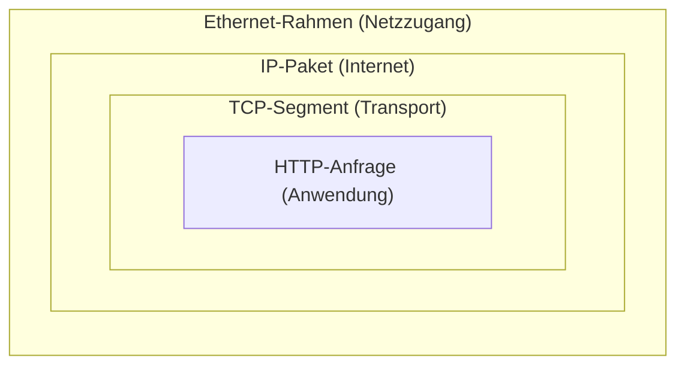

import Quiz from '@site/src/components/Quiz';
import fragen from './01-schichten-ip-subnetze.fragen.yaml';

# Schichtenmodell, IP-Adressen und Subnetze

:::info[Lernziele]
Nach dieser Lektion kannst du …
- das **OSI-** und das **TCP/IP-Modell** erklären und Protokolle zuordnen,
- **IPv4-Adressen**, **Subnetzmasken** und die **CIDR-Schreibweise** lesen und Netze berechnen,
- **private** und **öffentliche** Adressen unterscheiden und **NAT** erklären,
- verstehen, wie ein Paket über **Gateway und Router** sein Ziel findet.
:::

## Schichtenmodelle \{#schichten}

Netzwerkkommunikation ist in **Schichten** aufgeteilt. Jede Schicht löst eine Aufgabe und nutzt die Schicht darunter. Das
**TCP/IP-Modell** beschreibt das Internet, das **OSI-Modell** ist feiner und wird vor allem für Begriffe genutzt
(„ein Layer-7-Problem“):

| OSI-Schicht | TCP/IP-Modell | Aufgabe | Beispiele |
|---|---|---|---|
| 7 Anwendung | **Anwendung** | Daten der Anwendung | HTTP, DNS, SSH, SMTP |
| 6 Darstellung | | Kodierung, Verschlüsselung | TLS (wird oft hier eingeordnet) |
| 5 Sitzung | | Sitzungen | |
| 4 Transport | **Transport** | Verbindung zwischen **Programmen** (Ports) | **TCP**, **UDP** |
| 3 Vermittlung | **Internet** | Weg zwischen **Rechnern** über Netze hinweg | **IP**, ICMP (ping) |
| 2 Sicherung | **Netzzugang** | Übertragung im **lokalen Netz** | Ethernet, WLAN, MAC-Adressen |
| 1 Bitübertragung | | Signale auf dem Kabel bzw. per Funk | Kabel, Funk |

Beim Senden packt jede Schicht die Daten der Schicht darüber ein (**Kapselung**): Die HTTP-Anfrage steckt in einem
TCP-Segment, das in einem IP-Paket, das in einem Ethernet-Rahmen. Der Empfänger packt in umgekehrter Reihenfolge aus.

:::tip[Schichten helfen bei der Fehlersuche]
Fehler systematisch von unten nach oben eingrenzen – genau wie in der Linux-Lektion
[Netzwerk: Schritt für Schritt](../04-linux/05-pakete-netzwerk-ssh.mdx#netzwerk): Hat der Rechner eine Adresse (3)? Ist der
Port offen (4)? Antwortet die Anwendung richtig (7)?
:::



So sieht die Kapselung aus: Jede Schicht verpackt die Daten der Schicht darüber.

## IPv4-Adressen und Subnetze \{#ipv4}

Eine IPv4-Adresse besteht aus **32 Bit**, geschrieben als vier Zahlen von 0 bis 255: `192.168.10.37`. Sie hat zwei Teile:
den **Netzanteil** (welches Netz?) und den **Hostanteil** (welcher Rechner darin?). Wo die Grenze liegt, sagt die
**Subnetzmaske** oder kürzer das **Präfix** in CIDR-Schreibweise:

```text
Adresse    192.168.10.37    11000000.10101000.00001010.00 100101
Maske /26  255.255.255.192  11111111.11111111.11111111.11 000000
                            ←────────── 26 Bit Netz ─────→ ←6 Bit Host→
```

Das Beispielprojekt rechnet das aus:

```bash
python subnetz.py 192.168.10.37/26
```

```text
adresse       192.168.10.37
netz          192.168.10.0/26
maske         255.255.255.192
broadcast     192.168.10.63
erster_host   192.168.10.1
letzter_host  192.168.10.62
anzahl_hosts  62
privat        True
```

Mit 6 Hostbits gibt es 2⁶ = 64 Adressen. Die erste (`.0`) bezeichnet das **Netz**, die letzte (`.63`) ist die
**Broadcast**-Adresse an alle – bleiben **62 nutzbare Hosts**.

| Präfix | Maske | Adressen | nutzbare Hosts |
|---|---|---|---|
| /24 | 255.255.255.0 | 256 | 254 |
| /26 | 255.255.255.192 | 64 | 62 |
| /28 | 255.255.255.240 | 16 | 14 |
| /30 | 255.255.255.252 | 4 | 2 |
| /16 | 255.255.0.0 | 65 536 | 65 534 |

Zwei Rechner können nur **direkt** miteinander sprechen, wenn sie im **selben Netz** liegen. `192.168.10.37` und
`192.168.10.70` liegen bei /24 im selben Netz – bei /26 nicht (`.0–.63` und `.64–.127`):

```python title="test_netzwerk.py"
def test_gleiches_netz_haengt_vom_praefix_ab(self):
    self.assertTrue(im_selben_netz("192.168.10.37", "192.168.10.70", 24))
    self.assertFalse(im_selben_netz("192.168.10.37", "192.168.10.70", 26))
```

Eine falsche Subnetzmaske ist deshalb ein Klassiker: Die Testumgebung „ist da“, aber nicht erreichbar.

## Private Adressen und NAT \{#privat-nat}

Für interne Netze sind drei Bereiche reserviert, die im Internet nicht geroutet werden:

| Bereich | CIDR | typisch für |
|---|---|---|
| 10.0.0.0 – 10.255.255.255 | 10.0.0.0/8 | Firmennetze, Cloud-Netze |
| 172.16.0.0 – 172.31.255.255 | 172.16.0.0/12 | Firmennetze, **Docker** |
| 192.168.0.0 – 192.168.255.255 | 192.168.0.0/16 | Heimnetze |

Dazu kommen Sonderadressen: `127.0.0.1` (**localhost**, der eigene Rechner), `0.0.0.0` (beim Lauschen: alle Schnittstellen)
und `169.254.x.x` (automatisch vergeben, wenn kein DHCP-Server antwortet – fast immer ein Fehlerzeichen).

Damit Rechner mit privaten Adressen ins Internet kommen, ersetzt der Router beim Verlassen des Netzes die Absenderadresse
durch seine öffentliche (**NAT**, Network Address Translation). Von außen sind die internen Rechner deshalb nicht direkt
erreichbar – es sei denn, man richtet eine **Portweiterleitung** ein. Bei Docker passiert mit `-p 8080:80` im Kleinen dasselbe.

## Gateway und Routing \{#routing}

Liegt das Ziel **außerhalb** des eigenen Netzes, schickt der Rechner das Paket an sein **Standard-Gateway** (den Router).
Router reichen es anhand ihrer **Routingtabellen** weiter, bis es ankommt. Jeder Zwischenschritt heißt **Hop**.

```bash
ip route                     # Linux: Routingtabelle, "default via 192.168.1.1" ist das Gateway
traceroute example.org       # Weg zum Ziel Hop für Hop (Windows: tracert)
```

## MAC-Adressen und ARP \{#mac-arp}

Innerhalb des lokalen Netzes adressiert Ethernet die Netzwerkkarten über **MAC-Adressen** (z. B. `3c:52:82:1a:9f:04`). Um
zu einer IP-Adresse im eigenen Netz die MAC-Adresse zu finden, fragt der Rechner per **ARP** in die Runde: „Wer hat
192.168.10.1?“ MAC-Adressen verlassen das lokale Netz nie – hinter jedem Router zählen nur noch IP-Adressen.

## IPv6 \{#ipv6}

IPv4 hat nur rund 4,3 Milliarden Adressen – zu wenig. **IPv6** nutzt **128 Bit**, geschrieben in acht Hexadezimalgruppen:

```text
2001:0db8:0000:0000:0000:ff00:0042:8329
2001:db8::ff00:42:8329         ← führende Nullen weglassen, eine Nullfolge durch :: ersetzen
::1                            ← localhost
```

Für Tests relevant: `localhost` kann zu `127.0.0.1` **oder** `::1` aufgelöst werden. Lauscht ein Dienst nur auf IPv4,
während der Client zuerst IPv6 versucht, entstehen verwirrende Verbindungsfehler – ein häufiger Grund, in Tests
ausdrücklich `127.0.0.1` zu verwenden.

## Typische Fehler \{#typische-fehler}

- **Falsche Subnetzmaske** – Rechner glauben, sie seien im selben Netz, oder eben nicht.
- **Adresse 169.254.x.x** übersehen – der Rechner hat keine Adresse per DHCP bekommen.
- Annehmen, interne Rechner seien **von außen** erreichbar (NAT).
- **localhost** mit IPv6 (`::1`) gegen einen Dienst, der nur auf IPv4 lauscht.
- Mit Subnetzen in großen Netzen **alle Adressen aufzählen** statt rechnen – im Beispielprojekt dauerte ein Test mit einem
  /8-Netz dadurch Sekunden, bis die Funktion umgestellt wurde.

## Zusammenfassung \{#zusammenfassung}

- Schichten: **Netzzugang** (Ethernet, MAC), **Internet** (IP), **Transport** (TCP/UDP, Ports), **Anwendung** (HTTP, DNS).
- Eine IPv4-Adresse hat **Netz-** und **Hostanteil**; das **Präfix** (/26) bestimmt die Grenze. Hosts = 2^(32 − Präfix) − 2.
- **Private** Bereiche: 10/8, 172.16/12, 192.168/16; **NAT** übersetzt sie ins Internet.
- Ziele außerhalb des Netzes gehen über das **Gateway**; Router leiten über Routingtabellen weiter.
- **IPv6** hat 128 Bit; `localhost` kann `127.0.0.1` oder `::1` sein.

<Quiz fragen={fragen} titel="Quiz: Schichtenmodell, IP-Adressen und Subnetze" />
