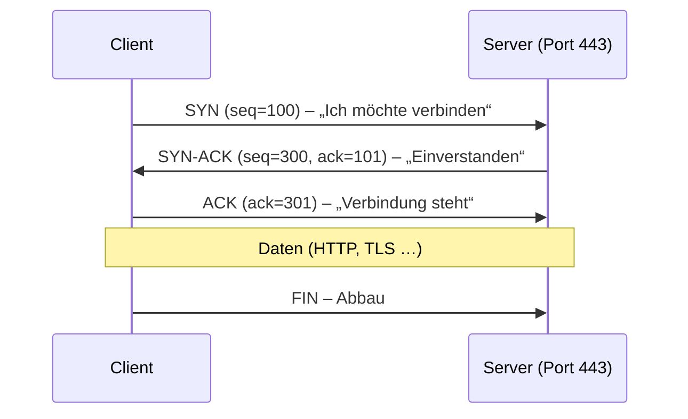

import Quiz from '@site/src/components/Quiz';
import fragen from './02-tcp-udp-ports.fragen.yaml';

# TCP, UDP und Ports

:::info[Lernziele]
Nach dieser Lektion kannst du …
- den **TCP-Handshake** und die Zuverlässigkeit von TCP erklären,
- **TCP und UDP** vergleichen und Anwendungen zuordnen,
- **Ports** und **Sockets** erklären,
- Verbindungsfehler wie **„Connection refused“** und **„Timeout“** richtig deuten,
- **Timeouts** in Tests sinnvoll setzen.
:::

## Ports \{#ports}

Eine IP-Adresse führt zu einem **Rechner**, ein **Port** (0–65535) zu einem **Programm** darauf. Eine Verbindung ist
eindeutig durch das Paar **Quell-IP:Quellport → Ziel-IP:Zielport** bestimmt.

| Bereich | Bedeutung | Beispiele |
|---|---|---|
| 0–1023 | **Well-known Ports**, unter Linux nur mit Administratorrechten belegbar | 22 SSH, 53 DNS, 80 HTTP, 443 HTTPS |
| 1024–49151 | registrierte Ports | 3306 MySQL, 5432 PostgreSQL, 5000/8080 oft Entwicklungsserver |
| 49152–65535 | dynamische Ports, z. B. die **Quellports** von Clients | zufällig vom Betriebssystem vergeben |

Ein **Socket** ist der Endpunkt einer Verbindung im Programm – die Kombination aus IP-Adresse, Port und Protokoll.
Wer „auf Port 5000 lauscht“, hat einen Socket an diesen Port gebunden.

## TCP: zuverlässig und geordnet \{#tcp}

TCP baut zuerst eine **Verbindung** auf – den **Drei-Wege-Handshake**:



Danach sorgt TCP dafür, dass Daten **vollständig, in der richtigen Reihenfolge und ohne Duplikate** ankommen:

- Jedes Byte hat eine **Sequenznummer**; der Empfänger bestätigt den Empfang (**ACK**).
- Fehlt eine Bestätigung, wird **neu übertragen**.
- **Flusskontrolle** und **Staukontrolle** verhindern, dass Empfänger oder Netz überlastet werden.

Das kostet Zeit: Vor dem ersten Byte Daten vergeht eine volle Hin-und-Rück-Zeit (bei HTTPS kommt der TLS-Handshake dazu).
Deshalb halten Clients Verbindungen offen und verwenden sie wieder (**Keep-Alive**, **Verbindungspools**).

## UDP: schnell und einfach \{#udp}

UDP schickt einzelne **Datagramme** ohne Verbindungsaufbau, ohne Bestätigung, ohne Reihenfolge:

```python title="test_netzwerk.py"
def test_udp_braucht_keine_verbindung(self):
    with socket.socket(socket.AF_INET, socket.SOCK_DGRAM) as empfaenger, \
            socket.socket(socket.AF_INET, socket.SOCK_DGRAM) as sender:
        empfaenger.bind(("127.0.0.1", 0))
        empfaenger.settimeout(2)
        sender.sendto(b"hallo", empfaenger.getsockname())   # kein Handshake, einfach losschicken
        daten, _ = empfaenger.recvfrom(1024)
    self.assertEqual(daten, b"hallo")
```

| | TCP | UDP |
|---|---|---|
| Verbindung | ja, mit Handshake | nein |
| Zuverlässigkeit | Bestätigung, Neuübertragung, Reihenfolge | keine – Pakete können fehlen oder vertauscht sein |
| Overhead | höher | gering |
| geeignet für | HTTP/1.1 und 2, SSH, Datenbanken, E-Mail | DNS-Abfragen, Video- und Sprachübertragung, Spiele, **QUIC/HTTP/3** |

Bei Echtzeitanwendungen ist ein verspätetes Paket wertlos – lieber weglassen als warten. HTTP/3 baut seine eigene
Zuverlässigkeit über **QUIC** auf UDP auf.

## Verbindungsfehler richtig deuten \{#fehler}

| Meldung | Bedeutung | typische Ursache |
|---|---|---|
| **Connection refused** | Rechner erreichbar, aber **niemand lauscht** auf dem Port (der Rechner antwortet mit RST) | Dienst nicht gestartet, falscher Port, lauscht nur auf 127.0.0.1 |
| **Timeout** | **keine Antwort** | Firewall verwirft Pakete, falsche IP, Rechner aus, Routingproblem |
| **Connection reset** | Verbindung wurde mittendrin abgebrochen | Dienst abgestürzt, Proxy/Firewall bricht ab, Protokollfehler |
| **No route to host** / **Network unreachable** | kein Weg zum Ziel | falsches Netz, fehlende Route, VPN nicht verbunden |
| **Name or service not known** | DNS-Fehler, siehe [DNS](./03-dns.mdx) | Tippfehler im Hostnamen, DNS nicht erreichbar |

„Refused“ ist eine **gute** Nachricht für die Fehlersuche: Das Netz funktioniert, nur der Dienst fehlt. Ein Timeout ist
schwieriger – irgendwo unterwegs verschwinden die Pakete.

:::note[Ein echter Befund: Windows lehnt langsamer ab]
Der Test `test_geschlossener_port_wird_sofort_abgelehnt` hatte zuerst ein Zeitlimit von 2 Sekunden – und scheiterte unter
Windows mit einem **Timeout** statt „refused“. Ursache: Linux meldet einen geschlossenen Port sofort, **Windows wiederholt
den Verbindungsaufbau** und meldet „refused“ erst nach etwa 2 Sekunden. Der Test hat jetzt ein großzügiges Zeitlimit und
prüft zusätzlich, dass die Ablehnung in weniger als 5 Sekunden kommt:

```python
start = time.perf_counter()
with self.assertRaises(ConnectionRefusedError):
    socket.create_connection(("127.0.0.1", freier_port()), timeout=10)
self.assertLess(time.perf_counter() - start, 5)
```

Plattformunterschiede wie dieser sind ein häufiger Grund für Tests, die [lokal grün und in der CI rot](../04-linux/07-linux-testautomation.mdx#lokal-gruen-ci-rot) sind – oder umgekehrt.
:::

## Ports und Verbindungen ansehen \{#werkzeuge}

```bash
ss -tulpn                       # Linux: wer lauscht auf welchem Port (t=TCP, u=UDP, l=lauschend, p=Prozess, n=numerisch)
ss -tn state established        # bestehende TCP-Verbindungen
nc -zv testserver 5432          # ist der Port erreichbar?
```

```powershell
Get-NetTCPConnection -State Listen          # Windows: lauschende Ports
Test-NetConnection testserver -Port 5432    # Windows: Port erreichbar?
```

Viele Verbindungen im Zustand `TIME_WAIT` oder `CLOSE_WAIT` deuten auf Programme hin, die Verbindungen nicht
wiederverwenden bzw. nicht sauber schließen – unter Last kann das freie Ports oder Ressourcen erschöpfen.

## Timeouts und Verbindungen in Tests \{#tests}

- **Immer ein Timeout setzen.** Ohne Timeout hängt ein Test bei einem verschluckten Paket womöglich minutenlang.
- **Verbindungstimeout und Lesetimeout** unterscheiden: Wie lange auf den Verbindungsaufbau warten, wie lange auf Daten?
- **HttpClient wiederverwenden** (.NET: eine Instanz bzw. `IHttpClientFactory`), statt pro Anfrage einen neuen zu erzeugen –
  sonst entstehen unnötig viele Verbindungen.
- **Freie Ports** vom Betriebssystem vergeben lassen (Port 0), statt feste Ports zu verwenden – so laufen Tests parallel ohne
  „Address already in use“. Das machen der Testserver im Beispielprojekt, der Mini-Shop in den UI-Tests und
  [Testcontainers](../05-docker/05-docker-testautomation.mdx#testcontainers).

## Typische Fehler \{#typische-fehler}

- „Refused“ und „Timeout“ **gleich behandeln** – sie zeigen auf völlig verschiedene Ursachen.
- Dienst lauscht nur auf `127.0.0.1`, Zugriff aber von einem anderen Rechner oder Container.
- **Feste Ports** in parallel laufenden Tests.
- Tests **ohne Timeout**.
- Einen neuen HTTP-Client **pro Anfrage** erzeugen.

## Zusammenfassung \{#zusammenfassung}

- Ports führen zu **Programmen**; eine Verbindung ist durch Quelle und Ziel (IP:Port) eindeutig.
- **TCP**: Handshake (SYN, SYN-ACK, ACK), Bestätigungen, Neuübertragung, Reihenfolge. **UDP**: schnell, ohne Garantien.
- **Refused** = erreichbar, aber kein Dienst; **Timeout** = keine Antwort (Firewall, falsche IP).
- Plattformen unterscheiden sich: Windows meldet „refused“ erst nach etwa 2 Sekunden.
- In Tests: Timeouts setzen, Clients wiederverwenden, freie Ports vom System vergeben lassen.

<Quiz fragen={fragen} titel="Quiz: TCP, UDP und Ports" />
