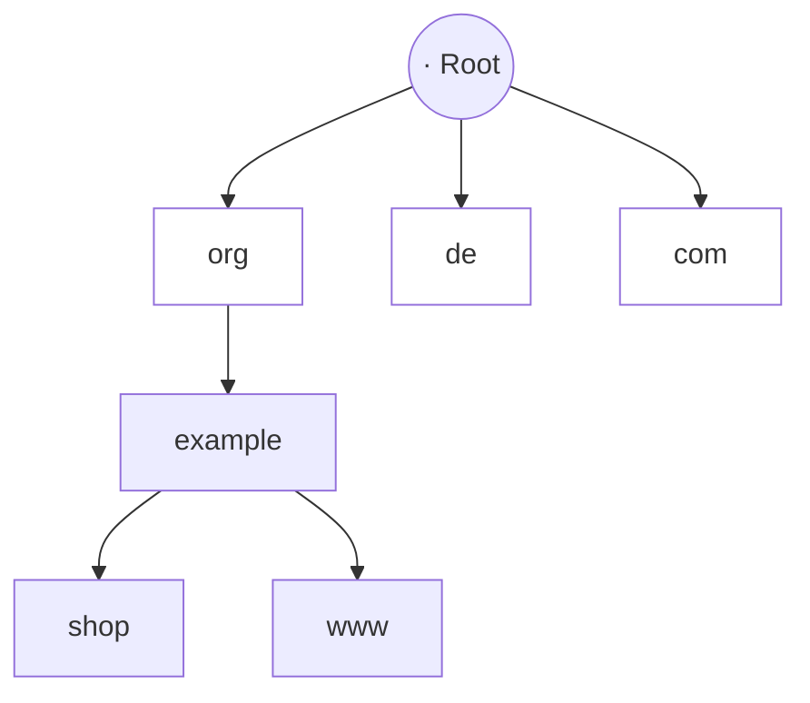
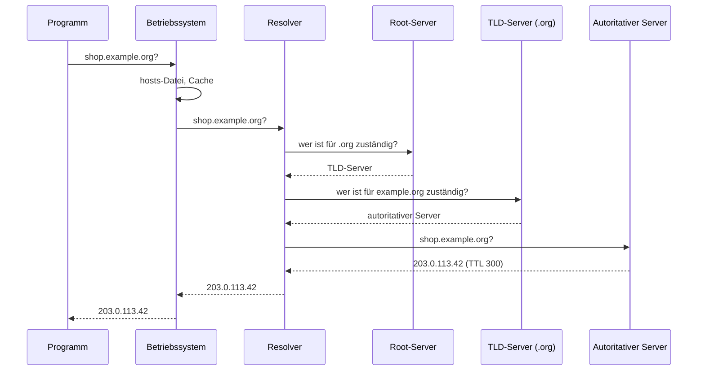

import Quiz from '@site/src/components/Quiz';
import fragen from './03-dns.fragen.yaml';

# DNS – Namen in Adressen übersetzen

:::info[Lernziele]
Nach dieser Lektion kannst du …
- den **Ablauf einer DNS-Auflösung** beschreiben,
- die wichtigsten **Eintragstypen** zuordnen,
- **TTL und Caching** und ihre Folgen für Tests und Umstellungen erklären,
- DNS mit **dig**, **nslookup** und `/etc/hosts` prüfen und gezielt steuern,
- typische **DNS-Fehler** erkennen.
:::

## Wozu DNS? \{#wozu}

Menschen merken sich `shop.example.org`, Rechner brauchen `203.0.113.42`. Das **Domain Name System** übersetzt Namen in
Adressen – ein weltweit verteiltes, hierarchisches Verzeichnis:



## Ablauf einer Auflösung \{#ablauf}

1. Das Programm fragt das **Betriebssystem**. Das schaut zuerst in die `hosts`-Datei und in seinen **Cache**.
2. Ist nichts da, fragt es den konfigurierten **DNS-Resolver** (vom Router, Firmennetz oder z. B. 9.9.9.9).
3. Der Resolver fragt – falls nicht im Cache – einen **Root-Server**: „Wer ist für `.org` zuständig?“
4. Der **TLD-Server** für `.org` verweist auf den zuständigen **autoritativen Server** von `example.org`.
5. Der autoritative Server liefert die Antwort: `shop.example.org → 203.0.113.42`.
6. Resolver und Betriebssystem **speichern** die Antwort für die Dauer der **TTL**.

Die meisten Anfragen beantwortet ein Cache in Millisekunden. DNS-Abfragen laufen normalerweise über **UDP Port 53**
(große Antworten über TCP), zunehmend auch verschlüsselt (DNS over HTTPS/TLS).



## Eintragstypen \{#eintraege}

| Typ | Bedeutung | Beispiel |
|---|---|---|
| **A** | Name → IPv4-Adresse | `shop.example.org. 300 IN A 203.0.113.42` |
| **AAAA** | Name → IPv6-Adresse | `shop.example.org. 300 IN AAAA 2001:db8::42` |
| **CNAME** | Alias auf einen anderen Namen | `www.example.org. IN CNAME shop.example.org.` |
| **MX** | Mailserver der Domain | `example.org. IN MX 10 mail.example.org.` |
| **TXT** | beliebiger Text, z. B. für Domain-Nachweise und E-Mail-Schutz (SPF, DMARC) | `"v=spf1 include:_spf.example.net -all"` |
| **NS** | zuständige Nameserver | `example.org. IN NS ns1.example.net.` |
| **PTR** | umgekehrt: Adresse → Name (Reverse DNS) | `42.113.0.203.in-addr.arpa. IN PTR shop.example.org.` |

## TTL und Caching \{#ttl}

Die **TTL** (Time to Live, in Sekunden) sagt, wie lange eine Antwort zwischengespeichert werden darf. Folgen in der Praxis:

- Wird eine Testumgebung auf einen neuen Server umgezogen, sehen manche Rechner noch **stundenlang die alte Adresse**,
  bis die alte TTL abgelaufen ist. Vor geplanten Umzügen setzt man die TTL deshalb rechtzeitig herab.
- Auch **negative Antworten** („gibt es nicht“) werden gecacht: Wer einen Namen abfragt, bevor er angelegt ist, bekommt
  eine Weile weiter „nicht gefunden“.
- Lokale Caches leeren: `ipconfig /flushdns` (Windows), `resolvectl flush-caches` (Linux mit systemd-resolved).

## Werkzeuge \{#werkzeuge}

```bash
dig shop.example.org              # vollständige Antwort mit TTL und antwortendem Server
dig +short shop.example.org       # nur die Adresse
dig @9.9.9.9 shop.example.org     # einen bestimmten Resolver fragen – hilft bei Cache-Problemen
dig MX example.org                # bestimmter Eintragstyp
nslookup shop.example.org         # auch unter Windows vorhanden
getent hosts shop.example.org     # Linux: so, wie Programme auflösen (inkl. /etc/hosts)
```

```powershell
Resolve-DnsName shop.example.org          # Windows PowerShell
```

`dig` fragt den DNS-Server direkt und **ignoriert `/etc/hosts`** – `getent` und die meisten Programme berücksichtigen sie.
Unterschiedliche Ergebnisse der beiden Werkzeuge sind deshalb ein wichtiger Hinweis.

## DNS in Tests steuern \{#tests}

Die `hosts`-Datei (`/etc/hosts`, unter Windows `C:\Windows\System32\drivers\etc\hosts`) hat Vorrang vor DNS. Damit lassen
sich Namen gezielt umleiten – etwa um die echte Domain gegen eine Testumgebung zu prüfen:

```text title="/etc/hosts"
127.0.0.1      localhost
10.20.30.40    shop.example.org      # Test der neuen Umgebung unter dem echten Namen
```

Weitere Möglichkeiten:

- In **Docker Compose** lösen Container sich über ihre **Dienstnamen** auf (`db`, `api`) – Docker bringt einen eigenen
  DNS-Server mit (siehe [Netzwerke in Docker](../05-docker/03-volumes-netzwerke.mdx#eigenes-netzwerk)).
- Browser-Tests mit Playwright können per Startargument Namen umleiten, ohne die hosts-Datei zu ändern.
- Für Tests ohne Abhängigkeit von externem DNS lokale Adressen verwenden – wie die Tests im Beispielprojekt, die nur
  `localhost` auflösen:

```python title="test_netzwerk.py"
def test_localhost_wird_aufgeloest(self):
    adressen = {eintrag[4][0] for eintrag in socket.getaddrinfo("localhost", 80)}
    self.assertTrue(adressen & {"127.0.0.1", "::1"})
```

## DNS und Sicherheit \{#sicherheit}

| Thema | Bedeutung |
|---|---|
| **DNS-Spoofing / Cache Poisoning** | gefälschte Antworten leiten auf falsche Server; Schutz u. a. durch DNSSEC und TLS mit Zertifikatsprüfung |
| **Subdomain Takeover** | ein CNAME zeigt auf einen gelöschten Cloud-Dienst; ein Angreifer registriert ihn und übernimmt die Subdomain |
| **Typosquatting** | ähnliche Domains (`examp1e.org`) für Phishing |
| **Aufklärung** | öffentliche DNS-Einträge verraten Subdomains und eingesetzte Dienste – der erste Schritt jedes [Angriffs](../07-cybersecurity/01-security-grundlagen.mdx#angriffsablauf) |
| **DNS-Logs** | zeigen, welche Domains ein Rechner auflöst – wertvoll, um Schadsoftware zu erkennen |

## Typische Fehler \{#typische-fehler}

- „Es ist immer DNS“ – und trotzdem zuletzt geprüft. **Früh** mit `dig` bzw. `nslookup` prüfen.
- **TTL** bei Umzügen vergessen – alte Adressen bleiben im Cache.
- Einträge in der **hosts-Datei** vergessen, die Tests oder Browser umleiten.
- `dig` und Anwendung liefern Verschiedenes – weil `dig` die hosts-Datei ignoriert.
- Verwaiste **CNAMEs** auf gelöschte Cloud-Dienste.

## Zusammenfassung \{#zusammenfassung}

- DNS übersetzt Namen in Adressen: hosts-Datei und Cache → Resolver → Root → TLD → autoritativer Server.
- Eintragstypen: **A/AAAA** (Adresse), **CNAME** (Alias), **MX** (Mail), **TXT**, **NS**, **PTR**.
- Die **TTL** bestimmt, wie lange Antworten gecacht werden – auch negative.
- Prüfen mit **dig**, **nslookup**, **getent**; steuern mit der **hosts-Datei** oder Dienstnamen in Docker.
- DNS ist auch ein Sicherheitsthema: Spoofing, Subdomain Takeover, Aufklärung.

<Quiz fragen={fragen} titel="Quiz: DNS" />
