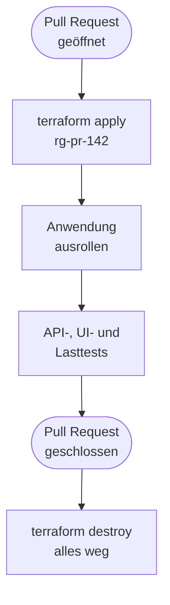

import Quiz from '@site/src/components/Quiz';
import fragen from './03-infrastructure-as-code.fragen.yaml';

# Infrastructure as Code

:::info[Lernziele]
Nach dieser Lektion kannst du …
- erklären, was **Infrastructure as Code** (IaC) ist und welche Vorteile es hat,
- den Ablauf **init – plan – apply – destroy** in Terraform beschreiben,
- **Testumgebungen auf Abruf** mit IaC planen,
- IaC mit **Checkov** auf Fehlkonfigurationen prüfen, Ergebnisse bewerten und **Ausnahmen begründen**,
- die **Grenzen** solcher Scanner an einem echten Beispiel erklären.
:::

## Was ist Infrastructure as Code? \{#was}

Statt Server, Netze und Speicher im Portal zusammenzuklicken, beschreibt man sie in **Dateien**, die versioniert, reviewt
und automatisch angewendet werden – genau wie Anwendungscode.

| Vorteil | Bedeutung |
|---|---|
| **Wiederholbar** | jede Umgebung entsteht identisch – keine „Schneeflocken-Server“ |
| **Versioniert** | jede Änderung ist im Git-Verlauf nachvollziehbar und per Pull Request reviewbar |
| **Prüfbar** | Fehlkonfigurationen lassen sich **vor** dem Ausrollen automatisch finden |
| **Abbaubar** | Testumgebungen verschwinden nach dem Test vollständig – keine vergessenen Kosten |

| Werkzeug | Sprache | gilt für |
|---|---|---|
| **Terraform** / OpenTofu | HCL | viele Clouds und Dienste |
| **Bicep** | eigene Sprache | Azure |
| **CloudFormation** | YAML/JSON | AWS |
| **Pulumi** | C#, TypeScript, Python … | viele Clouds |

## Terraform in Kürze \{#terraform}

```hcl title="Beispiel: Speicherkonto für Testberichte"
resource "azurerm_storage_account" "berichte" {
  name                     = "testberichtesicher"
  resource_group_name      = azurerm_resource_group.test.name
  location                 = azurerm_resource_group.test.location
  account_tier             = "Standard"
  account_replication_type = "LRS"
  min_tls_version          = "TLS1_2"
}
```

| Befehl | Wirkung |
|---|---|
| `terraform init` | Provider herunterladen, Arbeitsverzeichnis vorbereiten |
| `terraform plan` | zeigen, was **geändert** würde – ohne etwas zu ändern |
| `terraform apply` | Änderungen ausführen |
| `terraform destroy` | alles wieder entfernen |

Der **State** speichert, welche echten Ressourcen zu welchem Code gehören. Er enthält oft **Geheimnisse** (z. B. erzeugte
Passwörter) und gehört deshalb in einen geschützten, gemeinsamen Speicher – nie ins Git-Repository.

`terraform plan` ist auch ein **Review-Werkzeug**: Im Pull Request sieht man nicht nur die Codeänderung, sondern auch
„1 Ressource wird ersetzt, 1 gelöscht“ – ein unerwartetes **Löschen** einer Datenbank fällt so vor dem Ausrollen auf.

## Testumgebungen auf Abruf \{#testumgebungen}

Mit IaC wird aus „Wir haben eine Testumgebung, um die sich alle streiten“ ein Ablauf in der Pipeline:

1. Pull Request wird geöffnet → `terraform apply` legt eine eigene Umgebung an (z. B. Ressourcengruppe `rg-pr-142`).
2. Anwendung wird ausgerollt, API-, UI- und Lasttests laufen gegen diese Umgebung.
3. Pull Request wird geschlossen → `terraform destroy` räumt alles ab.

Vorteile: Tests stören sich nicht, jeder Stand ist reproduzierbar, Kosten entstehen nur während der Tests. Für Tests reicht
oft eine **kleinere Ausprägung** derselben Konfiguration (weniger Instanzen, günstigere Stufen) – über Variablen gesteuert.



## Fehlkonfigurationen finden: IaC-Scans \{#scan}

IaC-Scanner wie **Checkov**, **Trivy** oder **KICS** prüfen den Code gegen Hunderte Regeln – bevor irgendetwas in der Cloud
existiert. Das Beispielprojekt [beispiele/cloud](https://github.com/Smie89/lernplattform/tree/main/beispiele/cloud) enthält
eine unsichere und eine sichere Konfiguration:

```hcl title="unsicher/main.tf (Auszug)"
resource "azurerm_storage_account" "berichte" {
  https_traffic_only_enabled      = false    # unverschlüsselter Zugriff erlaubt
  min_tls_version                 = "TLS1_0" # veraltete TLS-Version
  allow_nested_items_to_be_public = true     # Container dürfen öffentlich lesbar sein
  public_network_access_enabled   = true
}

security_rule {
  name                  = "ssh-von-ueberall"
  destination_port_range = "22"
  source_address_prefix = "*"                # SSH aus dem gesamten Internet
}
```

Das echte Ergebnis von Checkov 3.4:

```text
$ checkov -d unsicher --framework terraform --compact --quiet
Passed checks: 6, Failed checks: 13, Skipped checks: 0

Check: CKV_AZURE_59: "Ensure that Storage accounts disallow public access"
Check: CKV_AZURE_44: "Ensure Storage Account is using the latest version of TLS encryption"
Check: CKV_AZURE_190: "Ensure that Storage blobs restrict public access"
Check: CKV_AZURE_9: "Ensure that RDP access is restricted from the internet"
Check: CKV_AZURE_10: "Ensure that SSH access is restricted from the internet"
...
```

### Befunde bewerten und Ausnahmen begründen \{#ausnahmen}

Nach dem Beheben der echten Befunde meldete Checkov in `sicher/` noch **7** Punkte – Empfehlungen wie
kundenverwaltete Schlüssel, Georeplikation oder Protokollierung für den nicht genutzten Queue-Dienst. Drei davon ließen sich
sinnvoll beheben (geteilte Kontoschlüssel abschalten, Ablauf für Freigabelinks, Soft Delete). Vier sind für Testberichte
**bewusst akzeptiert** – mit Begründung direkt im Code:

```hcl title="sicher/main.tf"
resource "azurerm_storage_account" "berichte" {
  #checkov:skip=CKV_AZURE_33:Queue-Dienst wird nicht genutzt
  #checkov:skip=CKV_AZURE_206:LRS genügt, Testberichte lassen sich jederzeit neu erzeugen
  #checkov:skip=CKV2_AZURE_1:Keine kritischen Daten, von Microsoft verwaltete Schlüssel genügen
  #checkov:skip=CKV2_AZURE_33:Private Endpoint wird im Netzwerkmodul angelegt, nicht Teil dieses Beispiels
  ...
  shared_access_key_enabled = false
  sas_policy {
    expiration_period = "01.00:00:00"
  }
}
```

```text
$ checkov -d sicher --framework terraform --compact --quiet
Passed checks: 15, Failed checks: 0, Skipped checks: 4
```

Das ist dieselbe Praxis wie `# nosec` bei [Bandit](../07-cybersecurity/04-sicherheitstests-devsecops.mdx#sast): **einzeln,
begründet, im Review sichtbar** – nie pauschal.

### Eine echte Lücke des Scanners \{#luecke}

Bemerkenswert ist, was **nicht** gemeldet wurde: `https_traffic_only_enabled = false` – unverschlüsselter Zugriff auf den
Speicher. Die zuständige Regel CKV_AZURE_3 („Ensure that 'enable_https_traffic_only' is enabled“) wurde als **bestanden**
gewertet. Die Ursache: Der Terraform-Provider hat das Attribut in Version 4.0 von `enable_https_traffic_only` in
`https_traffic_only_enabled` **umbenannt**, die Regel prüft aber noch den alten Namen. Mit dem alten Namen und `false`
meldet Checkov den Befund korrekt.

Die Konsequenz ist dieselbe wie bei [Bandit, das 2 von 6 Lücken fand](../07-cybersecurity/04-sicherheitstests-devsecops.mdx#sast):
**Ein grüner Scan beweist keine sichere Konfiguration.** Scanner hinken neuen Versionen hinterher; Reviews, eigene
Richtlinien und Prüfungen der echten Umgebung (z. B. mit Defender for Cloud) bleiben nötig.

Die CI hält beides fest – die erwarteten Befunde **und** die Lücke. Wird die Lücke im Scanner geschlossen, schlägt die
Prüfung an, und die Lektion wird aktualisiert:

```python title="pruefe_scan.py (Auszug)"
ERWARTET = {
    "CKV_AZURE_44": "veraltete TLS-Version",
    "CKV_AZURE_59": "Speicherkonto öffentlich erreichbar",
    "CKV_AZURE_190": "Blobs öffentlich lesbar",
    "CKV_AZURE_9": "RDP aus dem Internet",
    "CKV_AZURE_10": "SSH aus dem Internet",
}
BEKANNTE_LUECKE = "CKV_AZURE_3"
```

## IaC in der Pipeline \{#pipeline}

```yaml title=".github/workflows/beispiele.yml (Job cloud)"
      - name: Checkov installieren
        run: pip install checkov==3.4.11            # feste Version – Ergebnisse bleiben vergleichbar
      - name: "IaC-Scan: sichere Konfiguration ohne Befunde"
        run: checkov -d sicher --framework terraform --compact --quiet
      - name: "IaC-Scan: unsichere Konfiguration – erwartete Befunde und bekannte Lücke"
        run: |
          checkov -d unsicher --framework terraform -o json > checkov.json || true
          python pruefe_scan.py checkov.json
```

In einem echten Projekt sieht die Kette so aus: `terraform fmt` und `validate` → **IaC-Scan** → `terraform plan` mit Ausgabe
im Pull Request → Review → `apply` nach Freigabe. Dazu kommen **Policy as Code** (z. B. Azure Policy, Open Policy Agent), die
auch Änderungen außerhalb der Pipeline verhindert – etwa einen Speicher, den jemand im Portal öffentlich schaltet.

## Typische Fehler \{#typische-fehler}

- Änderungen **im Portal** an IaC-verwalteten Ressourcen – beim nächsten `apply` werden sie überschrieben (oder umgekehrt).
- **State-Datei** mit Geheimnissen im Repository.
- `apply` **ohne Review** des Plans.
- Scanner-Befunde **pauschal** abschalten statt einzeln begründen.
- Einen **grünen Scan** für einen Sicherheitsnachweis halten.
- Scanner-Version **nicht festlegen** – Ergebnisse ändern sich ohne Codeänderung.

## Zusammenfassung \{#zusammenfassung}

- IaC macht Infrastruktur **wiederholbar, versioniert, prüfbar und abbaubar**.
- Terraform: **init – plan – apply – destroy**; der **State** ist sensibel; der Plan ist ein Review-Werkzeug.
- **Testumgebungen auf Abruf** pro Pull Request – isoliert und nur während der Tests kostenpflichtig.
- IaC-Scanner wie **Checkov** finden Fehlkonfigurationen vor dem Ausrollen; Ausnahmen **einzeln mit Begründung**.
- Im Beispiel: 13 Befunde in `unsicher/`, 0 in `sicher/` – und eine **echte Lücke** (umbenanntes Attribut), die die CI dokumentiert.

<Quiz fragen={fragen} titel="Quiz: Infrastructure as Code" />
