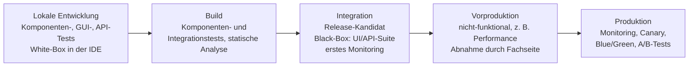

import Quiz from '@site/src/components/Quiz';
import fragen from './01-tae-ziele-vorbereitung.fragen.yaml';

# TAE: Ziele und Vorbereitung

:::info[Lernziele]
Nach dieser Lektion kannst du …
- den **Aufbau der CTAL-TAE-Prüfung** und die Bedeutung der K-Stufen erklären,
- **Vor- und Nachteile** sowie **Grenzen** der Testautomation benennen,
- beschreiben, wie Testautomation in **Wasserfall, V-Modell und agilen Teams** eingesetzt wird,
- **Testbarkeit** mit Beobachtbarkeit, Steuerbarkeit und Architekturtransparenz erklären,
- die typischen **Testumgebungen** und was dort automatisiert läuft unterscheiden,
- ein **SUT analysieren** und das Ergebnis einer **Werkzeugbewertung** als Vergleichstabelle darstellen.
:::

## Die Prüfung im Überblick \{#pruefung}

| | CTAL-TAE v2.0 |
|---|---|
| Voraussetzung | Foundation Level (CTFL) |
| Fragen | 40, Multiple Choice (eine richtige Antwort oder „Wähle ZWEI“) |
| Punkte | 66 – eine Frage zählt je nach K-Stufe 1, 2 oder 3 Punkte |
| Bestanden | ab **43 Punkten** (65 %) |
| Dauer | **90 Minuten**, in einer Fremdsprache 25 % mehr (113 Minuten) |

Die **K-Stufe** eines Lernziels sagt, was in der Prüfung verlangt wird – und wie viel die Frage wert ist:

| K-Stufe | Bedeutung | Fragen | Punkte je Frage | Typische Frage |
|---|---|---|---|---|
| K2 – Verstehen | erklären, unterscheiden, zusammenfassen | 20 | 1 | „Welche Aussage beschreibt … am besten?“ |
| K3 – Anwenden | ein Verfahren auf eine Situation anwenden | 14 | 2 | kurzes Szenario, „Was solltest du tun?“ |
| K4 – Analysieren | eine Situation zerlegen und begründet entscheiden | 6 | 3 | längeres Szenario mit mehreren Faktoren |

Die Fragen verteilen sich fest auf die acht Kapitel:

| Kapitel | Thema | Fragen | Punkte |
|---|---|---|---|
| 1 | Einführung und Ziele | 3 | 3 |
| 2 | Vorbereitung der Testautomation | 5 | 9 |
| 3 | Testautomationsarchitektur | 6 | 10 |
| 4 | Implementierung der Testautomation | 4 | 7 |
| 5 | Einführungs- und Bereitstellungsstrategien | 6 | 8 |
| 6 | Berichte und Metriken | 4 | 8 |
| 7 | Verifikation der Testautomationslösung | 6 | 8 |
| 8 | Kontinuierliche Verbesserung | 6 | 13 |

Kapitel 8 bringt die meisten Punkte, Kapitel 2 und 6 die schwersten Fragen pro Stück (K4). Die
[Prüfungssimulation](./06-pruefungssimulation.mdx) zieht ihre Fragen nach genau dieser Verteilung.

## Grundbegriffe \{#begriffe}

| Abkürzung | Begriff | Bedeutung |
|---|---|---|
| **SUT** | System under Test | das System, das getestet wird |
| **TAE** | Test Automation Engineer | die Rolle, die Testautomation entwirft, baut und pflegt |
| **TAS** | Test Automation Solution | die **gesamte** Lösung: Werkzeuge, Framework, Testfälle, Daten, Konfiguration, Anbindungen |
| **TAF** | Test Automation Framework | das **Fundament** der TAS: Test-Harness (Test-Runner), Bibliotheken, Testskripte, Testsuiten |
| **TAA** | Test Automation Architecture | der **technische Entwurf** einer konkreten TAS |
| **gTAA** | generic Test Automation Architecture | der **allgemeine** Bauplan, aus dem man eine TAA ableitet |
| | Testware | alles, was zum Testen entsteht: Skripte, Daten, Konfiguration, Dokumentation |

Auf dieser Plattform ist z. B. das Testprojekt des Mini-Shops mit NUnit, Playwright und den Hilfsklassen eine kleine TAS;
NUnit als Runner plus die eigenen Bibliotheken bilden ihr TAF.

## Vor- und Nachteile der Testautomation \{#vor-nachteile}

Testautomation umfasst drei Dinge: Testsuiten mit Werkzeugen **steuern und vorbereiten**, Tests **automatisch ausführen** und
**Ist- mit Soll-Ergebnissen vergleichen**.

| Vorteile | Nachteile |
|---|---|
| mehr Tests pro Build | zusätzliche Kosten: Personal, Hardware, Schulung |
| Tests, die manuell unmöglich sind (Echtzeit, parallel, entfernt) | Anfangsinvestition für die TAS |
| komplexere Tests | Zeit für Entwicklung **und Wartung** |
| schneller und weniger anfällig für menschliche Fehler | braucht klare Ziele, sonst scheitert sie |
| schnellere Rückmeldung zur Qualität | starre Tests, die schlecht auf Änderungen reagieren |
| gleichbleibende Ausführung über alle Testzyklen | die Automation kann selbst Fehler enthalten |
| hilft bei Zuverlässigkeit (Verfügbarkeit, Wiederherstellbarkeit) | |

### Grenzen \{#grenzen}

- Nicht jeder manuelle Test lässt sich automatisieren.
- Ein automatisierter Test prüft **nur, was programmiert wurde** – was er nicht prüft, sieht er nicht.
- Er kann nur **maschinenlesbare** Ergebnisse prüfen; manche Qualitätsmerkmale (z. B. ob eine Oberfläche verständlich ist)
  entziehen sich.
- Er braucht ein **automatisierbares Testorakel**, das entscheidet, was richtig ist.

## Testautomation in Vorgehensmodellen \{#vorgehensmodelle}

| Modell | Wann wird automatisiert? | Wann laufen die Tests? |
|---|---|---|
| **Wasserfall** | parallel zur oder nach der Implementierung | meist erst in der Verifikationsphase, weil die Komponenten vorher nicht fertig sind |
| **V-Modell** | je Teststufe (Komponente bis Abnahme) – ein TAF **pro Teststufe** ist möglich und empfohlen | auf jeder Stufe, sobald die zugehörige Entwicklungsstufe fertig ist |
| **Agil** | im selben Sprint wie das Feature (**In-Sprint-Automation**) | ständig, z. B. bei jedem Commit |

Im agilen Vorgehen entscheiden TAE und Fachseite gemeinsam über Zeitplan und Umfang. Code-Reviews, Pair-Programming und
häufige automatische Testläufe helfen. Entscheidend ist, **Silos aufzulösen**: Entwicklung, Test und Fachseite arbeiten
zusammen, damit alle Teststufen passend abgedeckt sind.

## Werkzeuge passend zum SUT wählen \{#werkzeugauswahl}

1. **Das SUT zuerst analysieren**: Weboberfläche, Webservice, Desktop, Mobil? Welche Anforderungen hat das Projekt
   langfristig? Daraus entsteht die Grundlage für die Auswahl.
2. **Kosten** immer mitdenken – kommerzielles Werkzeug oder eigene Lösung auf Open-Source-Basis sind beide aufwendig.
3. **Team betrachten**: Wenig Programmiererfahrung spricht für **Low-Code/No-Code**. Programmierende Tester profitieren
   von einem Werkzeug in **derselben Sprache wie das SUT** – Entwickler helfen dann beim Debuggen, und das Wissen wird im Team
   geteilt.

Beispiel: Für den .NET-Mini-Shop passen NUnit und Playwright für .NET besser als ein Java-Werkzeug, weil das Entwicklungsteam
dieselbe Sprache nutzt.

## Testbarkeit \{#testbarkeit}

**Testbarkeit** ist eine nicht-funktionale Anforderung an das SUT. Sie sollte **gleichzeitig mit den Features** entworfen
werden – meist von der Softwarearchitektur, mit Hinweisen des TAE. Drei Aspekte:

| Aspekt | Bedeutung | Beispiel |
|---|---|---|
| **Beobachtbarkeit** | Das SUT bietet Schnittstellen, über die man seinen Zustand sieht. | Statusendpunkt, Logs, lesbare UI-Elemente |
| **Steuerbarkeit** | Das SUT bietet Schnittstellen, über die man es bedient. | UI-Elemente, API-Aufrufe, Protokolle wie TCP/IP oder USB, Signale |
| **Architekturtransparenz** | Die Dokumentation zeigt klar Komponenten und Schnittstellen. | Architekturdiagramm mit allen Schnittstellen je Teststufe |

Konkrete Hilfen mit eigenem Konfigurationsbedarf:

- **Accessibility-Kennungen** – vom Framework erzeugt oder von Entwicklern gesetzt, z. B. `AutomationId` in WPF
  (siehe [WPF testbar machen](../02-testautomation/05-desktop/02-wpf-testbar-machen.mdx)) oder `data-testid` im Web.
- **Systemumgebungsvariablen** – Parameter, mit denen man das Verhalten für Tests anpasst, z. B. einen Testmodus.
- **Deployment-Variablen** – wie Umgebungsvariablen, aber schon **vor** dem Deployment gesetzt, z. B. die Datenbank einer
  Testumgebung.

## Testautomation in verschiedenen Umgebungen \{#umgebungen}

| Umgebung | Was läuft dort? | Besonderheit |
|---|---|---|
| **Lokale Entwicklung** | Komponenten-, GUI- und API-Tests | **White-Box**-Tests in der IDE finden Codeprobleme früh |
| **Build** | Komponenten- und Komponentenintegrationstests, statische Analyse | lokal oder als CI/CD-Agent, **ohne Deployment** |
| **Integration** | vollständige automatisierte UI- oder API-Suite | nur **Black-Box**; **erste** Umgebung mit Monitoring |
| **Vorproduktion** | vor allem **nicht-funktionale** Tests, Abnahme | so nah an der Produktion wie möglich, überwacht |
| **Produktion** | funktional und nicht-funktional in Echtzeit | Monitoring, Canary Release, Blue/Green, A/B-Tests |

Technisch entstehen Umgebungen heute oft aus **Containern** oder **virtuellen Maschinen** – siehe
[Docker in der Testautomation](../05-docker/05-docker-testautomation.mdx).

## Das SUT analysieren \{#sut-analysieren}

Bevor man sich für eine TAS entscheidet, sammelt der TAE die Anforderungen – am besten **gemeinsam** mit manuellen Testern,
Fachseite und Business-Analysten, um möglichst viele Risiken früh zu sehen. Zu klären ist:

- **Welche Testaktivitäten** automatisiert werden: Testmanagement, Testentwurf, Testgenerierung, Testausführung
- **Welche Teststufen** und **welche Testarten**
- **Welche Rollen und Fähigkeiten** die Lösung unterstützen muss
- **Welche Produkte, Produktlinien und -familien** – das bestimmt Reichweite und Lebensdauer der TAS
- **Welche Arten von SUT** kompatibel sein müssen (Web, mobil, Webservice …)
- **Verfügbarkeit und Qualität der Testdaten**
- **Wie unerreichbare Teile nachgebildet** werden, z. B. Drittsysteme (Mocks, siehe
  [WireMock](../02-testautomation/08-api-vertieft/02-externe-dienste-wiremock.mdx))

## Ergebnisse einer Werkzeugbewertung darstellen \{#vergleichstabelle}

Oft erfüllt **kein einzelnes Werkzeug** alle Anforderungen – das sollten alle Beteiligten von Anfang an wissen. Die
Ergebnisse hält man in einer **Vergleichstabelle** fest: **Werkzeuge in den Spalten, Anforderungen in den Zeilen**, in den
Zellen die Eigenschaften des Werkzeugs und die Priorität der Anforderung.

| Anforderung (Priorität) | Playwright | Selenium WebDriver | Low-Code-Werkzeug |
|---|---|---|---|
| Sprache wie SUT: C# (hoch) | ja | ja | nein, eigene Oberfläche |
| Mehrere Umgebungen konfigurierbar (hoch) | ja, per Konfiguration | ja, per Konfiguration | eingeschränkt |
| Testdaten verwalten, versionierbar (mittel) | über Dateien im Repository | über Dateien im Repository | integriert, schwer versionierbar |
| Berichte (mittel) | Trace Viewer, HTML | über Zusatzbibliotheken | integriert |
| Anbindung an CI/CD (hoch) | Kommandozeile | Kommandozeile, Grid | Plugin nötig |
| Skalierbarkeit, Wartbarkeit (hoch) | gut | gut, mehr Eigenbau | mittel |

Bewertet werden typischerweise: Sprache und IDE, **Konfigurierbarkeit** (Umgebungen, statische oder dynamische Werte),
**Testdatenverwaltung**, Eignung für die **Testarten**, **Berichte**, **Integration** mit CI/CD, Ticketsystem und
Testmanagement sowie **Erweiterbarkeit** (Skalierbarkeit, Wartbarkeit, Änderbarkeit, Kompatibilität, Zuverlässigkeit).
Aus der Tabelle entsteht ein **Vorschlag**, der den Stakeholdern zur **Freigabe** vorgestellt wird.

## Typische Fehler \{#typische-fehler}

- Werkzeug **vor** der Analyse des SUT festlegen („Wir nehmen das, was wir kennen“).
- Testautomation ohne **klare Ziele** starten.
- Wartungsaufwand in der Kostenrechnung vergessen.
- Testbarkeit erst nachträglich einfordern, wenn die Architektur schon steht.
- Erwarten, dass ein Werkzeug alle Anforderungen erfüllt.

## Zusammenfassung \{#zusammenfassung}

- Die Prüfung: **40 Fragen, 66 Punkte, 43 zum Bestehen, 90 Minuten**; K2 = 1, K3 = 2, K4 = 3 Punkte.
- **TAS** ist die ganze Lösung, **TAF** ihr Fundament, **TAA** ihr Entwurf, **gTAA** der allgemeine Bauplan.
- Testautomation ist schnell und wiederholbar, kostet aber Aufbau und Wartung und prüft nur, was programmiert ist.
- **Testbarkeit** = Beobachtbarkeit + Steuerbarkeit + Architekturtransparenz, früh mit entworfen.
- Jede **Umgebung** hat ihre Tests: lokal und Build White-Box, ab Integration Black-Box mit Monitoring.
- Werkzeuge erst nach der **SUT-Analyse** wählen und in einer **Vergleichstabelle** begründen.

<Quiz fragen={fragen} titel="Quiz: TAE – Ziele und Vorbereitung" />
