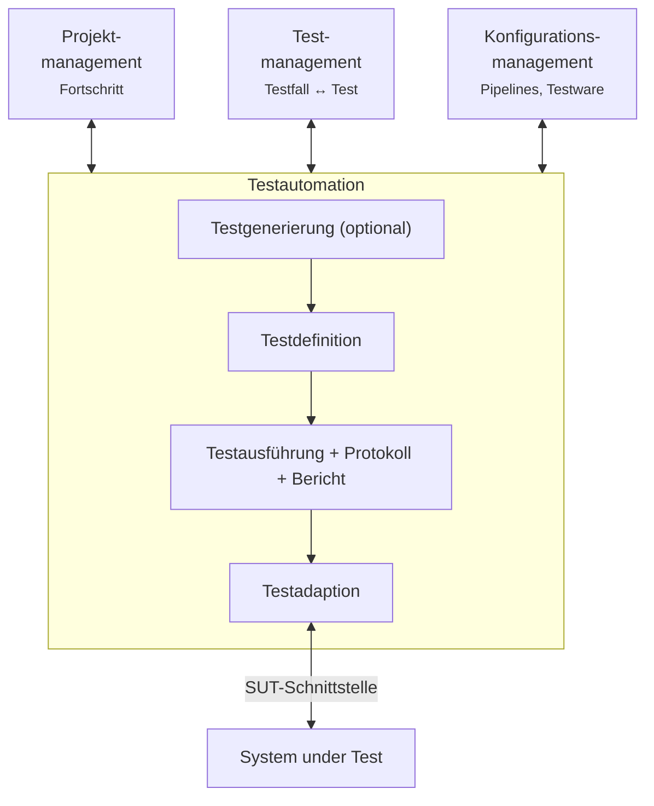
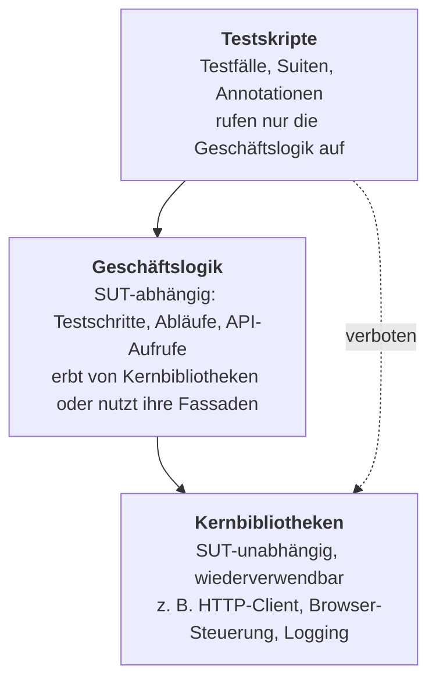

import Quiz from '@site/src/components/Quiz';
import fragen from './02-tae-architektur.fragen.yaml';

# TAE: Testautomationsarchitektur

:::info[Lernziele]
Nach dieser Lektion kannst du …
- die **gTAA** mit ihren vier Schnittstellen und vier Fähigkeiten erklären,
- beschreiben, was der Entwurf einer **TAS** festlegen muss,
- ein TAF in **Schichten** aufteilen: Testskripte, Geschäftslogik, Kernbibliotheken,
- die **Ansätze** von Capture/Playback bis BDD vergleichen und passend auswählen,
- **Entwurfsprinzipien und -muster** in der Testautomation anwenden.
:::

Kapitel 3 bringt in der Prüfung 6 Fragen und 10 Punkte – vier davon sind K3-Fragen mit kurzen Szenarien.

## Die generische Testautomationsarchitektur (gTAA) \{#gtaa}

Die **gTAA** ist ein abstrakter Bauplan. Sie zeigt, mit welchen Systemen die Testautomation verbunden ist, und welche
Fähigkeiten man beim Entwurf einer konkreten Architektur (TAA) abdecken muss.



### Die vier Schnittstellen \{#schnittstellen}

| Schnittstelle | Beschreibt |
|---|---|
| **SUT** | die Verbindung zwischen SUT und TAF |
| **Projektmanagement** | den Fortschritt der Automatisierung |
| **Testmanagement** | die Zuordnung von Testfalldefinitionen zu automatisierten Testfällen |
| **Konfigurationsmanagement** | CI/CD-Pipelines, Umgebungen und Testware |

### Die vier Fähigkeiten \{#faehigkeiten}

| Fähigkeit | Aufgabe | Beispiel auf dieser Plattform |
|---|---|---|
| **Testgenerierung** (optional) | Testfälle aus einem **Testmodell** erzeugen, z. B. modellbasiertes Testen | – |
| **Testdefinition** | Testfälle und Suiten definieren, **getrennt** von SUT und Werkzeug; hoch- und niedrigstufige Tests über Testdaten, Testfälle und Testbibliotheken | NUnit-Testklassen, `TestCaseSource` |
| **Testausführung** | Tests automatisch ausführen, **protokollieren** und **berichten** | NUnit-Runner, TRX-Bericht in der CI |
| **Testadaption** | Adapter, die die Tests an die Schnittstellen des SUT anbinden: APIs, Protokolle, Dienste | `HttpClient`, Playwright, FlaUI |

Merkhilfe: **G**enerieren → **D**efinieren → **A**usführen, und die **A**daption ist die Brücke zum SUT.

## Eine TAS entwerfen \{#tas-entwerfen}

Eine **TAS** ergibt sich aus den funktionalen, nicht-funktionalen und technischen Anforderungen an das SUT und aus den
Werkzeugen, die man hat oder braucht. Sie besteht aus kommerziellen oder Open-Source-Werkzeugen plus eventuell
**SUT-spezifischen Adaptern**. Die **TAA** als technischer Entwurf legt fest:

- **Werkzeuge** und werkzeugspezifische Bibliotheken
- eigene **Plugins und Komponenten**
- **Verbindungen und Schnittstellen**: Firewalls, Datenbanken, URLs, Mocks/Stubs, Message Queues, Protokolle
- Anbindung an **Testmanagement und Fehlermanagement**
- **Versionsverwaltung** und Repositories

## Schichten eines TAF \{#schichten}

Ein **TAF** umfasst Test-Harness (Test-Runner), Testbibliotheken, Testskripte und Testsuiten. Eine **Schicht** fasst Klassen
mit ähnlichem Zweck zusammen. Zu viele Schichten machen den Entwurf kompliziert – der Lehrplan empfiehlt, ihre **Zahl klein
zu halten**, und nennt drei:



| Schicht | Inhalt | Regel |
|---|---|---|
| **Testskripte** | Testfälle des SUT, Suiten, Annotationen | rufen die **Geschäftslogik**, **nie direkt** die Kernbibliotheken |
| **Geschäftslogik** | alle **SUT-abhängigen** Bibliotheken; Einrichtung des TAF für das SUT | erbt von den Kernbibliotheken oder nutzt deren Fassaden |
| **Kernbibliotheken** | alles **SUT-Unabhängige** | wiederverwendbar in jedem Projekt mit gleichem Technologie-Stack |

So sieht das für den Mini-Shop aus:

```csharp title="Drei Schichten im Testprojekt"
// Kernbibliothek – weiß nichts vom Shop, auch für andere Projekte nutzbar
public class ApiClient
{
    protected readonly HttpClient Http;
    public ApiClient(Uri basis) => Http = new HttpClient { BaseAddress = basis };
    protected async Task<T> PostAsync<T>(string pfad, object daten) =>
        await (await Http.PostAsJsonAsync(pfad, daten)).Content.ReadFromJsonAsync<T>();
}

// Geschäftslogik – kennt den Shop, baut auf der Kernbibliothek auf
public class ShopApi(Uri basis) : ApiClient(basis)
{
    public Task<Bestellung> BestelleAsync(int produktId, int menge) =>
        PostAsync<Bestellung>("/api/bestellungen", new { produktId, menge });
}

// Testskript – spricht nur die Sprache des Fachbereichs
[Test]
public async Task Bestellung_mit_zwei_Kabeln_kostet_19_80()
{
    var bestellung = await shop.BestelleAsync(produktId: 3, menge: 2);
    Assert.That(bestellung.Summe, Is.EqualTo(19.80m));
}
```

### Testautomation skalieren \{#skalieren}

Weil die Kernbibliotheken SUT-unabhängig sind, können **mehrere TAFs** auf denselben Kernbibliotheken aufbauen – im
selben Projekt (z. B. ein TAF für die Weboberfläche, eines für die API) und in **anderen Projekten** mit demselben
Technologie-Stack. Verschiedene TAEs bauen ihre TAFs, ohne die Grundlagen neu zu erfinden.

## Ansätze zum Automatisieren von Testfällen \{#ansaetze}

| Ansatz | Kurz | Vorteile | Nachteile |
|---|---|---|---|
| **Capture/Playback** | manuelle Bedienung wird aufgezeichnet und abgespielt | anfangs sehr einfach | schwer zu warten und zu skalieren; SUT muss beim Aufzeichnen laufen; hängt stark an der aufgezeichneten Version |
| **Lineares Skripting** | Skripte ohne eigene Bibliotheken, oft aus Aufzeichnungen weiterbearbeitet | schneller Start, leichter änderbar als Aufzeichnungen | schwer zu warten und zu skalieren; etwas Programmierwissen nötig |
| **Strukturiertes Skripting** | Bibliotheken mit wiederverwendbaren Schritten und Abläufen | gut wartbar, skalierbar, übertragbar; Geschäftslogik getrennt von Skripten | Programmierwissen nötig; Anfangsinvestition ins TAF |
| **TDD** | Test vor dem Code: Rot – Grün – Refactor | bessere Code-Struktur und Testbarkeit, Abdeckung leichter, weniger Fehler auf höheren Stufen | Eingewöhnung; falsch angewendet trügerische Sicherheit |
| **Datengetrieben (DDT)** | baut auf strukturiertem Skripting auf; dieselben Skripte mit Daten aus CSV, Excel, Datenbank | neue Tests einfach durch neue Datenzeilen; Testanalysten können Tests ohne Programmierung ergänzen | braucht Testdatenmanagement |
| **Schlüsselwortgetrieben (KDT)** | Testfälle als Tabelle aus **Schlüsselwörtern** (aus Nutzersicht) plus Daten; baut meist auf DDT auf | Fach- und Testanalysten schreiben Tests mit; auch für manuelle Tests nutzbar (ISO/IEC/IEEE 29119-5) | Schlüsselwörter zu bauen und zu pflegen ist aufwendig; für kleine Systeme zu viel Aufwand |
| **BDD** | Akzeptanzkriterien in Given–When–Then, in Feature-Dateien, von einem Werkzeug ausgeführt | bessere Kommunikation; Szenarien sind Tests und belegen die Abdeckung der Spezifikation; auf mehreren Stufen der Testpyramide nutzbar | Negativ- und Grenzfälle muss das Team zusätzlich definieren; oft missverstanden als „nur Tests in Prosa“; komplexe Schritte erschweren das Debuggen |

Capture/Playback **ohne** sichtbaren Code nennt man **No-Code**, mit bearbeitbarem Code **Low-Code**.

### Beispiele \{#ansatz-beispiele}

```csharp title="Datengetrieben: ein Skript, viele Datenzeilen"
[TestCase(0, false)]
[TestCase(1, true)]
[TestCase(10, true)]
[TestCase(11, false)]
public void Menge_wird_geprueft(int menge, bool gueltig) =>
    Assert.That(Warenkorb.IstGueltigeMenge(menge), Is.EqualTo(gueltig));
```

```text title="Schlüsselwortgetrieben: Testfall als Tabelle"
Schlüsselwort        | Daten
Anmelden             | anna@example.org | Test123!
Produkt suchen       | HDMI-Kabel
In den Warenkorb     | 2
Summe prüfen         | 19,80 €
```

```gherkin title="BDD: Akzeptanzkriterium als ausführbares Szenario"
Funktionalität: Warenkorb
  Szenario: Zwei Kabel kosten 19,80 €
    Angenommen der Warenkorb ist leer
    Wenn ich 2 "HDMI-Kabel" in den Warenkorb lege
    Dann beträgt die Summe 19,80 €
```

### Welcher Ansatz passt? \{#ansatz-waehlen}

- **Kleine, selten geänderte Anwendung, schnelle Demo** → Capture/Playback oder lineares Skripting reichen.
- **Langlebige Suite, viele Tests** → strukturiertes Skripting als Basis.
- **Gleiche Abläufe mit vielen Eingaben** → datengetrieben.
- **Fachbereich soll Tests selbst schreiben** → schlüsselwortgetrieben oder BDD (BDD nur, wenn Fachbereich und Entwicklung
  wirklich zusammenarbeiten).
- **Neue Komponenten von Anfang an testbar** → TDD.

## Entwurfsprinzipien und Muster \{#muster}

Testautomation **ist Softwareentwicklung** – Prinzipien und Muster gelten genauso:

- die vier Prinzipien der **Objektorientierung**: Kapselung, Abstraktion, Vererbung, Polymorphie
  (siehe [Objektorientierung](../03-softwareentwicklung/01-objektorientierung.mdx))
- **SOLID**: Single Responsibility, Open-Closed, Liskov Substitution, Interface Segregation, Dependency Inversion
  (siehe [SOLID](../03-softwareentwicklung/04-solid.mdx))

Vier Muster sind für TAEs besonders wichtig:

| Muster | Zweck in der Testautomation |
|---|---|
| **Facade** | verbirgt Details und zeigt den Testfällen nur, was sie brauchen |
| **Singleton** | stellt sicher, dass es **nur einen Treiber** gibt, der mit dem SUT spricht |
| **Page Object Model** | je Seite eine Klasse mit den Locators – ändert sich die Seite, ändert man **eine Stelle** statt jedes Tests |
| **Flow Model** | eine weitere Fassade **über** den Page Objects mit allen Nutzeraktionen; diese „doppelte Fassade“ macht Testschritte in vielen Skripten wiederverwendbar |

```csharp title="Flow Model: Abläufe über Page Objects"
public class BestellAblauf(Page page)
{
    private readonly LoginSeite login = new(page);
    private readonly ProduktSeite produkte = new(page);
    private readonly WarenkorbSeite warenkorb = new(page);

    public async Task<WarenkorbSeite> KaufeAlsKundeAsync(string produkt, int menge)
    {
        await login.AnmeldenAsync("anna@example.org", "Test123!");
        await produkte.InDenWarenkorbAsync(produkt, menge);
        return warenkorb;
    }
}
```

Mehr zu Page Objects in der Lektion [Page Object Model](../02-testautomation/04-browser/03-page-object-model.mdx).

## Typische Fehler \{#typische-fehler}

- Testskripte rufen **direkt** Kernbibliotheken (z. B. rohe Selenium- oder HTTP-Aufrufe) statt der Geschäftslogik.
- **Zu viele Schichten** – jede Kleinigkeit bekommt eine eigene Ebene.
- Capture/Playback für eine große, sich ständig ändernde Anwendung.
- BDD ohne Fachbereich: Gherkin wird nur von Testern geschrieben.
- Locators in jedem Test statt zentral im Page Object.

## Zusammenfassung \{#zusammenfassung}

- **gTAA**: Schnittstellen zu SUT, Projekt-, Test- und Konfigurationsmanagement; Fähigkeiten Generierung (optional),
  Definition, Ausführung, Adaption.
- Die **TAA** legt Werkzeuge, eigene Komponenten, Verbindungen, Anbindungen und Versionsverwaltung fest.
- **TAF-Schichten**: Testskripte → Geschäftslogik (SUT-abhängig) → Kernbibliotheken (SUT-unabhängig). Wenige Schichten.
- Ansätze vom einfachen **Capture/Playback** bis **BDD**: je wartbarer, desto mehr Anfangsaufwand.
- **Facade, Singleton, Page Object, Flow Model** halten Testcode wartbar.

<Quiz fragen={fragen} titel="Quiz: TAE – Testautomationsarchitektur" />
