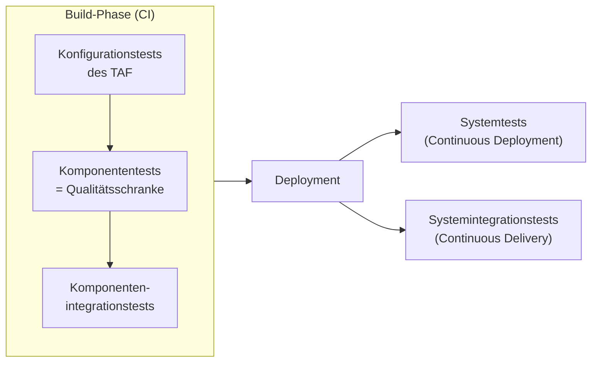

import Quiz from '@site/src/components/Quiz';
import fragen from './03-tae-einfuehrung-pipelines.fragen.yaml';

# TAE: Einführung und Pipelines

:::info[Lernziele]
Nach dieser Lektion kannst du …
- ein **Pilotprojekt** für Testautomation planen und auswerten,
- **Bereitstellungsrisiken** analysieren und Gegenmaßnahmen planen,
- erklären, was die **Wartbarkeit** einer TAS fördert oder schwächt,
- Tests der verschiedenen **Teststufen in Pipelines** einordnen,
- **Konfigurationsmanagement** für Testware erklären,
- **Abhängigkeiten bei API-Tests** und **Contract-Tests** beschreiben.
:::

## Das Pilotprojekt \{#pilot}

Ein Pilot dauert nicht lange, entscheidet aber oft über die Richtung des ganzen Vorhabens. Deshalb zuerst den **Umfang**
festlegen, der validiert werden soll. Auf Basis der SUT-Analyse werden bewertet:

- **Programmiersprache(n)**
- geeignete **kommerzielle oder Open-Source-Werkzeuge**
- abzudeckende **Teststufen**
- ausgewählte **Testfälle**
- **Ansatz** für die Testfallentwicklung (z. B. strukturiert, datengetrieben, BDD)

Daraus entsteht ein erster Ansatz – gern **mehrere Prototypen**, um Vor- und Nachteile zu vergleichen. Weitere Empfehlungen:

- **Zeitplan** festlegen und den Fortschritt **regelmäßig prüfen**, um Risiken früh zu sehen.
- Den Pilot **schon in die CI/CD integrieren** – das deckt Probleme im SUT, in der TAS oder im Zusammenspiel der Werkzeuge
  früh auf.
- Mit wachsender Testzahl die Pipeline anpassen (andere Zeitpunkte, Aufteilung).
- **Nicht-technische Aspekte** bewerten: Wissen und Erfahrung im Team, Teamstruktur, **Lizenzen und Unternehmensregeln**,
  geplante Testarten und Teststufen.

Am Ende bewerten **TAEs und Testmanager** gemeinsam Erfolg oder Misserfolg und entscheiden über das weitere Vorgehen.

## Risiken bei der Bereitstellung \{#risiken}

Schon beim Architekturentwurf ist zu klären, **wie das TAF an das SUT angebunden** wird; danach wählt man Paketierung,
Protokollierung und Test-Harness. Im Pilot zeigen sich typische Risiken:

**Umgebungsrisiken** – nicht spezifisch für Testautomation, aber Voraussetzung für verlässliche Qualitätsschranken:

- **Firewall-Freischaltungen** fehlen
- **Ressourcen** (CPU, RAM) reichen nicht
- **Netzwerkverbindung** und Zuverlässigkeit
- Beispiel mobile Geräte: Sie müssen eingeschaltet sein, genug Akku haben, im Netz sein und das SUT erreichen.

**Technische Risiken**:

| Risiko | Worum es geht | Gegenmaßnahme |
|---|---|---|
| **Paketierung** | Testware braucht Versionsverwaltung wie das SUT und muss geteilt werden | Testware in ein Repository (lokal oder Cloud), versioniert paketieren |
| **Protokollierung** | Logs liefern die meisten Informationen über Ergebnisse | passende Log-Level festlegen (siehe unten) |
| **Teststrukturierung** | Test-Harness und **Test-Fixtures** sind das Wichtigste der TAS | Vor- und Nachbedingungen, Suiten, **wiederholbare und atomare** Tests |
| **Aktualisierung** | automatische Updates von Agents, Versionswechsel auf Geräten | Updates steuern, stabile Stromversorgung und Netz, Konfigurationsplan für Geräte |

### Log-Level \{#log-level}

| Level | Wofür |
|---|---|
| **Fatal** | Fehler, die zum **Abbruch** der Testausführung führen können |
| **Error** | eine Bedingung oder Interaktion schlägt fehl – **der Testfall schlägt fehl** |
| **Warn** | Unerwartetes, das den **Ablauf nicht unterbricht** |
| **Info** | Grundinformationen: welcher Test, was passiert |
| **Debug** | Details, die man nur bei der **Fehleranalyse** braucht |
| **Trace** | wie Debug, aber noch ausführlicher |

### Test-Fixtures \{#fixtures}

Ein **Test-Fixture** ist alles, was vorhanden sein muss, damit ein Test laufen kann – Testdaten, Umgebungszustand,
Vor- und Nachbedingungen. In NUnit entspricht das `[SetUp]`, `[TearDown]`, `[OneTimeSetUp]` (siehe
[NUnit-Grundlagen](../02-testautomation/02-csharp/01-nunit-grundlagen.mdx)). Fixtures machen Tests **wiederholbar** und
**atomar**: Jeder Test bringt mit, was er braucht, und hängt nicht von anderen ab.

## Wartbarkeit der TAS \{#wartbarkeit}

Wartbarkeit hängt vor allem an **Programmierstandards** und daran, was die TAEs voneinander erwarten. Goldene Regel:
**Clean Code** (Robert C. Martin):

- einheitliche, **sprechende Namen** (`loginButton`, `resetPasswordButton`)
- logische, einheitliche **Projektstruktur**
- **kein Hardcoding**
- **wenige Parameter** pro Methode, **kurze** Methoden
- **Logging** nutzen
- **Entwurfsmuster**, wo sie nützen
- auf **Testbarkeit** achten

**Hardcoding** spart beim Schreiben Zeit, kostet aber bei jeder Datenänderung Wartung. Abhilfe: **datengetriebenes Testen**
(Daten aus einer gemeinsamen Quelle) und **Konstanten** für Werte, die sich selten ändern.

Außerdem: **statische Analyse** und **Code-Formatierer** für den Testcode und eine vereinbarte **Branching-Strategie**
(Feature-, Release- und Bugfix-Branches). Mehr in [Clean Code](../03-softwareentwicklung/03-clean-code.mdx).

## Teststufen in Pipelines \{#pipelines}

Automatisierte Tests laufen **unbeaufsichtigt** – ideal für Pipelines.



| Teststufe | Wo in der Pipeline? |
|---|---|
| **Konfigurationstests** des TAF/der TAS | beim Build des Testprojekts – prüfen, ob alle Dateipfade stimmen und die Dateien existieren; eine Art Komponententest |
| **Komponententests** | im **Build-Schritt**; Qualitätsschranke der CI |
| **Komponentenintegrationstests** | in der CI, zusammen mit den Komponententests, wenn sie niedrigstufige Komponenten testen |
| **Systemtests** | oft in der **Continuous-Deployment**-Pipeline als letzte Qualitätsschranke |
| **Systemintegrationstests** | oft in der **Continuous-Delivery**-Pipeline; prüfen, ob getrennt entwickelte Systemteile zusammenspielen |

### Zwei Wege für Tests nach dem Deployment \{#nach-deployment}

| | 1. Teil der Deployment-Phase | 2. Eigene Pipeline, ausgelöst durch erfolgreiches Deployment |
|---|---|---|
| Qualitätsschranke? | **ja** – bei Fehlschlag schlägt das Deployment fehl und kann **zurückgerollt** werden | **nein** – Rückrollen erfordert andere, meist **manuelle** Schritte |
| Tests wiederholen | erfordert ein **erneutes Deployment** | ohne neues Deployment möglich |
| Passt, wenn … | die Tests über das Deployment entscheiden sollen | je Deployment **unterschiedliche Suiten** laufen sollen |

Beim zweiten Weg prüfen ein paar einfache **Deployment-Checks**, ob das SUT überhaupt bereitsteht – sie prüfen aber nicht
breit die Funktionalität.

Pipelines eignen sich außerdem für **periodische Läufe** (z. B. eine **nächtliche Regression** für lange Suiten, damit das
Team morgens den Stand kennt) und **nicht-funktionale Tests** wie Performance. Praxis dazu:
[Pipelines und Teststrategie](../03-softwareentwicklung/10-pipelines-teststrategie.mdx).

## Konfigurationsmanagement für Testware \{#konfiguration}

Testautomation läuft auf **mehreren Umgebungen** und gegen **mehrere Versionen** des SUT. Konfigurationsmanagement umfasst:

| Was | Wo liegt es? |
|---|---|
| **Umgebungskonfiguration** (URLs, Zugangsdaten …) | meist **bei der Testware**; bei mehreren Projekten oder TAFs in den **Kernbibliotheken** oder einem **gemeinsamen Repository** |
| **Testdaten** (je Umgebung, Release oder Feature-Set) | bei kleinen TAFs bei der Testware, sonst in einem **Testdatenmanagementsystem** |
| **Testsuiten/Testfälle** (z. B. Smoke, Regression) | je Zweck eigene Suiten, oft auf eigenen Teststufen, Pipelines und Umgebungen |

Damit zu jedem Release die passenden Tests laufen, gibt es zwei Wege:

- **Feature-Toggles** je Release oder Umgebung: Die Testware liest sie und entscheidet, welche Suiten laufen.
- **Testware mit dem SUT versionieren**: gleiche Versionsnummer, umgesetzt über **Tags oder Branches** – SUT-Version und
  passende Tests stimmen exakt überein.

```yaml title="Beispiel: Umgebungskonfiguration mit Feature-Toggle"
umgebungen:
  test:
    basisUrl: https://test.shop.example
    features: { gutscheine: true, ratenkauf: false }
  vorproduktion:
    basisUrl: https://staging.shop.example
    features: { gutscheine: true, ratenkauf: true }
```

Zugangsdaten gehören dabei **nicht** im Klartext in die Datei, sondern in Secrets der Pipeline.

## API-Abhängigkeiten und Contract-Tests \{#contract-tests}

Für eine Strategie für API-Tests braucht man:

- die **API-Verbindungen**: welche Geschäftslogik automatisiert testbar ist und wie die APIs zusammenhängen
- die **API-Dokumentation** als Testbasis: Parameter, Header, Anfrage- und Antworttypen (z. B. OpenAPI, siehe
  [OpenAPI und Vertragstests](../02-testautomation/08-api-vertieft/01-openapi-vertragstests.mdx))

Im Sinne von **Shift Left** verteilt man API-Tests auf mehrere Teststufen und Rollen (Entwicklung und TAE). Ergänzend zu
Komponenten- und Systemintegrationstests empfiehlt der Lehrplan **Contract-Tests**:

- prüfen, dass zwei Dienste **miteinander kommunizieren können** und die ausgetauschten Daten den vereinbarten Regeln
  entsprechen
- gehen **über Schemavalidierung hinaus**: Beide Seiten einigen sich auf die erlaubten Interaktionen, und der Vertrag kann
  sich weiterentwickeln
- finden Fehler früh und zeigen schnell, **welche Seite** schuld ist

| Variante | Wer legt den Vertrag fest? |
|---|---|
| **Consumer-driven** | der **Konsument** legt fest, wie der Anbieter auf seine Anfragen antworten soll |
| **Provider-driven** | der **Anbieter** beschreibt, wie seine Dienste arbeiten |

Praxis mit Pact: [Contract-Tests, Authentifizierung und GraphQL](../02-testautomation/08-api-vertieft/03-contract-auth-graphql.mdx).

## Typische Fehler \{#typische-fehler}

- Pilot ohne festgelegten Umfang und ohne Zeitplan.
- Pilot erst am Ende an die CI anbinden – Integrationsprobleme tauchen zu spät auf.
- Nur Technik bewerten, **Lizenzen** und **Teamwissen** vergessen.
- Automatische Updates auf Test-Agents unkontrolliert laufen lassen.
- Testdaten und URLs **hart codieren**.
- Lange UI-Suiten bei jedem Commit statt nachts.

## Zusammenfassung \{#zusammenfassung}

- **Pilot**: Umfang, Sprache, Werkzeuge, Stufen, Testfälle, Ansatz – mit Zeitplan, früh in die CI, auch nicht-technisch
  bewerten.
- **Risiken**: Firewall, Ressourcen, Netz; technisch Paketierung, Logging, Teststruktur (Fixtures), Updates.
- **Wartbarkeit**: Clean Code, kein Hardcoding, statische Analyse, Branching-Strategie.
- **Pipelines**: Komponententests im Build, Systemtests in CD, Systemintegrationstests in Continuous Delivery; Tests nach
  dem Deployment entweder als Schranke oder als eigene Pipeline.
- **Konfigurationsmanagement**: Umgebung, Testdaten, Suiten; Feature-Toggles oder gemeinsame Versionierung mit dem SUT.
- **Contract-Tests**: consumer- oder provider-driven, mehr als Schemavalidierung.

<Quiz fragen={fragen} titel="Quiz: TAE – Einführung und Pipelines" />
