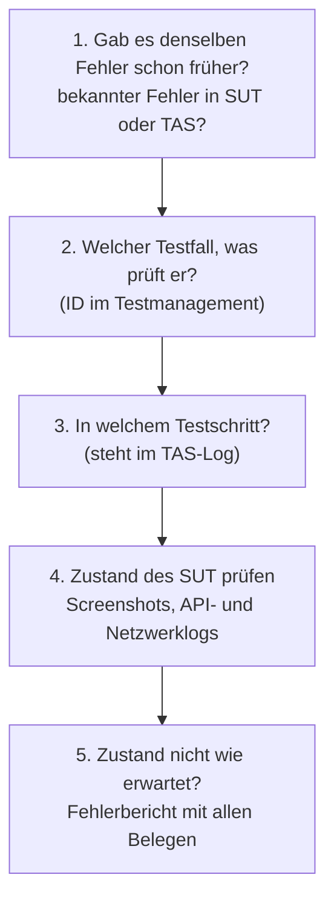

import Quiz from '@site/src/components/Quiz';
import fragen from './04-tae-berichte-verifikation.fragen.yaml';

# TAE: Berichte, Metriken und Verifikation

:::info[Lernziele]
Nach dieser Lektion kannst du …
- **Daten** aus TAS und SUT sammeln und wissen, was protokolliert werden sollte,
- **Fehlschläge analysieren** und entscheiden, ob der Fehler im SUT oder in der TAS liegt,
- erklären, wie ein **Testfortschrittsbericht** aufgebaut und veröffentlicht wird,
- die **Verifikation** der Testautomationsumgebung und der Testsuiten planen,
- Ursachen **unerwarteter Ergebnisse** finden,
- erklären, wie **statische Analyse** die Qualität von Testcode verbessert.
:::

## Datenquellen \{#datenquellen}

- **SUT-Logs**: Web- und Mobiloberfläche, APIs, Anwendungen, Webserver, Datenbankserver
- **TAF-Logs** als Prüfpfad (Audit Trail)
- **Build-Logs** und **Deployment-Logs**
- **Produktionslogs** und Monitoring: Performance-Trends in Produktion, Logs aus Last-, Stress- und Spike-Tests
- **Screenshots und Bildschirmaufnahmen**

Weil die TAS auf gemeinsamer Testware aufbaut, kann man **die unterste Ebene erweitern**, und alle Tests profitieren –
z. B. Start- und Endzeit jedes Tests einmal im Basiscode protokollieren statt in jedem Test.

Wichtig für die Auswertung:

- Berichte über **mehrere Läufe** brauchen eine **Trendanalyse**, z. B. wie sich die Erfolgsquote ändert.
- Der **Teststatus** muss korrekt ermittelt werden. Bei Fehlschlag braucht man mehr Informationen (z. B. Screenshots).
- Vergleiche sollten **erwartete Unterschiede ignorieren** (Datum, Uhrzeit) und nur unerwartete hervorheben.

## Was die TAS protokollieren sollte \{#tas-logging}

- **welcher Testfall** gerade läuft, mit **Start- und Endzeit**
- der **Status**: bestanden, fehlgeschlagen oder **TAS-Fehler** (der Fehler liegt **nicht** im SUT); manchmal
  **unklar** (inconclusive) – die Organisation sollte die Status eindeutig definieren
- **wichtige Testschritte** mit Zeitangaben
- **dynamische Informationen** über das SUT, z. B. Speicherlecks (mit Drittwerkzeugen)
- bei Zuverlässigkeits- und Stresstests ein **Zähler**, wie oft die Tests liefen
- bei **zufälligen Elementen** (Parameter, Pfade) die **gewählten Zufallswerte** – sonst ist der Lauf nicht reproduzierbar
- alle **Aktionen**, sodass sich der Test aus dem Log **wiederholen** lässt
- **Screenshots** für die Ursachenanalyse
- bei Fehlschlägen alle nötigen Informationen: **Crash-Dumps, Stacktraces**; Logs, die überschrieben werden könnten
  (Ringpuffer), **sichern**
- **Farben** helfen: Fehler rot, Fortschritt grün

## Was das SUT protokollieren sollte \{#sut-logging}

- bei einem Fehler: **Zeitstempel**, **Quelle** und **Fehlermeldung**
- beim Start die **Konfiguration**: Software- und Firmware-Versionen, SUT- und Betriebssystemkonfiguration
- Logs sollen **durchsuchbar** sein; ein Fehler im TAS-Log muss sich im SUT-Log wiederfinden lassen – **synchronisierte
  Zeitstempel** machen das möglich

Ergebnisse lassen sich in **Drittwerkzeuge** exportieren (Tabellen, XML, Datenbanken, Testmanagement) und mit Diagrammen
oder **Ampeln** visualisieren. Das Management will vor allem die Übersicht und klickt bei Bedarf in die Details.

## Fehlschläge analysieren \{#analyse}

Für die Analyse sind die Daten der **TAS primär**, die des **SUT sekundär**. Vorgehen bei einem Fehlschlag:



Sonderfälle:

- **Ist und Soll stimmen überein, der Test schlägt trotzdem fehl** → wahrscheinlich ein Fehler **in der TAS** oder ein
  unsichtbarer Unterschied (z. B. Leerzeichen, Zeitzone).
- **Viele Tests schlagen gleichzeitig fehl** → oft war die **Testumgebung (teilweise) nicht verfügbar**. Die SUT-Logs
  zeigen, ob es zur Laufzeit Ausfälle gab.

Außerdem auswerten: Umgebungsdaten für die **Dimensionierung** (Cluster, CPU, RAM; ein oder mehrere Browser parallel),
**Vergleich mit früheren Läufen** und **Weblogs** zur tatsächlichen Nutzung.

### Correlation-ID \{#correlation-id}

Viele Systeme vergeben pro Interaktion eine eindeutige **Correlation-ID** (auch **Trace-ID**), die bei jedem Folgeaufruf
mitgeht. Protokolliert die TAS diese ID, lässt sich der Weg einer Testanfrage durch alle Dienste verfolgen.

```csharp title="Correlation-ID im API-Test mitprotokollieren"
var id = Guid.NewGuid().ToString();
client.DefaultRequestHeaders.Add("X-Correlation-ID", id);
TestContext.Out.WriteLine($"Correlation-ID: {id}");   // im Testlog – damit im SUT-Log suchen
```

## Der Testfortschrittsbericht \{#bericht}

Testlogs sind detailliert, geben aber **keinen Überblick**. Nach einer Suite wird deshalb ein knapper
**Testfortschrittsbericht** erstellt (oft mit einem Berichtsgenerator). Er enthält:

- die **Testergebnisse**, welche Tests fehlschlugen und **warum**
- Informationen über das **SUT** und die **Testumgebung**
- die **Ausführungshistorie** und wer den Test erstellt oder zuletzt geändert hat – diese Person kümmert sich um Ursache,
  Fehlerbericht und Nachtest

Der Bericht dient auch dazu, **Fehler in TAF-Komponenten** zu erkennen.

**Veröffentlichen**: auf einer Website, in der Cloud oder lokal, per Mailingliste, im Testmanagement oder per **Chatbot** –
so wird er tatsächlich gelesen. Eine **Historie** der Berichte zeigt, welche Teile häufig Regressionen haben.

| Stakeholder | Typische Rollen | Interessiert an |
|---|---|---|
| **Management** | Architektur, Projekt- und Programmleitung, Testmanagement | **Trends**: neue Tests, Bestehensquote, Zuverlässigkeit von TAS und SUT |
| **Operativ** | Product Owner, Fachseite, Business-Analyse | **Produktnutzung** |
| **Technisch** | Teamleitung, Scrum Master, Admins, Entwicklung, Test, TAE | **Details** auf niedriger Ebene |

**Dashboards** sammeln Daten aus Pipelines, Projektmanagement und Repositories und zeigen Trends wie **Fehlerhäufungen**,
Fehler, die bis in bestimmte Umgebungen durchrutschen, **Performance-Verschlechterung** und **Build-Zuverlässigkeit**.
**KI/ML** in Werkzeugen hilft, kaputte Locators zu finden, Fehlschläge einzuordnen (SUT oder TAS?) und ähnliche Fehler zu
gruppieren.

## Die Testautomationsumgebung verifizieren \{#umgebung-verifizieren}

Bevor man sich auf die Ergebnisse verlässt, muss die TAS selbst geprüft werden:

| Prüfung | Worum es geht |
|---|---|
| **Installation, Einrichtung, Konfiguration** | Werkzeuge, Bibliotheken, Daten und Konfiguration **automatisiert** oder aus einem **Repository** installieren – dann laufen alle Tests mit derselben Version und Konfiguration; Updates über das Repository wie bei Entwicklerwerkzeugen |
| **Wiederholbarer Auf- und Abbau** | die TAS systematisch auf jede Umgebung bringen und wieder entfernen; Neuaufbau darf **keinen Unterschied** machen; Konfigurationsmanagement und Dokumentation der Komponenten |
| **Verbindungen** | vor dem Test prüfen: Anmeldung an Servern, Werkzeuge starten, SUT erreichbar, Konfiguration, **Berechtigungen** für Logs und Berichte |
| **TAF-Komponenten testen** | wie jede Software, funktional und nicht-funktional: z. B. Objekterkennung für viele GUI-Klassen, korrekte Berichte, Performance, **Speicherlecks**, Interoperabilität |

## Testsuiten verifizieren \{#suite-verifizieren}

- **Zusammensetzung prüfen**: Vollständigkeit (alle Tests haben erwartete Ergebnisse, Testdaten sind da), richtige Version
  von TAF und SUT.
- **Neue TAF-Funktionen** beim ersten Einsatz genau beobachten.
- **Wiederholbarkeit**: Wiederholte Läufe müssen gleiche Ergebnisse liefern. Unzuverlässige Tests (z. B. Race Conditions)
  **aus der aktiven Suite nehmen** und gesondert analysieren – siehe [Flaky Tests](../02-testautomation/01-grundlagen/02-flaky-tests.mdx).
- **Intrusivität**: Die TAS ist eng mit dem SUT gekoppelt. Läuft sie in der SUT-Umgebung, kann sich das SUT **anders
  verhalten** als bei manueller Bedienung (auch in der Performance). Dann zeigen Tests Fehler, die es in Produktion nicht
  gibt – und das Vertrauen in die TAS sinkt. Entwickler verlangen dann oft, Fehler **manuell nachzustellen**.

## Unerwartete Ergebnisse \{#unerwartet}

Schlägt ein Test **unerwartet fehl oder besteht unerwartet**, folgt eine **Ursachenanalyse**: Logs, Performancedaten,
Setup und Teardown prüfen, einzelne Tests **isoliert** ausführen, Systemressourcen beobachten, debuggen, bei Bedarf
Testanalyse, Fachseite, Entwicklung oder Systemtechnik hinzuziehen. Der Fehler kann im **Testfall, im SUT, im TAF, in der
Hardware oder im Netzwerk** liegen. Sporadische Fehler sind am schwersten.

**Fehlende Assertions** prüfen – ohne Assertion ist ein Ergebnis **nicht aussagekräftig**:

```csharp title="Besteht immer – prüft aber nichts"
[Test]
public async Task Bestellung_wird_gespeichert()
{
    await shop.BestelleAsync(produktId: 3, menge: 2);
    // keine Assertion: der Test ist grün, egal was gespeichert wurde
}
```

## Statische Analyse für Testcode \{#statische-analyse}

Statische Codeanalyse findet **Schwachstellen und Fehler** im Code – im SUT **und im TAF**. Sie läuft früh in der
Pipeline, ist eine **proaktive** Technik und zentral für **DevSecOps**. Befunde werden meist als **kritisch, hoch, mittel,
niedrig** eingestuft; manche Werkzeuge schlagen gleich eine Korrektur vor. Für TAEs messen sie Qualität und zeigen
schlechte Bibliotheksaufrufe, fehlende Fehlerbehandlung oder ungünstige Schleifen.

Klassisches Beispiel: ein **Passwort im Klartext** im Testskript. Testcode wird zwar nicht mit ausgeliefert, aber ein
gefundenes Passwort ist trotzdem eine Schwachstelle. Deshalb gehören **Testskripte in dieselben Scans** wie der
Produktivcode – siehe [Sicherheitstests und DevSecOps](../07-cybersecurity/04-sicherheitstests-devsecops.mdx).

## Typische Fehler \{#typische-fehler}

- Zufallswerte nicht protokollieren – der Fehlschlag lässt sich nicht nachstellen.
- Jeden Fehlschlag sofort als Fehler im SUT melden, ohne die TAS zu prüfen.
- Einen Bericht für alle: Management bekommt Stacktraces, Entwicklung nur Ampeln.
- Flaky Tests in der aktiven Suite lassen – jedes Mal wird derselbe Fehlschlag neu analysiert.
- Testcode von statischer Analyse und Secret-Scans ausnehmen.

## Zusammenfassung \{#zusammenfassung}

- Daten aus **SUT, TAF, Build, Deployment, Produktion** und Screenshots sammeln; Basiscode einmal erweitern.
- Die TAS protokolliert Test, Zeiten, Status (inkl. **TAS-Fehler**), Schritte, Zufallswerte, Dumps; das SUT Fehler,
  Konfiguration und synchronisierte Zeitstempel.
- **Fünf Schritte** der Fehleranalyse; **Correlation-ID** verbindet Test- und SUT-Logs.
- **Testfortschrittsbericht** je Stakeholder: Management Trends, Operative Nutzung, Technik Details.
- TAS **verifizieren**: Installation, wiederholbarer Aufbau, Verbindungen, TAF-Komponenten; Suiten auf Vollständigkeit,
  Wiederholbarkeit und **Intrusivität** prüfen.
- **Statische Analyse** auch für Testcode – etwa gegen Klartext-Passwörter.

<Quiz fragen={fragen} titel="Quiz: TAE – Berichte, Metriken und Verifikation" />
