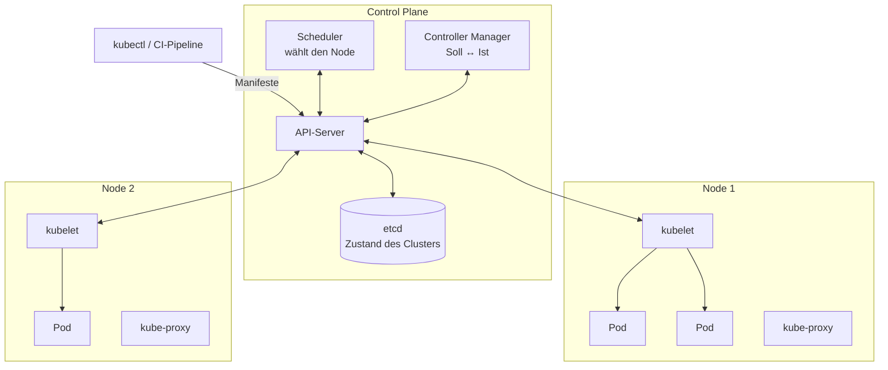
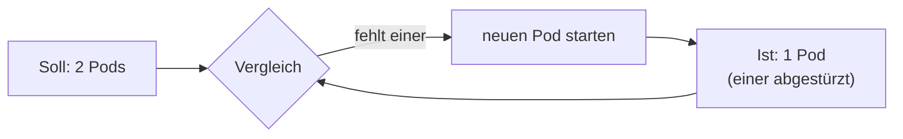

import Quiz from '@site/src/components/Quiz';
import fragen from './01-kubernetes-grundlagen.fragen.yaml';

# Kubernetes-Grundlagen

:::info[Lernziele]
Nach dieser Lektion kannst du …
- erklären, welche Aufgaben Kubernetes übernimmt und wie ein Cluster aufgebaut ist,
- das Prinzip **Soll gegen Ist** beschreiben,
- **Pod, Deployment, Service und Namespace** unterscheiden,
- ein **Manifest** lesen und mit **kubectl** anwenden und untersuchen,
- einen lokalen Cluster mit **kind** starten.
:::

## Wozu Kubernetes? \{#wozu}

Mit Docker startet man Container auf **einem** Rechner. In Produktion braucht man mehr:

| Aufgabe | Ohne Orchestrierung | Mit Kubernetes |
|---|---|---|
| Container stürzt ab | jemand startet ihn neu | wird automatisch neu gestartet |
| Rechner fällt aus | Anwendung ist weg | Pods werden auf anderen Nodes gestartet |
| Mehr Last | Container von Hand dazustarten | Anzahl der Replikate erhöhen (auch automatisch) |
| Neue Version | stoppen, tauschen, starten – mit Ausfall | **Rolling Update** ohne Ausfall, Rollback per Befehl |
| Anfragen verteilen | eigener Load Balancer | **Service** verteilt auf alle bereiten Pods |

Kubernetes (kurz **K8s**) stammt ursprünglich von Google und ist heute der Standard. Alle großen Clouds bieten es als
verwalteten Dienst an: **AKS** (Azure), **EKS** (AWS), **GKE** (Google). OpenShift von Red Hat baut darauf auf.

## Aufbau eines Clusters \{#architektur}



| Teil | Aufgabe |
|---|---|
| **API-Server** | einziger Eingang: alle Befehle und Komponenten sprechen mit ihm |
| **etcd** | Datenbank mit dem gesamten Zustand des Clusters |
| **Scheduler** | entscheidet, auf welchem Node ein neuer Pod läuft (nach freien Ressourcen) |
| **Controller Manager** | Regelkreise, die Soll und Ist vergleichen und angleichen |
| **kubelet** | Agent auf jedem Node; startet die Container über die Container-Runtime (meist containerd) |
| **kube-proxy** | sorgt auf jedem Node dafür, dass Services erreichbar sind |

## Soll gegen Ist \{#soll-ist}

Kubernetes arbeitet **deklarativ**: Man beschreibt den **gewünschten Zustand** („2 Pods des Shops in Version 1.0“), nicht
die Schritte dorthin. Controller vergleichen ständig Soll und Ist und gleichen ab (*Reconciliation*):



Das erklärt viel Verhalten: Löscht man einen Pod eines Deployments, ist er nach Sekunden wieder da – nicht als derselbe Pod,
sondern als **neuer** mit neuem Namen und neuer IP.

## Die wichtigsten Objekte \{#objekte}

### Pod \{#pod}

Die kleinste Einheit: **ein oder mehrere Container**, die sich Netzwerk (eine IP) und Speicher-Volumes teilen. Meist ein
Container pro Pod; zusätzliche Container (*Sidecars*) z. B. für Logs oder Proxys. Pods sind **vergänglich** – man startet
sie fast nie direkt.

### Deployment und ReplicaSet \{#deployment}

Ein **Deployment** beschreibt, welches Image in wie vielen **Replikaten** laufen soll. Es erzeugt ein **ReplicaSet**, das die
Anzahl der Pods hält. Bei einer neuen Version legt das Deployment ein neues ReplicaSet an und fährt das alte schrittweise
herunter.

```yaml title="beispiele/kubernetes/manifeste/deployment.yaml (Auszug)"
apiVersion: apps/v1
kind: Deployment
metadata:
  name: mini-shop
  namespace: mini-shop
spec:
  replicas: 2
  selector:
    matchLabels:
      app: mini-shop          # welche Pods gehören dazu?
  template:                   # Vorlage für jeden Pod
    metadata:
      labels:
        app: mini-shop
    spec:
      containers:
        - name: shop
          image: mini-shop:1.0
          ports:
            - name: http
              containerPort: 8080
```

### Service \{#service}

Pods kommen und gehen, ihre IPs ändern sich. Ein **Service** gibt ihnen einen **stabilen Namen** und verteilt Anfragen auf
alle **bereiten** Pods mit passenden Labels.

```yaml title="beispiele/kubernetes/manifeste/service.yaml (Auszug)"
apiVersion: v1
kind: Service
metadata:
  name: mini-shop
  namespace: mini-shop
spec:
  selector:
    app: mini-shop
  ports:
    - port: 80              # Port des Services
      targetPort: http      # Port im Container (8080)
```

Innerhalb des Clusters ist der Shop dann per DNS unter `http://mini-shop` (im selben Namespace) oder
`http://mini-shop.mini-shop.svc.cluster.local` erreichbar.

| Typ | Erreichbar von | Typisch für |
|---|---|---|
| **ClusterIP** (Standard) | nur innerhalb des Clusters | Dienste, die andere Dienste aufrufen |
| **NodePort** | von außen über einen Port auf jedem Node (30000–32767) | Tests, einfache Umgebungen |
| **LoadBalancer** | von außen über einen Load Balancer der Cloud | öffentliche Dienste in der Cloud |

Für HTTP von außen nutzt man meist einen **Ingress** – dazu mehr in [Konfiguration und Betrieb](./02-konfiguration-betrieb.mdx#ingress).

### Namespace \{#namespace}

Ein **Namespace** trennt Objekte logisch: Namen müssen nur innerhalb eines Namespace eindeutig sein, Rechte und
Ressourcengrenzen lassen sich pro Namespace vergeben. Typisch: ein Namespace pro Anwendung, pro Team – oder **pro
Testumgebung** (siehe [Testen mit Kubernetes](./03-testen-mit-kubernetes.mdx#pro-pull-request)).

### Labels und Selektoren \{#labels}

**Labels** sind Schlüssel-Wert-Paare an Objekten (`app: mini-shop`, `umgebung: test`). **Selektoren** wählen Objekte
anhand ihrer Labels aus – so findet ein Deployment seine Pods und ein Service seine Ziele.

:::warning[Selektor und Labels müssen passen]
Stimmt der Selektor des Services nicht mit den Labels der Pods überein (Tippfehler, `app: minishop`), hat der Service
**keine Endpunkte**. Er existiert, antwortet aber nicht – ein häufiger Fehler. Prüfen mit `kubectl get endpointslices`.
:::

## Aufbau eines Manifests \{#manifest}

Jedes Kubernetes-Objekt wird in YAML beschrieben und hat vier Teile:

| Feld | Bedeutung |
|---|---|
| `apiVersion` | API-Gruppe und Version, z. B. `apps/v1` für Deployments, `v1` für Services |
| `kind` | Art des Objekts: `Deployment`, `Service`, `ConfigMap` … |
| `metadata` | Name, Namespace, Labels, Annotationen |
| `spec` | der **gewünschte** Zustand |

Den **tatsächlichen** Zustand schreibt Kubernetes in das Feld `status` – sichtbar mit `kubectl get … -o yaml`.

## kubectl \{#kubectl}

| Befehl | Wirkung |
|---|---|
| `kubectl apply -f datei.yaml` | Manifest anwenden (anlegen oder ändern) |
| `kubectl apply -k ordner/` | alle Manifeste einer Kustomization anwenden |
| `kubectl get pods -n mini-shop` | Pods im Namespace auflisten (`-o wide` mit Node und IP) |
| `kubectl get all -n mini-shop` | Pods, Deployments, ReplicaSets, Services |
| `kubectl describe pod <name>` | Details und **Ereignisse** – erste Anlaufstelle bei Problemen |
| `kubectl logs <pod>` / `-l app=mini-shop` | Ausgaben eines Pods / aller Pods mit dem Label |
| `kubectl exec -it <pod> -- sh` | Shell im Container |
| `kubectl port-forward service/mini-shop 8080:80` | Service lokal unter Port 8080 erreichbar machen |
| `kubectl delete -f datei.yaml` | Objekte löschen |

Mit `kubectl config set-context --current --namespace=mini-shop` spart man sich das ständige `-n`.

## Lokale Cluster \{#lokal}

| Werkzeug | Eigenschaft |
|---|---|
| **kind** (Kubernetes in Docker) | Nodes als Docker-Container; schnell, ideal für die CI |
| **minikube** | lokale VM oder Container, viele Erweiterungen |
| **k3d** / **k3s** | sehr leichtes Kubernetes, auch für kleine Server |
| **Docker Desktop** | Kubernetes per Schalter in den Einstellungen |

```bash
kind create cluster --name lernplattform
kind load docker-image mini-shop:1.0 --name lernplattform   # lokales Image in den Cluster laden
kubectl apply -k manifeste
kubectl -n mini-shop rollout status deployment/mini-shop     # warten, bis alles bereit ist
```

## Typische Fehler \{#typische-fehler}

- Pods direkt anlegen statt über ein Deployment – stürzt der Pod ab, startet ihn niemand neu.
- Selektor und Pod-Labels passen nicht – der Service hat keine Endpunkte.
- Auf Pod-IPs zugreifen statt auf den Service-Namen – nach jedem Neustart ist die IP eine andere.
- Im falschen Namespace suchen: `kubectl get pods` zeigt nur `default`.
- `port` und `targetPort` verwechseln.
- Annehmen, dass ein gelöschter Pod „derselbe“ wiederkommt – er ist neu, sein Arbeitsspeicher ist leer.

## Zusammenfassung \{#zusammenfassung}

- Kubernetes betreibt Container auf vielen Nodes: Neustart, Verteilung, Updates ohne Ausfall.
- **Control Plane** (API-Server, etcd, Scheduler, Controller) und **Nodes** (kubelet, kube-proxy, Runtime).
- **Deklarativ**: Soll beschreiben, Controller gleichen das Ist an.
- **Pod** (Container), **Deployment** (Anzahl und Version), **Service** (stabiler Name, Lastverteilung), **Namespace**
  (Trennung), verbunden über **Labels und Selektoren**.
- Manifeste: `apiVersion`, `kind`, `metadata`, `spec`; Zustand in `status`.
- **kubectl** zum Anwenden und Untersuchen, **kind** für lokale und CI-Cluster.

<Quiz fragen={fragen} titel="Quiz: Kubernetes-Grundlagen" />
