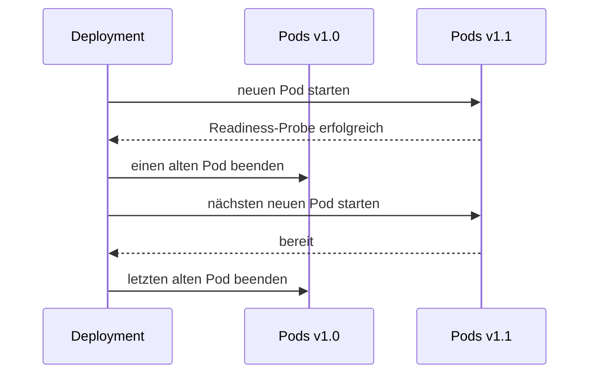
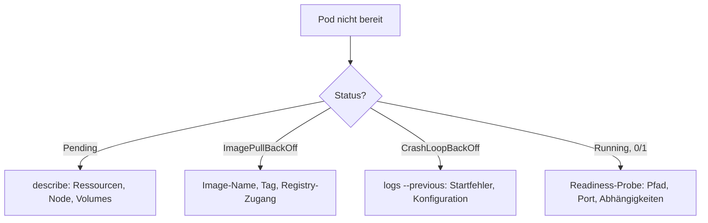

import Quiz from '@site/src/components/Quiz';
import fragen from './02-konfiguration-betrieb.fragen.yaml';

# Konfiguration und Betrieb

:::info[Lernziele]
Nach dieser Lektion kannst du …
- Konfiguration mit **ConfigMaps** und **Secrets** vom Image trennen,
- **Probes** und **Ressourcengrenzen** richtig setzen und ihre Folgen erklären,
- **Rolling Updates** und **Rollbacks** durchführen,
- Pods mit **Sicherheitskontext** und **NetworkPolicy** absichern,
- typische **Fehlerzustände** von Pods erkennen und untersuchen.
:::

## ConfigMaps und Secrets \{#konfiguration}

Dasselbe Image soll in Test und Produktion laufen – nur mit anderer Konfiguration. Die steht deshalb **nicht im Image**,
sondern in Kubernetes-Objekten:

```yaml title="beispiele/kubernetes/manifeste/configmap.yaml"
apiVersion: v1
kind: ConfigMap
metadata:
  name: mini-shop-konfiguration
  namespace: mini-shop
data:
  ASPNETCORE_ENVIRONMENT: Production
  Logging__LogLevel__Default: Warning   # doppelter Unterstrich = Ebene in appsettings.json
```

```yaml title="Im Deployment: alle Einträge als Umgebungsvariablen"
envFrom:
  - configMapRef:
      name: mini-shop-konfiguration
```

ConfigMaps lassen sich auch als **Dateien** in den Container einhängen (z. B. eine `appsettings.json`).

**Secrets** funktionieren genauso, sind aber für vertrauliche Werte gedacht – Passwörter, Tokens, Zertifikate.

:::danger[Base64 ist keine Verschlüsselung]
Die Werte eines Secrets sind nur **Base64-kodiert**. Jeder, der das Secret lesen darf, kann sie dekodieren. Schutz
entsteht erst durch **RBAC** (wer darf Secrets lesen?), **Verschlüsselung in etcd** und oft durch externe Tresore
(Azure Key Vault, AWS Secrets Manager, HashiCorp Vault). Secrets gehören **nie** im Klartext ins Git-Repository.
:::

Eine Änderung an einer ConfigMap wirkt auf Umgebungsvariablen erst nach einem **Neustart** der Pods
(`kubectl rollout restart deployment/mini-shop`).

## Probes \{#probes}

Mit **Probes** fragt Kubernetes regelmäßig nach, wie es dem Container geht:

| Probe | Frage | Bei Fehlschlag |
|---|---|---|
| **Readiness** | Kann der Container Anfragen annehmen? | Pod wird aus dem Service **genommen** – kein Verkehr, kein Neustart |
| **Liveness** | Lebt der Prozess noch sinnvoll? | Container wird **neu gestartet** |
| **Startup** | Ist der Start schon abgeschlossen? | Liveness und Readiness warten, bis sie erfolgreich ist – für langsam startende Anwendungen |

```yaml title="beispiele/kubernetes/manifeste/deployment.yaml (Auszug)"
readinessProbe:
  httpGet:
    path: /api/produkte
    port: http
  periodSeconds: 5
  failureThreshold: 2
livenessProbe:
  httpGet:
    path: /api/produkte
    port: http
  initialDelaySeconds: 10
  periodSeconds: 10
  failureThreshold: 3
```

:::warning[Liveness nicht von Abhängigkeiten abhängig machen]
Prüft die Liveness-Probe auch die Datenbank, startet Kubernetes bei einem Datenbankausfall **alle** Pods neu – immer
wieder. Das macht den Ausfall schlimmer. Abhängigkeiten gehören, wenn überhaupt, in die **Readiness**-Probe. In echten
Anwendungen gibt es dafür eigene Endpunkte wie `/health/live` und `/health/ready`.
:::

Ohne Readiness-Probe schickt der Service Anfragen an Pods, die noch starten – nach jedem Deployment gibt es dann kurz
Fehler.

## Ressourcen \{#ressourcen}

```yaml
resources:
  requests:          # garantiert; danach plant der Scheduler
    cpu: 100m        # 0,1 CPU-Kern
    memory: 128Mi
  limits:            # Obergrenze
    cpu: 500m
    memory: 256Mi
```

| | CPU | Arbeitsspeicher |
|---|---|---|
| **Request** | reserviert für den Pod | reserviert für den Pod |
| **Limit überschritten** | Container wird **gebremst** (Throttling) – langsam, aber läuft | Container wird **beendet**: `OOMKilled` |

Zu hohe Requests: Pods finden keinen Node und bleiben `Pending`. Zu niedrige Memory-Limits: Neustarts unter Last. Beides
ist ein Fall für **Lasttests** in einer realistischen Umgebung – siehe [Lasttests mit k6](../02-testautomation/06-performance/02-lasttests-mit-k6.mdx).

## Rolling Updates und Rollback \{#rolling-update}

Ändert sich das Image, ersetzt das Deployment die Pods **schrittweise**:

```yaml
strategy:
  type: RollingUpdate
  rollingUpdate:
    maxUnavailable: 0   # nie weniger bereite Pods als gewünscht
    maxSurge: 1         # höchstens ein zusätzlicher Pod während des Updates
```



| Befehl | Wirkung |
|---|---|
| `kubectl set image deployment/mini-shop shop=mini-shop:1.1` | neue Version ausrollen |
| `kubectl rollout status deployment/mini-shop` | warten, bis das Update fertig ist (gut für die CI) |
| `kubectl rollout history deployment/mini-shop` | bisherige Versionen |
| `kubectl rollout undo deployment/mini-shop` | zurück zur vorherigen Version |
| `kubectl rollout restart deployment/mini-shop` | alle Pods neu starten, z. B. nach geänderter ConfigMap |

Beim Beenden eines Pods nimmt Kubernetes ihn **gleichzeitig** aus dem Service und schickt das Signal zum Beenden. Damit
dabei keine Anfragen verloren gehen, wartet ein **preStop-Hook** ein paar Sekunden (siehe
[Befund im Testen-Kapitel](./03-testen-mit-kubernetes.mdx#selbstheilung)):

```yaml
lifecycle:
  preStop:
    sleep:
      seconds: 5
```

Startet die neue Version nicht (Readiness schlägt fehl), bleibt das Update stehen – die alten Pods laufen weiter. Darauf
beruht die Sicherheit von Rolling Updates; ohne Readiness-Probe gibt es sie nicht.

## Ingress \{#ingress}

Ein **Ingress** leitet HTTP-Anfragen von außen anhand von Hostname und Pfad an Services weiter – ein Eingang für viele
Anwendungen, inklusive TLS:

```yaml
apiVersion: networking.k8s.io/v1
kind: Ingress
metadata:
  name: mini-shop
spec:
  rules:
    - host: shop.test.example.org
      http:
        paths:
          - path: /
            pathType: Prefix
            backend:
              service:
                name: mini-shop
                port:
                  number: 80
```

Damit das funktioniert, muss ein **Ingress-Controller** laufen (z. B. ingress-nginx, Traefik). Der Nachfolger ist die
**Gateway API**.

## Kustomize und Helm \{#kustomize-helm}

| Werkzeug | Idee | Typisch für |
|---|---|---|
| **Kustomize** (in kubectl eingebaut: `apply -k`) | einfache YAML-Dateien plus **Überlagerungen** je Umgebung (andere Replikate, andere Konfiguration) | eigene Anwendungen |
| **Helm** | **Charts** mit Vorlagen und Werten (`values.yaml`), versioniert und installierbar | fertige Software installieren (Datenbanken, Monitoring) |

```yaml title="beispiele/kubernetes/manifeste/kustomization.yaml"
apiVersion: kustomize.config.k8s.io/v1beta1
kind: Kustomization
resources:
  - namespace.yaml
  - configmap.yaml
  - deployment.yaml
  - service.yaml
  - networkpolicy.yaml
```

## Sicherheit \{#sicherheit}

Die wichtigsten Einstellungen pro Pod – alle im Beispiel gesetzt:

```yaml
spec:
  automountServiceAccountToken: false   # kein Token für die Kubernetes-API im Container
  securityContext:
    runAsNonRoot: true
    runAsUser: 10001
    seccompProfile:
      type: RuntimeDefault              # Systemaufrufe einschränken
  containers:
    - name: shop
      securityContext:
        allowPrivilegeEscalation: false
        readOnlyRootFilesystem: true    # Angreifer können keine Dateien ablegen
        capabilities:
          drop: ["ALL"]
```

Mit `readOnlyRootFilesystem` braucht die Anwendung einen beschreibbaren Ort für temporäre Dateien – im Beispiel ein
`emptyDir`-Volume unter `/tmp`.

Eine **NetworkPolicy** legt fest, wer einen Pod erreichen darf – ohne sie darf **jeder Pod im Cluster** jeden anderen
erreichen:

```yaml title="beispiele/kubernetes/manifeste/networkpolicy.yaml"
apiVersion: networking.k8s.io/v1
kind: NetworkPolicy
metadata:
  name: mini-shop-zugriff
  namespace: mini-shop
spec:
  podSelector:
    matchLabels:
      app: mini-shop
  policyTypes: ["Ingress"]
  ingress:
    - from:
        - podSelector: {}   # nur Pods aus demselben Namespace
      ports:
        - port: 8080
```

NetworkPolicies wirken nur, wenn das Netzwerk-Plugin des Clusters sie umsetzt (z. B. Calico, Cilium). **RBAC** (Role,
RoleBinding) regelt, wer welche Objekte über die API lesen und ändern darf. Mehr zur Härtung in
[Systemhärtung](../07-cybersecurity/05-systemhaertung.mdx) und zu Cloud-Identitäten in
[Cloud-Sicherheit](../10-cloud/02-cloud-sicherheit.mdx).

## Fehlersuche \{#fehlersuche}

| Status | Bedeutung | Erste Schritte |
|---|---|---|
| **Pending** | kein Node gefunden | `kubectl describe pod` → Ereignisse: zu hohe Requests? Volume fehlt? |
| **ImagePullBackOff** / **ErrImagePull** | Image nicht ladbar | Tippfehler im Namen oder Tag? Registry-Zugang? Bei kind: `kind load` vergessen? |
| **CrashLoopBackOff** | Container startet und stürzt immer wieder ab | `kubectl logs <pod> --previous` – Ausgabe des **vorherigen** Versuchs |
| **OOMKilled** (im `describe`) | Speicherlimit überschritten | Limit erhöhen oder Speicherleck suchen |
| **Running**, aber **0/1 READY** | Readiness-Probe schlägt fehl | Pfad und Port der Probe prüfen, `kubectl describe pod` |
| Service antwortet nicht | keine Endpunkte | `kubectl get endpointslices` – passen Selektor und Labels? |

```bash
kubectl -n mini-shop get pods
kubectl -n mini-shop describe pod mini-shop-7d9c8b5f4-x2k8q     # Ereignisse ganz unten
kubectl -n mini-shop logs mini-shop-7d9c8b5f4-x2k8q --previous
kubectl -n mini-shop get events --sort-by=.lastTimestamp
```



## Typische Fehler \{#typische-fehler}

- Passwörter in ConfigMaps statt Secrets – oder Secrets im Klartext im Repository.
- Keine Readiness-Probe: Nach jedem Deployment gibt es kurze Fehler.
- Liveness-Probe prüft die Datenbank – ein Datenbankausfall führt zu Neustarts aller Pods.
- Keine Ressourcengrenzen: Ein Pod mit Speicherleck verdrängt alle anderen auf dem Node.
- Tag `latest`: Niemand weiß, welche Version läuft, und Rollbacks sind unmöglich.
- Container als root mit beschreibbarem Dateisystem.
- Bei `CrashLoopBackOff` nur `logs` ohne `--previous` ansehen – man sieht den neuen, noch leeren Versuch.

## Zusammenfassung \{#zusammenfassung}

- Konfiguration in **ConfigMaps**, vertrauliche Werte in **Secrets** (nur Base64 – Schutz über RBAC und Tresore).
- **Readiness** steuert den Verkehr, **Liveness** den Neustart, **Startup** schützt langsame Starts.
- **Requests** für die Planung, **Limits** als Grenze: CPU wird gebremst, Speicher führt zu `OOMKilled`.
- **Rolling Update** mit `maxUnavailable: 0` und Readiness-Probe; `rollout undo` für den Rückweg.
- Sicherheit: nicht als root, schreibgeschütztes Dateisystem, keine Capabilities, **NetworkPolicy**.
- Fehlersuche: `describe` (Ereignisse), `logs --previous`, `get endpointslices`.

<Quiz fragen={fragen} titel="Quiz: Konfiguration und Betrieb" />
