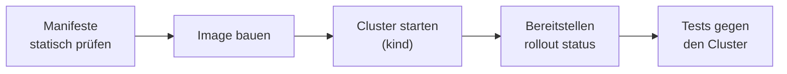
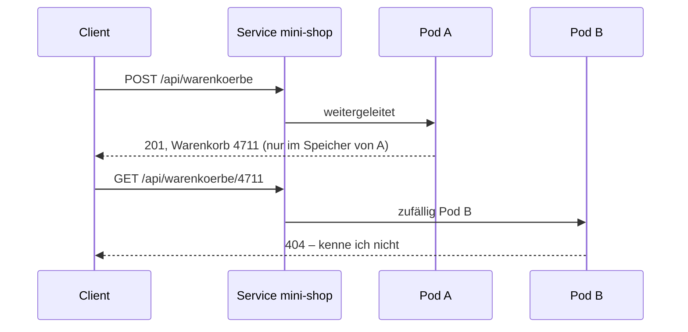

import Quiz from '@site/src/components/Quiz';
import fragen from './03-testen-mit-kubernetes.fragen.yaml';

# Testen mit Kubernetes

:::info[Lernziele]
Nach dieser Lektion kannst du …
- **Manifeste** ohne Cluster auf Fehlkonfigurationen prüfen,
- einen **kind-Cluster** in der CI starten und eine Anwendung bereitstellen,
- **Rauch-, Sicherheits- und Resilienztests** gegen einen Cluster schreiben,
- erklären, warum **Zustand im Arbeitsspeicher** mit mehreren Pods zum Fehler wird,
- **Testumgebungen pro Pull Request** mit Namespaces planen.
:::

## Wo Tests ansetzen \{#ebenen}



| Ebene | Was wird geprüft? | Werkzeuge |
|---|---|---|
| **Statisch** | Schema, Sicherheitsregeln, Best Practices – ohne Cluster | Checkov, kubeconform, kube-linter, `kubectl apply --dry-run=server` |
| **Bereitstellung** | Lässt sich alles anwenden? Werden die Pods bereit? | `kubectl apply`, `kubectl rollout status` |
| **Rauchtests** | Antwortet der Dienst über den Service? Stimmen Konfiguration und Sicherheit? | pytest + kubectl, curl |
| **Resilienz** | Übersteht der Dienst den Ausfall eines Pods? Ein Rolling Update? | Pods löschen, Chaos-Werkzeuge (Chaos Mesh, Litmus) |
| **Last** | Reichen Requests und Limits? | k6, Locust gegen den Cluster |

Die funktionalen Tests der Anwendung laufen weiterhin **vorher** – Unit-, API- und UI-Tests gehören nicht in den Cluster.
Hier geht es um Fehler, die erst durch die **Bereitstellung** entstehen.

## Manifeste statisch prüfen \{#statisch}

**Checkov** kennt aus dem Bereich [Infrastructure as Code](../10-cloud/03-infrastructure-as-code.mdx) auch
Kubernetes-Regeln – über 90 Prüfungen allein für ein Deployment, z. B.:

| Prüfung | Regel |
|---|---|
| CKV_K8S_8 / 9 | Liveness- und Readiness-Probe vorhanden |
| CKV_K8S_10 bis 13 | CPU- und Speicher-Requests und -Limits gesetzt |
| CKV_K8S_20 | keine Rechteausweitung (`allowPrivilegeEscalation: false`) |
| CKV_K8S_22 | schreibgeschütztes Dateisystem |
| CKV_K8S_23 / 40 | nicht als root, hohe Benutzer-ID |
| CKV_K8S_43 | Image per Digest statt Tag |

```bash
pipx run --spec checkov==3.4.11 checkov -d manifeste --framework kubernetes --compact
```

```text
kubernetes scan results:

Passed checks: 90, Failed checks: 0, Skipped checks: 2
```

Die zwei übersprungenen Prüfungen sind **bewusst** abgeschaltet – mit Begründung direkt im Manifest:

```yaml title="deployment.yaml (Auszug)"
metadata:
  annotations:
    checkov.io/skip1: CKV_K8S_43=Image kommt per "kind load" in den Cluster; in Produktion per Digest referenzieren
    checkov.io/skip2: CKV_K8S_15=Image liegt nur lokal im kind-Cluster; "Always" würde es vergeblich aus einer Registry laden
```

:::tip[Werkzeuge in eigener Umgebung]
In der CI läuft Checkov über **pipx** in einer eigenen Umgebung. Grund war ein echter Konflikt: Checkov 3.4.11 verlangt
das Paket `packaging` in einer Version unter 24, pytest 9 mindestens Version 24 – in einer gemeinsamen Umgebung bricht
`pip install` ab. Kommandozeilen-Werkzeuge gehören deshalb in eigene Umgebungen.
:::

## Ein Cluster in der CI \{#kind-ci}

**kind** startet einen vollständigen Kubernetes-Cluster als Docker-Container – in GitHub Actions in etwa einer Minute:

```yaml title=".github/workflows/beispiele.yml (Auszug)"
- name: Container-Image des Mini-Shops bauen
  run: docker build -t mini-shop:1.0 -f Dockerfile ../shop
- name: Kubernetes-Cluster mit kind starten
  uses: helm/kind-action@v1
  with:
    cluster_name: lernplattform
- name: Image in den Cluster laden (ohne Registry)
  run: kind load docker-image mini-shop:1.0 --name lernplattform
- name: Bereitstellen und warten, bis alle Pods bereit sind
  run: |
    kubectl apply -k manifeste
    kubectl -n mini-shop rollout status deployment/mini-shop --timeout=180s
- name: Tests gegen den Cluster (Rauchtests, Selbstheilung, Zustand)
  run: pytest tests -v
```

`kubectl rollout status` ist das **Eingangskriterium** für die Tests: Erst wenn alle Pods bereit sind, lohnt es sich zu
testen. Schlägt es nach dem Timeout fehl, ist die Bereitstellung kaputt – nicht die Anwendung.

Das Image ist ein Multi-Stage-Build wie in der Lektion [Dockerfile](../05-docker/02-dockerfile.mdx) und läuft als
Nicht-root-Benutzer auf Port 8080.

## Tests mit pytest und kubectl \{#pytest}

Die Tests rufen `kubectl` über `subprocess` auf und werten das JSON aus:

```python title="beispiele/kubernetes/tests/conftest.py (Auszug)"
def kubectl(*argumente: str, pruefen: bool = True) -> str:
    ergebnis = subprocess.run(["kubectl", "-n", "mini-shop", *argumente],
                              capture_output=True, text=True, timeout=120)
    if pruefen and ergebnis.returncode != 0:
        raise AssertionError(f"kubectl {' '.join(argumente)} fehlgeschlagen:\n{ergebnis.stderr}")
    return ergebnis.stdout

def kubectl_json(*argumente: str) -> dict:
    return json.loads(kubectl(*argumente, "-o", "json"))
```

### Von innen testen statt per Port-Forward \{#von-innen}

`kubectl port-forward service/mini-shop` ist bequem, verbindet sich aber mit **genau einem Pod** – die Lastverteilung des
Services wird umgangen. Wer das echte Verhalten des Services testen will, ruft ihn **aus dem Cluster** auf. Dafür startet
eine Fixture einen kleinen Hilfs-Pod mit curl:

```python
def anfrage(url: str, methode: str = "GET") -> tuple[int, str]:
    befehl = ["curl", "-s", "-w", "\n%{http_code}", "-X", methode, url]
    *koerper, status = kubectl("exec", "testclient", "--", *befehl).rsplit("\n", 1)
    return int(status), "".join(koerper)
```

### Rauch- und Sicherheitstests \{#rauchtests}

```python title="beispiele/kubernetes/tests/test_bereitstellung.py (Auszug)"
def test_alle_replikate_sind_bereit():
    deployment = kubectl_json("get", "deployment", "mini-shop")
    assert deployment["status"].get("readyReplicas") == deployment["spec"]["replicas"] == 2

def test_service_liefert_die_produktliste():
    status, koerper = anfrage("http://mini-shop/api/produkte")
    assert status == 200
    assert len(json.loads(koerper)) == 5

def test_container_laeuft_nicht_als_root():
    assert kubectl("exec", "deploy/mini-shop", "--", "id", "-u").strip() == "10001"

def test_konfiguration_kommt_aus_der_configmap():
    assert kubectl("exec", "deploy/mini-shop", "--", "printenv", "ASPNETCORE_ENVIRONMENT").strip() == "Production"
```

Checkov prüft, was im Manifest **steht**; diese Tests prüfen, was im Cluster **tatsächlich** passiert. Beides ergänzt sich.

### Resilienz: Selbstheilung \{#selbstheilung}

```python
def test_selbstheilung_nach_ausfall_eines_pods():
    vorher = {p["metadata"]["name"] for p in kubectl_json("get", "pods", "-l", "app=mini-shop")["items"]}
    opfer = sorted(vorher)[0]
    kubectl("delete", "pod", opfer, "--wait=false")

    for _ in range(5):                     # während des Ausfalls übernimmt der zweite Pod
        assert anfrage("http://mini-shop/api/produkte")[0] == 200

    # … danach warten, bis wieder 2 bereite Pods ohne den gelöschten laufen
```

Das ist **Chaos-Engineering im Kleinen**: einen Ausfall absichtlich herbeiführen und prüfen, dass der Dienst ihn
übersteht. Werkzeuge wie **Chaos Mesh** oder **LitmusChaos** können auch Netzwerkverzögerungen, CPU-Last oder den Ausfall
ganzer Nodes simulieren.

## Ein echter Befund: Zustand im Arbeitsspeicher \{#befund}

Lokal mit einer Instanz funktioniert der Mini-Shop tadellos. Im Cluster mit **zwei Replikaten** verschwinden Warenkörbe:



Der Shop speichert Warenkörbe im **Arbeitsspeicher** seines Pods (`InMemoryWarenkorbSpeicher`). Der Service verteilt jede
neue Verbindung zufällig. Der Test hält den Befund fest:

```python title="beispiele/kubernetes/tests/test_zustand.py (Auszug)"
def test_ohne_affinitaet_geht_der_warenkorb_verloren():
    warenkorb = neuer_warenkorb("mini-shop")
    codes = statuscodes(f"http://mini-shop/api/warenkoerbe/{warenkorb}", 20)
    assert set(codes) == {200, 404}, codes
```

Bei 20 Anfragen ist die Wahrscheinlichkeit, dass zufällig alle denselben Pod treffen, etwa 2 · 0,5²⁰ ≈ 0,0002 % – der Test
ist praktisch deterministisch.

| Lösung | Bewertung |
|---|---|
| **Gemeinsamer Speicher** (Datenbank, Redis) | richtige Lösung: Pods werden **zustandslos**, jeder kann jede Anfrage beantworten |
| **Session-Affinität** (`sessionAffinity: ClientIP`) | Notlösung: Jede Client-IP landet beim selben Pod. Fällt der Pod aus, ist der Warenkorb trotzdem weg; hinter einem Proxy teilen sich viele Nutzer eine IP |
| Ein einziges Replikat | verschiebt das Problem: kein Ausfallschutz, und jeder Neustart löscht alle Warenkörbe |

Der zweite Service `mini-shop-sticky` mit Session-Affinität zeigt, dass die Notlösung wirkt:

```python
def test_mit_session_affinitaet_bleibt_der_warenkorb_erhalten():
    warenkorb = neuer_warenkorb("mini-shop-sticky")
    codes = statuscodes(f"http://mini-shop-sticky/api/warenkoerbe/{warenkorb}", 20)
    assert codes == [200] * 20, codes
```

:::info[Was man daraus lernt]
Tests mit **einer** Instanz finden diesen Fehler nie. Testumgebungen sollten deshalb der Produktion in den Punkten
ähneln, die das Verhalten ändern – hier: **mehr als ein Replikat**. Dasselbe gilt für Caches, Hintergrundjobs und
Sitzungen.
:::

## Testumgebung pro Pull Request \{#pro-pull-request}

Mit Namespaces bekommt jeder Pull Request eine **eigene, kurzlebige Umgebung** – im gemeinsamen Test-Cluster oder in
kind:

```bash
NS="pr-${PR_NUMMER}"
kubectl create namespace "$NS"
kubectl -n "$NS" apply -k manifeste          # Kustomize: Namespace per Überlagerung setzen
kubectl -n "$NS" rollout status deployment/mini-shop --timeout=180s
pytest tests                                 # Tests gegen genau diese Umgebung
kubectl delete namespace "$NS"               # aufräumen – löscht alles darin
```

Vorteile: keine gegenseitige Störung zwischen Teams, gleiche Bedingungen für jeden Lauf, kein „Wer hat die
Testumgebung kaputt gemacht?“. Werkzeuge wie Argo CD oder Flux automatisieren das (*Preview Environments*).

Für Integrationstests einzelner Dienste gibt es außerdem **Testcontainers mit k3s** – ein leichter Cluster pro Testklasse,
siehe [Testcontainers](../05-docker/05-docker-testautomation.mdx#testcontainers).

## Diagnose bei Fehlschlag \{#diagnose}

Schlägt ein Test im Cluster fehl, ist der Cluster nach dem CI-Lauf weg. Deshalb die Informationen **im selben Lauf**
sichern:

```yaml
- name: Diagnose bei Fehlschlag
  if: failure()
  run: |
    kubectl -n mini-shop get all,endpointslices,events -o wide || true
    kubectl -n mini-shop describe pods || true
    kubectl -n mini-shop logs -l app=mini-shop --tail=50 --prefix || true
```

`|| true` sorgt dafür, dass ein fehlschlagender Diagnosebefehl die übrigen nicht verhindert.

## Typische Fehler \{#typische-fehler}

- Tests starten, bevor die Pods bereit sind – `rollout status` vergessen.
- Per `port-forward` testen und glauben, man habe die Lastverteilung geprüft.
- Testumgebung mit nur einem Replikat – Fehler durch Zustand bleiben unsichtbar.
- Manifeste nur im Cluster testen – Sicherheitsregeln prüft ein statischer Scan schneller.
- Bei Fehlschlag keine Logs und Ereignisse sichern – der Cluster ist danach weg.
- Feste `sleep`-Pausen statt auf Zustände zu warten (`kubectl wait`, `rollout status`).

## Zusammenfassung \{#zusammenfassung}

- Ebenen: **statisch** (Checkov), **Bereitstellung** (`rollout status`), **Rauchtests**, **Resilienz**, **Last**.
- **kind** startet einen echten Cluster in der CI; Images per `kind load` ohne Registry.
- Tests mit **pytest und kubectl**; den Service **von innen** aufrufen, nicht per Port-Forward.
- **Befund**: Zustand im Arbeitsspeicher + mehrere Pods = verlorene Warenkörbe. Lösung: zustandslose Pods mit
  gemeinsamem Speicher; Session-Affinität nur als Notlösung.
- **Namespace pro Pull Request** für unabhängige Testumgebungen; Diagnose bei Fehlschlag im selben Lauf sichern.

<Quiz fragen={fragen} titel="Quiz: Testen mit Kubernetes" />
