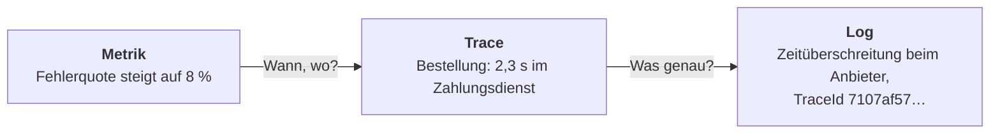

import Quiz from '@site/src/components/Quiz';
import fragen from './01-observability-grundlagen.fragen.yaml';

# Observability – Grundlagen

:::info[Lernziele]
Nach dieser Lektion kannst du …
- **Monitoring** und **Observability** unterscheiden,
- **Logs, Metriken und Traces** erklären und wissen, wofür jedes Signal taugt,
- **Metriktypen** und das Problem der **Kardinalität** beschreiben,
- mit **RED** und den **Golden Signals** einen Dienst beurteilen,
- **SLI, SLO und Fehlerbudget** erklären und gute **Alarme** erkennen.
:::

## Monitoring und Observability \{#begriffe}

| | Monitoring | Observability |
|---|---|---|
| Frage | Ist etwas kaputt, das ich kenne? | **Warum** verhält sich das System so – auch bei Fehlern, die ich nicht vorhergesehen habe? |
| Grundlage | vorher festgelegte Prüfungen und Schwellen | reichhaltige Telemetrie, die man frei abfragen kann |
| Beispiel | „CPU über 90 % → Alarm“ | „Welche Anfragen von Stammkunden waren gestern zwischen 14 und 15 Uhr langsam, und in welchem Dienst hing die Zeit?“ |

Der Begriff stammt aus der Regelungstechnik: Ein System ist *beobachtbar*, wenn man aus seinen Ausgaben auf den inneren
Zustand schließen kann – dieselbe **Beobachtbarkeit**, die der Lehrplan zur Testautomation als Teil der
[Testbarkeit](../11-istqb/01-tae-ziele-vorbereitung.mdx#testbarkeit) fordert.

## Die drei Signale \{#signale}



| Signal | Was es ist | Stark bei | Schwach bei |
|---|---|---|---|
| **Metriken** | Zahlen über Zeit, zusammengefasst: Anzahl, Dauer, Auslastung | Trends, Alarme, Dashboards; billig zu speichern | Einzelfälle – die Metrik sagt nicht, **welche** Anfrage langsam war |
| **Traces** | der Weg **einer** Anfrage durch alle Dienste, in Abschnitte (*Spans*) zerlegt | „Wo bleibt die Zeit?“, Abhängigkeiten zwischen Diensten | große Datenmengen; meist nur Stichproben |
| **Logs** | Einzelereignisse mit Text und Feldern | Details: Fehlermeldungen, Parameter, Zustände | Überblick; teuer bei großen Mengen |

Den größten Nutzen bringen sie **zusammen**: Die Metrik zeigt, **dass** etwas schiefgeht, der Trace, **wo**, das Log,
**was** genau. Verbunden werden sie über die **Trace-ID** – dieselbe Idee wie die
[Correlation-ID](../11-istqb/04-tae-berichte-verifikation.mdx#correlation-id).

## Strukturierte Logs \{#logs}

Ein Log als freier Text ist für Menschen lesbar, für Maschinen kaum:

```text
2026-11-27 12:42:03 WARN Zahlung für Warenkorb f2c00dd2 abgelehnt
```

Ein **strukturiertes Log** hat Felder, nach denen man filtern und zählen kann – im Mini-Shop als JSON:

```json
{
  "LogLevel": "Warning",
  "Category": "Shop.Bestellungen",
  "Message": "Zahlung für Warenkorb f2c00dd2-… abgelehnt",
  "State": { "WarenkorbId": "f2c00dd2-…" },
  "Scopes": [{ "TraceId": "7107af57eccfa6067a2fe36ef9331608", "SpanId": "5cda808ab2959249" }]
}
```

Regeln: **Log-Level** bewusst wählen (siehe [Log-Level](../11-istqb/03-tae-einfuehrung-pipelines.mdx#log-level)), Werte als
**Felder** statt in den Text kleben, immer die **Trace-ID** mitschreiben – und nie Passwörter, Tokens oder
personenbezogene Daten.

## Metriken \{#metriken}

| Typ | Verhalten | Beispiel im Mini-Shop |
|---|---|---|
| **Counter** | zählt nur aufwärts | `shop_bestellungen_total` – Bestellversuche |
| **Gauge** | Momentwert, steigt und fällt | belegter Arbeitsspeicher, offene Verbindungen |
| **Histogramm** | Verteilung von Werten in Klassen (*Buckets*) | `http_server_request_duration_seconds` – Antwortzeiten, daraus Perzentile |

Metriken haben **Labels** (Dimensionen), z. B. `http_route="/api/produkte"` oder `ergebnis="abgelehnt"`. Jede
Kombination von Labelwerten ist eine eigene Zeitreihe.

:::danger[Kardinalität]
Ein Label mit vielen möglichen Werten – Benutzer-ID, Warenkorb-ID, vollständige URL mit Parametern – erzeugt
**Millionen Zeitreihen** und legt den Metrikspeicher lahm. Einzelne Anfragen gehören in Traces und Logs, nicht in
Metrik-Labels. Deshalb nutzt ASP.NET Core die **Route-Vorlage** `/api/warenkoerbe/{id:guid}` statt der echten URL.
:::

Warum Histogramme statt Durchschnitt? Weil der Durchschnitt Ausreißer versteckt – siehe
[Perzentile](../02-testautomation/06-performance/01-performance-grundlagen.mdx). Aus Histogrammen berechnet man das
**p95**: 95 % der Anfragen waren schneller.

## Traces \{#traces}

Ein **Trace** beschreibt eine Anfrage von Anfang bis Ende. Er besteht aus **Spans** – Abschnitten mit Name, Start, Dauer,
Status und Attributen –, die über Eltern-Kind-Beziehungen verbunden sind:

```mermaid
gantt
  dateFormat x
  axisFormat %L ms
  tickInterval 40millisecond
  title Trace einer Bestellung
  section mini-shop
  POST /api/warenkoerbe/{id}/bestellung :a1, 0, 120
  Bestellung aufgeben                   :a2, 10, 105
  section zahlungsdienst
  POST /zahlungen                        :a3, 25, 90
```



Damit ein Trace über Dienste hinweg zusammenhängt, wird der **Kontext** mitgeschickt – standardisiert im HTTP-Header
`traceparent` (*W3C Trace Context*):

```text
traceparent: 00-7107af57eccfa6067a2fe36ef9331608-0123456789abcdef-01
             │  └──────────── Trace-ID ──────────┘ └─ Eltern-Span ─┘ └ gesampelt
             └ Version
```

Weil Traces viele Daten erzeugen, speichert man oft nur eine **Stichprobe** (*Sampling*), z. B. 10 % aller Anfragen –
aber alle mit Fehlern.

## RED, USE und die Golden Signals \{#red-use}

Welche Metriken braucht ein Dienst mindestens?

| Methode | Für | Signale |
|---|---|---|
| **RED** | Dienste, die Anfragen bearbeiten | **R**ate (Anfragen/s), **E**rrors (Fehlerquote), **D**uration (Antwortzeit) |
| **USE** | Ressourcen (CPU, Speicher, Festplatte) | **U**tilization (Auslastung), **S**aturation (Warteschlange), **E**rrors |
| **Golden Signals** (Google SRE) | beides | Latency, Traffic, Errors, Saturation |

Das Grafana-Dashboard im Beispielprojekt zeigt genau RED – plus die Bestellungen als fachliche Metrik. Fachliche
Metriken („Bestellungen pro Minute“, „abgelehnte Zahlungen“) erkennen Fehler oft früher als technische.

## SLI, SLO und Fehlerbudget \{#slo}

| Begriff | Bedeutung | Beispiel |
|---|---|---|
| **SLI** (Service Level Indicator) | gemessene Kennzahl für Qualität aus Nutzersicht | Anteil der Bestellanfragen, die in < 500 ms erfolgreich antworten |
| **SLO** (Service Level Objective) | Zielwert für den SLI über einen Zeitraum | 99,5 % über 30 Tage |
| **Fehlerbudget** | was das SLO an „schlechten“ Anfragen erlaubt | 0,5 % ≈ 3,6 Stunden im Monat |
| **SLA** (Service Level Agreement) | **Vertrag** mit Folgen bei Verletzung | Gutschrift, wenn unter 99 % |

Das **Fehlerbudget** verbindet Betrieb und Entwicklung: Ist noch Budget übrig, darf das Team mutig ausliefern; ist es
aufgebraucht, haben Stabilität und Tests Vorrang. SLOs sind damit auch **Abnahmekriterien** für nicht-funktionale
Anforderungen – messbar statt „soll schnell sein“.

## Gute Alarme \{#alarme}

- Auf **Symptome** alarmieren, die Nutzer spüren (Fehlerquote, Antwortzeit, SLO-Verbrauch) – nicht auf jede Ursache
  (CPU kurz bei 90 %).
- Jeder Alarm braucht eine **Handlung** – sonst wird er ignoriert (*Alert Fatigue*).
- **Runbook** verlinken: Was ist zu tun?
- Alarme **testen**: Löst er wirklich aus? Das gehört in die nächste Lektion.

## Datenschutz \{#datenschutz}

Telemetrie wird lange aufbewahrt und von vielen gelesen. Personenbezogene Daten (Namen, E-Mail-Adressen, IP-Adressen,
Inhalte von Formularen) gehören deshalb **nicht** hinein – das verlangt auch die DSGVO. Der Mini-Shop schreibt bewusst nur
Beträge, Anzahl und „Stammkunde ja/nein“ in seine Spans, und ein Test prüft, dass der Kundenname in **keinem** Signal
auftaucht.

## Typische Fehler \{#typische-fehler}

- Nur Logs, keine Metriken und Traces – jede Analyse beginnt mit Suchen in Textbergen.
- Logs als freier Text ohne Trace-ID.
- IDs als Metrik-Labels – die Kardinalität explodiert.
- Durchschnittswerte statt Perzentile.
- Alarme auf Ursachen statt Symptome, ohne Handlung.
- Kundendaten, Passwörter oder Tokens in Logs und Spans.

## Zusammenfassung \{#zusammenfassung}

- **Observability** beantwortet „warum?“ – auch für Fehler, die niemand vorhergesehen hat.
- **Metriken** für Trends und Alarme, **Traces** für den Weg einer Anfrage, **Logs** für Details – verbunden über die
  **Trace-ID**.
- Metriktypen **Counter, Gauge, Histogramm**; Labels mit wenigen Werten (**Kardinalität**).
- **RED** für Dienste, **USE** für Ressourcen; fachliche Metriken ergänzen.
- **SLI → SLO → Fehlerbudget**; Alarme auf Symptome mit Handlung.
- Keine personenbezogenen Daten in Telemetrie.

<Quiz fragen={fragen} titel="Quiz: Observability – Grundlagen" />
