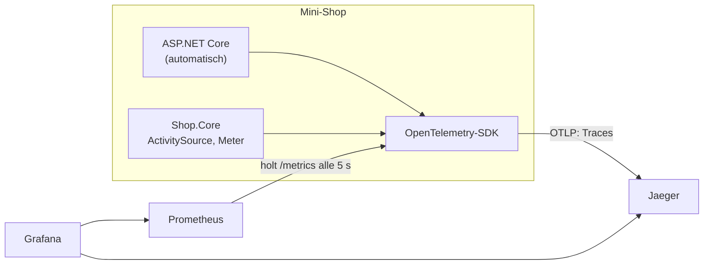

import Quiz from '@site/src/components/Quiz';
import fragen from './02-opentelemetry.fragen.yaml';

# OpenTelemetry in der Praxis

:::info[Lernziele]
Nach dieser Lektion kannst du …
- eine Anwendung mit **OpenTelemetry** instrumentieren – automatisch und mit eigenen Spans und Metriken,
- Telemetrie per **OTLP** und als **Prometheus**-Endpunkt bereitstellen,
- einen Stack aus **Jaeger, Prometheus und Grafana** mit Docker Compose starten,
- einfache **PromQL**-Abfragen für Rate, Fehlerquote und p95 schreiben.
:::

## OpenTelemetry \{#opentelemetry}

**OpenTelemetry** (kurz OTel) ist der herstellerunabhängige Standard für Telemetrie: eine API, SDKs für alle großen
Sprachen und ein Protokoll (**OTLP**). Man instrumentiert die Anwendung **einmal** und entscheidet später, wohin die Daten
gehen – Jaeger, Prometheus, Grafana, Datadog, Azure Monitor, Elastic …



Zwischen Anwendung und Speicher steht in größeren Umgebungen oft der **OpenTelemetry Collector**: Er nimmt Telemetrie
an, filtert, reichert an, entfernt sensible Felder und verteilt sie auf mehrere Ziele. Im Beispiel sendet der Shop
direkt an Jaeger.

## Automatische Instrumentierung \{#automatisch}

Für verbreitete Bibliotheken gibt es fertige Instrumentierung. Sie erzeugt Spans und Metriken für jede HTTP-Anfrage,
jeden ausgehenden HTTP-Aufruf und die Laufzeit (Speicher, Garbage Collection, Threads):

```csharp title="beispiele/shop/src/Shop.Web/Program.cs (Auszug)"
var otlpEndpunkt = builder.Configuration["OTEL_EXPORTER_OTLP_ENDPOINT"];
builder.Services.AddOpenTelemetry()
    .ConfigureResource(ressource => ressource.AddService(builder.Configuration["OTEL_SERVICE_NAME"] ?? "mini-shop"))
    .WithTracing(traces =>
    {
        traces.AddAspNetCoreInstrumentation()       // eingehende Anfragen
              .AddHttpClientInstrumentation()       // ausgehende Aufrufe, z. B. zum Zahlungsanbieter
              .AddSource(ShopTelemetrie.Name);      // eigene Spans aus Shop.Core
        if (!string.IsNullOrEmpty(otlpEndpunkt)) traces.AddOtlpExporter();
    })
    .WithMetrics(metriken => metriken
        .AddAspNetCoreInstrumentation()
        .AddRuntimeInstrumentation()
        .AddMeter(ShopTelemetrie.Name)
        .AddPrometheusExporter());
// …
app.MapPrometheusScrapingEndpoint();   // /metrics
```

Konfiguriert wird über **Standard-Umgebungsvariablen**, die in allen Sprachen gleich heißen:

| Variable | Bedeutung |
|---|---|
| `OTEL_SERVICE_NAME` | Name des Dienstes in Jaeger und Grafana |
| `OTEL_EXPORTER_OTLP_ENDPOINT` | Empfänger, z. B. `http://jaeger:4317` |
| `OTEL_TRACES_SAMPLER` / `…_ARG` | Stichprobe, z. B. `parentbased_traceidratio` mit `0.1` |
| `OTEL_BSP_SCHEDULE_DELAY` | wie oft gebündelte Spans gesendet werden (Standard 5000 ms) |

Der Exporter wird nur eingeschaltet, wenn ein Empfänger konfiguriert ist – in Unit- und API-Tests ohne Jaeger versucht der
Shop also nicht vergeblich zu senden.

## Eigene Spans und Metriken \{#eigene}

Automatische Instrumentierung zeigt **technische** Abläufe. Was fachlich passiert, muss die Anwendung selbst melden.
.NET bringt dafür alles mit – `ActivitySource` (Spans) und `Meter` (Metriken) aus `System.Diagnostics`, ohne
Abhängigkeit zu OpenTelemetry:

```csharp title="beispiele/shop/src/Shop.Core/Telemetrie/ShopTelemetrie.cs (Auszug)"
public static class ShopTelemetrie
{
    public const string Name = "MiniShop";
    public static readonly ActivitySource Quelle = new(Name);
    private static readonly Meter Messgeraet = new(Name);

    public static readonly Counter<long> Bestellungen =
        Messgeraet.CreateCounter<long>("shop.bestellungen", description: "Bestellversuche nach Ergebnis");
    public static readonly Histogram<double> Bestellwert =
        Messgeraet.CreateHistogram<double>("shop.bestellwert_euro", description: "Endpreis erfolgreicher Bestellungen in Euro");
}
```

```csharp title="beispiele/shop/src/Shop.Core/Bestellungen/BestellService.cs (Auszug)"
using var aktivitaet = ShopTelemetrie.Quelle.StartActivity("Bestellung aufgeben");
aktivitaet?.SetTag("shop.positionen", warenkorb.Positionen.Count);
aktivitaet?.SetTag("shop.stammkunde", kunde.IstStammkunde);   // bewusst KEIN Kundenname

var endpreis = rabattrechner.Endpreis(warenkorb.Zwischensumme, kunde.IstStammkunde);
aktivitaet?.SetTag("shop.endpreis", (double)endpreis);

if (!zahlungsdienst.Abbuchen(kunde.Name, endpreis))
{
    aktivitaet?.SetStatus(ActivityStatusCode.Error, "Zahlung abgelehnt");
    ShopTelemetrie.Bestellungen.Add(1, new KeyValuePair<string, object?>("ergebnis", "abgelehnt"));
    return BestellErgebnis.Abgelehnt("Die Zahlung wurde abgelehnt.");
}
```

`StartActivity` liefert `null`, wenn niemand zuhört – deshalb `?.`. Der neue Span hängt automatisch unter dem Span der
laufenden HTTP-Anfrage. Andere Sprachen nutzen die OpenTelemetry-API direkt, z. B. in Python
`tracer.start_as_current_span("Bestellung aufgeben")`.

### Logs mit Trace-ID \{#logs}

ASP.NET Core legt die Trace-ID automatisch in den Log-**Scope**. Mit JSON-Ausgabe und eingeschalteten Scopes steht sie in
jeder Zeile:

```json title="beispiele/shop/src/Shop.Web/appsettings.json (Auszug)"
"Console": {
  "FormatterName": "json",
  "FormatterOptions": { "IncludeScopes": true }
}
```

```csharp
logs.CreateLogger("Shop.Bestellungen").LogWarning("Zahlung für Warenkorb {WarenkorbId} abgelehnt", id);
```

Die Platzhalter `{WarenkorbId}` werden zu eigenen Feldern – **strukturiertes Logging** statt zusammengesetzter Texte.

## Der Stack mit Docker Compose \{#stack}

```yaml title="beispiele/observability/docker-compose.yml (Auszug)"
services:
  shop:
    image: mini-shop:1.0                         # vorher gebaut – dasselbe Image wie im Kubernetes-Beispiel
    pull_policy: never
    environment:
      OTEL_SERVICE_NAME: mini-shop
      OTEL_EXPORTER_OTLP_ENDPOINT: http://jaeger:4317
      OTEL_BSP_SCHEDULE_DELAY: "1000"
    ports: ["8080:8080"]
  jaeger:
    image: jaegertracing/jaeger:2.20.0           # OTLP auf 4317, Oberfläche auf 16686
    ports: ["16686:16686"]
  prometheus:
    image: prom/prometheus:v3.15.1
    volumes: ["./prometheus/prometheus.yml:/etc/prometheus/prometheus.yml:ro"]
    ports: ["9090:9090"]
  grafana:
    image: grafana/grafana:13.2.7
    volumes:
      - ./grafana/provisioning:/etc/grafana/provisioning:ro
      - ./grafana/dashboards:/var/lib/grafana/dashboards:ro
    ports: ["3001:3000"]
```

```bash
docker build -t mini-shop:1.0 -f ../kubernetes/Dockerfile ../shop
docker compose up -d
```

:::note[Warum das Image vorher gebaut wird]
Zuerst stand im Compose-File `build:` mit `dockerfile: ../kubernetes/Dockerfile`. In der CI brach der Start ab:
*„additional privileges requested: pass --allow=fs.read=../kubernetes/Dockerfile“*. Der neue Bake-Builder von Compose
liest aus Sicherheitsgründen keine Dateien außerhalb des Build-Kontexts, ohne dass man es ausdrücklich erlaubt. Statt die
Schutzregel auszuhebeln, wird das Image vorher gebaut und von Compose nur gestartet – wie im Kubernetes-Beispiel.
:::

| Werkzeug | Aufgabe | Aufruf |
|---|---|---|
| **Jaeger** | Traces speichern und anzeigen | http://localhost:16686 |
| **Prometheus** | Metriken abholen (*Pull*), speichern, mit PromQL abfragen | http://localhost:9090 |
| **Grafana** | Dashboards und Alarme über alle Quellen | http://localhost:3001 |

```yaml title="beispiele/observability/prometheus/prometheus.yml"
global:
  scrape_interval: 5s
scrape_configs:
  - job_name: mini-shop
    static_configs:
      - targets: ["shop:8080"]   # Prometheus holt /metrics ab, der Shop schickt nichts
```

Datenquellen und Dashboard richtet Grafana beim Start **aus Dateien** ein (*Provisioning*) – Dashboards als Code,
versioniert im Repository, statt von Hand zusammengeklickt.

### Befund: Jaeger und Grafana passten nicht zusammen \{#versionskonflikt}

Zuerst lief der Stack mit der neuesten Jaeger-Version 2.22. Alle Traces kamen an – aber der Test der Grafana-Datenquelle
schlug fehl: *„request failed: 404 Not Found“*. Die Grafana-Logs zeigten, dass das Jaeger-Plugin bei seiner Prüfung einen
404 bekam. Ein Diagnoseschritt in der CI fragte beide APIs von Jaeger ab:

```text
/api/services: 404
/api/v3/services: 200
```

Eine einmalige Untersuchung mit mehreren Jaeger-Versionen nebeneinander fand die Grenze:

```text
Jaeger 2.20.0: /api/services 200  /api/v3/services 200
Jaeger 2.21.0: /api/services 404  /api/v3/services 200
```

Jaeger hat die alte Abfrage-API mit Version 2.21 entfernt; das Jaeger-Plugin von Grafana 13.2 nutzt sie noch. Der Stack
verwendet deshalb Jaeger 2.20 – mit Kommentar im Compose-File, damit niemand „einfach aktualisiert“.

Lehre: **Werkzeugketten haben Versionsabhängigkeiten** wie Anwendungen. Ein Test, der die Verbindung zwischen den
Werkzeugen prüft, findet so etwas sofort – sonst merkt man es erst, wenn im Ernstfall keine Traces in Grafana erscheinen.

## Was /metrics liefert \{#metriken-format}

```text
http_server_request_duration_seconds_count{http_request_method="POST",http_response_status_code="422",
  http_route="/api/warenkoerbe/{id:guid}/bestellung",…} 1
shop_bestellungen_total{otel_scope_name="MiniShop",ergebnis="abgelehnt"} 1
```

Aus `shop.bestellungen` wird `shop_bestellungen_total`: Prometheus ersetzt Punkte und hängt bei Countern `_total` an.
Histogramme erscheinen als `…_bucket`, `…_sum` und `…_count`. Die Route steht als **Vorlage** im Label – die
Warenkorb-ID nicht, sonst explodiert die [Kardinalität](./01-observability-grundlagen.mdx#metriken).

## PromQL \{#promql}

| Frage | PromQL |
|---|---|
| Anfragen pro Sekunde je Route (letzte Minute) | `sum by (http_route) (rate(http_server_request_duration_seconds_count[1m]))` |
| Anteil der Serverfehler | `sum(rate(http_server_request_duration_seconds_count{http_response_status_code=~"5.."}[1m])) / sum(rate(http_server_request_duration_seconds_count[1m]))` |
| Antwortzeit p95 | `histogram_quantile(0.95, sum by (le) (rate(http_server_request_duration_seconds_bucket[1m])))` |
| Bestellungen nach Ergebnis (5 Minuten) | `sum by (ergebnis) (increase(shop_bestellungen_total[5m]))` |

- **`rate(…[1m])`** macht aus einem stetig steigenden Counter „pro Sekunde“ – Counter selbst sind fast nie interessant.
- **`sum by (…)`** fasst Zeitreihen zusammen und behält nur die genannten Labels.
- **`histogram_quantile`** berechnet Perzentile aus den Buckets – nur so genau, wie die Buckets fein sind.

Genau diese Abfragen stecken im Dashboard „Mini-Shop – Überblick“ – RED plus Bestellungen.

## Traces in Jaeger \{#jaeger}

In Jaeger sucht man nach Dienst, Operation, Dauer oder Attributen und sieht jeden Trace als Zeitleiste. Im Beispiel
hängt der Span „Bestellung aufgeben“ unter `POST /api/warenkoerbe/{id:guid}/bestellung`; bei abgelehnter Zahlung ist er
rot markiert (`otel.status_code = ERROR`). Die ältere Abfrage-API zeigt manche Attribute unter alten Namen – aus
`http.response.status_code` wird dort `http.status_code`. Über die Trace-ID aus einem Log springt man direkt zum Trace:
`http://localhost:16686/trace/<Trace-ID>`.

## Typische Fehler \{#typische-fehler}

- Nur automatische Instrumentierung – fachliche Abläufe bleiben unsichtbar.
- Spans ohne Status: Fehler sind in Jaeger nicht rot.
- Den Exporter fest einbauen – Tests ohne Empfänger hängen in Wiederholungen oder schreiben Fehler ins Log.
- Metriknamen ohne Einheit oder Bedeutung; Labels mit IDs.
- Dashboards von Hand klicken – nach dem nächsten Neuaufbau sind sie weg.
- Prometheus-Intervall von einer Minute und dann im Test nach zwei Sekunden auf Daten warten.

## Zusammenfassung \{#zusammenfassung}

- **OpenTelemetry**: einmal instrumentieren, Ziel frei wählen; Protokoll **OTLP**, Konfiguration über `OTEL_…`-Variablen.
- **Automatisch** für HTTP und Laufzeit, **eigene** Spans und Metriken für Fachliches (`ActivitySource`, `Meter`).
- **Jaeger** für Traces, **Prometheus** holt `/metrics` ab, **Grafana** zeigt beides – alles als Code.
- PromQL: `rate`, `sum by`, `histogram_quantile`, `increase`.
- Logs strukturiert und mit Trace-ID.

<Quiz fragen={fragen} titel="Quiz: OpenTelemetry in der Praxis" />
